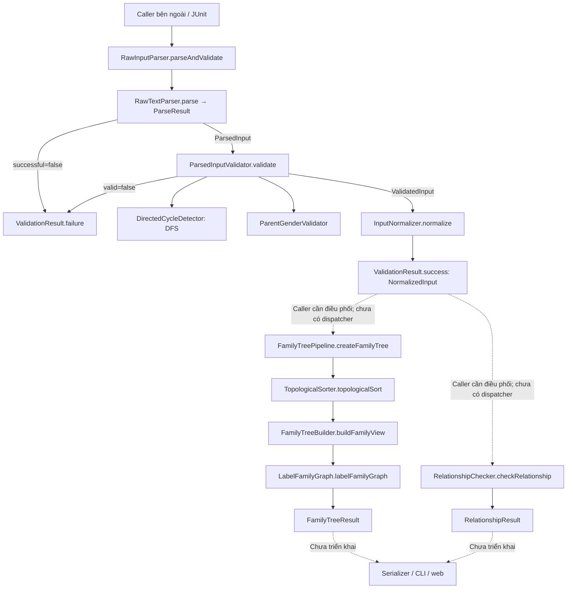
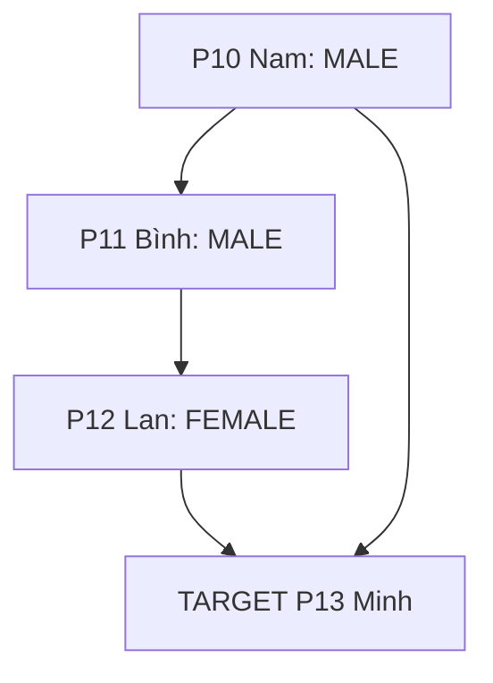
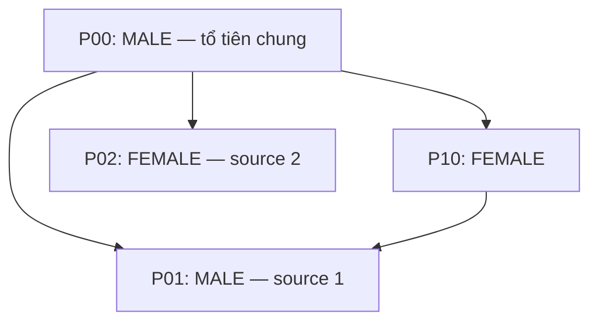

# Audit tuần 7 — Giai đoạn 1: source, contract và kiểm thử

**Ngày kiểm chứng:** 17/10/2026, Asia/Saigon.  
**Checkout:** `DSA-project`, branch `feature/input-validation`, commit `ba9b9c2920fc8621d1ab74e1681d7fa64540bdae`.  
**Phạm vi:** audit phiên bản đang có trên máy; không suy diễn trạng thái các branch hoặc repository khác.  
**Điểm dừng:** tài liệu audit để duyệt giai đoạn 1; chưa phải bộ báo cáo giai đoạn 2.

## Mục lục

1. [Kết luận và mức bằng chứng](#1-kết-luận-và-mức-bằng-chứng)
2. [Phạm vi đã đọc và kiến trúc thực tế](#2-phạm-vi-đã-đọc-và-kiến-trúc-thực-tế)
3. [Thống kê toàn bộ class và object](#3-thống-kê-toàn-bộ-class-và-object)
4. [Đối chiếu đặc tả với implementation](#4-đối-chiếu-đặc-tả-với-implementation)
5. [Audit Parse / Validate / Normalize](#5-audit-parse--validate--normalize)
6. [Audit Kahn / Family Tree / labeling](#6-audit-kahn--family-tree--labeling)
7. [Audit BFS kiểm tra quan hệ](#7-audit-bfs-kiểm-tra-quan-hệ)
8. [Độ phức tạp của implementation](#8-độ-phức-tạp-của-implementation)
9. [Test thực tế và ma trận edge cases](#9-test-thực-tế-và-ma-trận-edge-cases)
10. [Vấn đề cần quyết định hoặc sửa](#10-vấn-đề-cần-quyết-định-hoặc-sửa)
11. [Đề xuất bộ báo cáo và hình minh họa](#11-đề-xuất-bộ-báo-cáo-và-hình-minh-họa)
12. [Các kịch bản dự kiến bổ sung](#12-các-kịch-bản-dự-kiến-bổ-sung)
13. [Các điểm chờ xác nhận](#13-các-điểm-chờ-xác-nhận)

## 1. Kết luận và mức bằng chứng

**Chưa đủ căn cứ kết luận toàn bộ sản phẩm đã hoàn tất hoặc hoàn toàn đúng đặc tả.** Ba module tính toán đã có implementation và test; luồng sản phẩm từ raw Input đến output thô/web chưa được triển khai trong checkout này. Có một sai lệch nghiệp vụ nghiêm trọng ở `RelationshipChecker` và một mâu thuẫn tài liệu về số đường BFS phải trả.

| Kết quả kiểm chứng | Bằng chứng | Ý nghĩa |
|---|---|---|
| Biên dịch thành công 41 file Java main và 14 file test | `mvn clean test`, chạy trực tiếp trong project | Không sử dụng class cũ trong `target` để kết luận build thành công |
| **67 test chạy, 0 failures, 0 errors, 0 skipped** | Kết quả Maven và 14 báo cáo Surefire; [bản tổng hợp lưu lại](evidence/surefire-summary.txt) | Xác nhận các assertion hiện có; không chứng minh mọi yêu cầu đều đúng |
| Có test kỳ vọng hai người cùng giới tính không liên quan dù có chung phụ huynh | [RelationshipCheckerTest](../../src/test/java/com/familygraph/model/relationship/RelationshipCheckerTest.java), `returnsUnrelatedForSameKnownGenderEvenWithCommonAncestor`, dòng 109–121 | Test xanh đang bảo vệ một hành vi trái mục tiêu tìm tổ tiên chung |
| BFS giữ tất cả đường hợp lệ dài 0–2 cạnh, kể cả đường dài hơn đường ngắn nhất | [RelationshipChecker](../../src/main/java/com/familygraph/relationship/RelationshipChecker.java), `findAncestorPaths`, dòng 114–143; các test nhiều đường | Khớp model contract hiện tại; khác một số đoạn kế hoạch nhóm |
| Family Tree giữ các mức khác nhau đến cùng người | [FamilyTreeBuilder](../../src/main/java/com/familygraph/familytree/FamilyTreeBuilder.java), `collectRelationLevels`, dòng 97–139; test mức `[1, 3]` | Không bị mất quan hệ dài hơn do chỉ dùng visited theo ID |
| Chưa có application entry point, dispatcher, serializer hoặc web thực thi | `app/`, `output/`, `web/` chỉ có `.gitkeep`; không có `main` trong main source | Không thể công bố đã kiểm thử end-to-end hoặc demo web |

Quy ước bằng chứng dùng trong tài liệu:

- **Đã chạy:** assertion tương ứng có trong bộ test vừa chạy thành công. Đây không phải bản dump mọi giá trị runtime.
- **Đã đọc code:** có lập luận trực tiếp từ implementation, chưa có test riêng chứng minh tình huống đó.
- **Chưa kiểm thử:** chưa tìm thấy assertion tương ứng trong 14 file test đã đọc; không đồng nghĩa chắc chắn code sai.
- **Sai đặc tả:** hành vi có bằng chứng xung đột với yêu cầu đang được ghi nhận.
- **Chưa triển khai:** không có thành phần thực thi trong checkout; khác với đã có code nhưng chưa chạy.

Không tạo test mới, không sửa Java source, contract, test hiện có hoặc các tài liệu kế hoạch. Các trace bằng tay dưới đây được ghi rõ; không gắn chúng thành log của chương trình.

## 2. Phạm vi đã đọc và kiến trúc thực tế

### 2.1. Tài liệu, cấu hình và tài nguyên đã kiểm tra

Đã đọc đầy đủ sáu Markdown có sẵn trong project:

| File | Vai trò trong audit |
|---|---|
| [README.md](../../README.md) | Hướng dẫn package, nền tảng và cách chạy test |
| [Ke_hoach_chinh_sua_nhom.md](../../Ke_hoach_chinh_sua_nhom.md) | Phát biểu bài toán, raw Input/Output, phân công, tuần 2–8, điều kiện hoàn thành |
| [model-contract.md](../contracts/model-contract.md) | Nguồn hợp đồng object được chính tài liệu chỉ định là nguồn sự thật |
| [huong-dan-model-va-ham.md](../contracts/huong-dan-model-va-ham.md) | Field, method, ranh giới nhóm và ví dụ tích hợp |
| [luong-xu-ly-input.md](../contracts/luong-xu-ly-input.md) | Pipeline, mức ưu tiên lỗi, DFS và chuẩn hóa |
| [quy-trinh-lam-viec-va-commit.md](../workflow/quy-trinh-lam-viec-va-commit.md) | Quy trình làm việc, test, branch và review |

Đã đọc toàn bộ **41 file `src/main/java`**, **14 file `src/test/java`**, [pom.xml](../../pom.xml), `.gitignore`, `.github/CODEOWNERS`; kiểm kê `resources`, `examples`, `app`, `output`, `graph`, `web`, `docs/traces`, `docs/presentation`. Các vùng này chỉ có file giữ chỗ khi chưa có nội dung. Không đọc dependency hay build artifact như source; riêng báo cáo Surefire vừa sinh được đọc làm bằng chứng kiểm thử.

Ảnh kế hoạch tuần do người dùng gửi phù hợp với bảng lộ trình trong kế hoạch, dòng 779–788. Đó là mục tiêu bàn giao, không chứng minh các đầu việc đã được triển khai. Thư mục `family-plan-site/dist` nằm ngoài Maven project và là build output; không có căn cứ coi đó là web frontend của hệ thống Java này.

### 2.2. Sơ đồ kiến trúc thực tế



**Chú giải:** mũi tên liền biểu diễn lời gọi hoặc dữ liệu trong thành phần đã có; mũi tên đứt biểu diễn kết nối cần được caller thực hiện hoặc thành phần chưa triển khai. Hai helper validator chỉ được gọi khi các kiểm tra trước đó chưa phát hiện lỗi. Không có đường thực thi tự động từ `NormalizedInput` sang hai module truy vấn trong main source.

### 2.3. Luồng gọi hàm có thể xác định từ source

1. **Input facade:** caller → `RawInputParser.parseAndValidate(String)` → `RawTextParser.parse` → `ParsedInputValidator.validate` → `InputNormalizer.normalize` → `ValidationResult`. Dừng ngay sau parse/validation thất bại. Nguồn: `RawInputParser`, dòng 25–36.
2. **Family Tree trong bộ nhớ:** caller → `FamilyTreePipeline.createFamilyTree(FamilyGraph, FamilyTreeQuery)` → `topologicalSort` → `buildFamilyView` → `labelFamilyGraph` → `FamilyTreeResult`. Nguồn: `FamilyTreePipeline`, dòng 29–32.
3. **Relationship trong bộ nhớ:** caller → static `RelationshipChecker.checkRelationship(FamilyGraph, CheckRelationshipQuery)` → tìm người → nhánh giới tính → lập chỉ mục cha mẹ → `findAncestorPaths` hai lần → giao ID → gom đường và evidence → `RelationshipResult`. Nguồn: `RelationshipChecker`, dòng 30–90.

Ba luồng trên được gọi độc lập trong test. Không có production entry point để truy vết tiếp đến output cuối. `ProjectQuery` và `ProjectResult` chỉ là marker interface, không tự dispatch hay serialize.

## 3. Thống kê toàn bộ class và object

Trong các bảng: “constructor/accessor” của record là thao tác tạo/đọc dữ liệu, không phải thuật toán kiểm tra nghiệp vụ. T01–T14 được liên kết đến test đầy đủ ở mục 9.1. Mỗi dòng dưới đây tương ứng một file Java top-level; không bỏ các enum/interface.

### 3.1. Các class xử lý — 11 file

| Module | File/Class | Trách nhiệm | Method chính | Input | Output | Test liên quan |
|---|---|---|---|---|---|---|
| Input | [RawInputParser](../../src/main/java/com/familygraph/input/RawInputParser.java) | Facade điều phối, chặn tầng sau khi lỗi | `parseAndValidate` | raw `String` | `ValidationResult` | T04 |
| Input | [RawTextParser](../../src/main/java/com/familygraph/input/RawTextParser.java) | Parse cú pháp, token và tên | `parse`, `parseDocument`, `parsePersonLine`, `parseQueryLine` | raw `String` | `ParseResult` / `ParsedInput` | T05, T04 |
| Input | [ParsedInputValidator](../../src/main/java/com/familygraph/input/ParsedInputValidator.java) | Kiểm tra nghiệp vụ theo ưu tiên | `validate`, `findCycle`, `validateParentGenders`, các `validate*` | `ParsedInput` đúng hình dạng cú pháp | `GraphValidationResult` | T03, T04 |
| Input | [DirectedCycleDetector](../../src/main/java/com/familygraph/input/DirectedCycleDetector.java) | DFS ba trạng thái và lấy chu trình | `findCycle`, `search` | `ParsedFamilyGraph` có ID hợp lệ | List ID khép kín hoặc rỗng | Gián tiếp T03, T04 |
| Input | [ParentGenderValidator](../../src/main/java/com/familygraph/input/ParentGenderValidator.java) | Tìm hai phụ huynh khác ID cùng giới tính xác định | `validateParentGenders` | Graph có token giới tính/ID hợp lệ | `ValidationError` hoặc `null` | Gián tiếp T03, T04 |
| Input | [InputNormalizer](../../src/main/java/com/familygraph/input/InputNormalizer.java) | Chuyển token thành enum và domain object | `normalize` | `ValidatedInput` | `NormalizedInput` | T01, T04 |
| Family Tree | [TopologicalSorter](../../src/main/java/com/familygraph/familytree/TopologicalSorter.java) | Kahn toàn graph | `topologicalSort` | `FamilyGraph` hợp lệ | `TopoResult` | T09, T08, T06 |
| Family Tree | [FamilyTreeBuilder](../../src/main/java/com/familygraph/familytree/FamilyTreeBuilder.java) | Duyệt trạng thái người/mức, chọn cạnh, lọc topo | `buildFamilyView`, `collectRelationLevels`, `sortedLevels` | Graph, `FamilyTreeQuery`, topo đầy đủ | `OrderedFamilyGraph` | T06, T08 |
| Family Tree | [LabelFamilyGraph](../../src/main/java/com/familygraph/familytree/LabelFamilyGraph.java) | Ánh xạ mức + giới tính sang nhãn | `labelFamilyGraph`, `mapLevelToRelationLabel` | `OrderedFamilyGraph` | `FamilyTreeResult` | T07, T08 |
| Family Tree | [FamilyTreePipeline](../../src/main/java/com/familygraph/familytree/FamilyTreePipeline.java) | Ghép ba bước Family Tree | `createFamilyTree` | Graph và `FamilyTreeQuery` | `FamilyTreeResult` | T08 |
| Relationship | [RelationshipChecker](../../src/main/java/com/familygraph/relationship/RelationshipChecker.java) | Liệt kê đường tổ tiên, giao tập, evidence; có guard giới tính | `checkRelationship`, `buildParentsByChild`, `findAncestorPaths` | Graph và `CheckRelationshipQuery` | `RelationshipResult` | T14 |

### 3.2. Object trung gian input — 8 file

| Module | File/Class | Trách nhiệm | Method chính | Input | Output | Test liên quan |
|---|---|---|---|---|---|---|
| Input model | [ParsedPerson](../../src/main/java/com/familygraph/input/model/ParsedPerson.java) | Giữ ID, gender token, name trước kiểm tra | constructor/accessor | Ba chuỗi | Record người thô | T05, T03 |
| Input model | [ParsedParentChildEdge](../../src/main/java/com/familygraph/input/model/ParsedParentChildEdge.java) | Giữ đầu cạnh thô | constructor/accessor | Hai ID | Record cạnh thô | T03, T04 |
| Input model | [ParsedFamilyGraph](../../src/main/java/com/familygraph/input/model/ParsedFamilyGraph.java) | Giữ count khai báo và bản ghi thực tế | constructor, `List.copyOf` | Count, người, cạnh | Graph thô bất biến collection | T05, T03 |
| Input model | [ParsedQuery](../../src/main/java/com/familygraph/input/model/ParsedQuery.java) | Giữ query token chưa chuẩn hóa | constructor, `List.copyOf` | type, arguments | Query thô | T05, T03 |
| Input model | [ParsedInput](../../src/main/java/com/familygraph/input/model/ParsedInput.java) | Gói graph và query vừa parse | constructor/accessor | Graph thô, query thô | Input thô | T01–T05 |
| Input model | [ParseResult](../../src/main/java/com/familygraph/input/model/ParseResult.java) | Loại trạng thái data/error mâu thuẫn | constructor, `success`, `failure` | Cờ, data/error | Kết quả parse | T02, T05 |
| Input model | [ValidatedInput](../../src/main/java/com/familygraph/input/model/ValidatedInput.java) | Marker dữ liệu qua validator; chỉ kiểm tra non-null | constructor, `parsedInput` | `ParsedInput` | Wrapper cho normalizer | T01–T03 |
| Input model | [GraphValidationResult](../../src/main/java/com/familygraph/input/model/GraphValidationResult.java) | Loại trạng thái data/error mâu thuẫn | constructor, `success`, `failure` | Cờ, `ValidatedInput`/error | Kết quả validate | T02, T03 |

### 3.3. Domain model và result — 22 file

| Module | File/Class | Trách nhiệm | Method chính | Input | Output | Test liên quan |
|---|---|---|---|---|---|---|
| Graph | [Gender](../../src/main/java/com/familygraph/model/graph/Gender.java) | Miền giới tính | enum constants | Token hợp lệ khi normalize | `MALE/FEMALE/UNKNOWN` | T01, T04, T07, T14 |
| Graph | [Person](../../src/main/java/com/familygraph/model/graph/Person.java) | ID, giới tính, tên | constructor/accessor | `id`, `gender`, `name` | Record người | T10, T04 |
| Graph | [ParentChildEdge](../../src/main/java/com/familygraph/model/graph/ParentChildEdge.java) | Cạnh cha/mẹ → con; equality theo hai đầu | constructor/accessor | `parentId`, `childId` | Record cạnh | T06, T14 |
| Graph | [FamilyGraph](../../src/main/java/com/familygraph/model/graph/FamilyGraph.java) | Nguồn graph đầy đủ, giữ thứ tự | constructor, `List.copyOf` | persons, edges | Graph bất biến collection | T10, T04 |
| Query | [ProjectQuery](../../src/main/java/com/familygraph/model/query/ProjectQuery.java) | Marker cho query | Không có method riêng | — | Kiểu chung | Gián tiếp T01, T04 |
| Query | [Direction](../../src/main/java/com/familygraph/model/query/Direction.java) | Miền hướng Family Tree | enum constants | Token hợp lệ khi normalize | `ANCESTORS/DESCENDANTS/BOTH` | T01, T06 |
| Query | [FamilyTreeQuery](../../src/main/java/com/familygraph/model/query/FamilyTreeQuery.java) | Target, k, hướng | constructor/accessor | ID, int, enum | Query gia phả | T10, T01, T06 |
| Query | [CheckRelationshipQuery](../../src/main/java/com/familygraph/model/query/CheckRelationshipQuery.java) | Hai ID và hằng 3 đời | constructor/accessor, `MAX_GENERATIONS` | Hai ID | Query quan hệ | T10, T14 |
| Validation | [NormalizedInput](../../src/main/java/com/familygraph/model/validation/NormalizedInput.java) | Gói domain graph/query | constructor/accessor | Graph, `ProjectQuery` | Input cho thuật toán | T01, T04, T13 |
| Validation | [ValidationErrorCode](../../src/main/java/com/familygraph/model/validation/ValidationErrorCode.java) | 13 mã lỗi thống nhất | enum constants | — | Mã lỗi | T03, T04, T05 |
| Validation | [ValidationError](../../src/main/java/com/familygraph/model/validation/ValidationError.java) | Mã, detail, cycle | constructor, `List.copyOf` | enum, chuỗi, list ID | Dữ liệu lỗi | T13, T03, T04 |
| Validation | [ValidationResult](../../src/main/java/com/familygraph/model/validation/ValidationResult.java) | Kết quả công khai của input facade | constructor, `success`, `failure` | Data hoặc error | Trạng thái loại trừ nhau | T13, T04 |
| Family Tree model | [TopoResult](../../src/main/java/com/familygraph/model/familytree/TopoResult.java) | Thứ tự topo toàn graph | constructor, `topoOrder` | List ID | Snapshot topo | T09 |
| Family Tree model | [FamilyNode](../../src/main/java/com/familygraph/model/familytree/FamilyNode.java) | Người và mọi mức quan hệ | constructor/accessor | Person, list mức | Node trung gian | T11, T06 |
| Family Tree model | [OrderedFamilyGraph](../../src/main/java/com/familygraph/model/familytree/OrderedFamilyGraph.java) | Query + topo đã lọc + node + cạnh | constructor/accessor | Các kết quả builder | Snapshot trước nhãn | T11, T06 |
| Family Tree model | [RelationType](../../src/main/java/com/familygraph/model/familytree/RelationType.java) | 19 loại nhãn | enum constants | — | Kiểu nhãn | T07, T08, T11 |
| Family Tree model | [RelationLabel](../../src/main/java/com/familygraph/model/familytree/RelationLabel.java) | Loại nhãn và great degree | `code`, `generationOffset` | type, degree | Mã và mức có dấu | T11, gián tiếp T07–T08 |
| Family Tree model | [LabeledPerson](../../src/main/java/com/familygraph/model/familytree/LabeledPerson.java) | Một người với nhiều nhãn | constructor/accessor | Person, list nhãn | Người để xuất | T07, T08, T11 |
| Family Tree model | [FamilyTreeResult](../../src/main/java/com/familygraph/model/familytree/FamilyTreeResult.java) | Kết quả cuối Family Tree | constructor/accessor | Query, topo, người, cạnh | `ProjectResult` cụ thể | T08, T11 |
| Relationship model | [RelationshipPath](../../src/main/java/com/familygraph/model/relationship/RelationshipPath.java) | Một đường nguồn → tổ tiên | constructor, `edgeCount` | Source, ancestor, node IDs | Path, số cạnh | T12, T14 |
| Relationship model | [RelationshipResult](../../src/main/java/com/familygraph/model/relationship/RelationshipResult.java) | Tổ tiên chung và bằng chứng | constructor, `related` | Query, common IDs, paths, evidence | `ProjectResult`, boolean suy ra | T12, T14 |
| Result | [ProjectResult](../../src/main/java/com/familygraph/model/result/ProjectResult.java) | Marker cho hai result cuối | Không có method riêng | — | Kiểu chung | Gián tiếp T08, T12 |

Các kiểu lồng bên trong cũng đã đọc: `RawTextParser.MalformedInputException` chứa detail lỗi cú pháp; `DirectedCycleDetector.VisitState` là ba trạng thái DFS; `FamilyTreeBuilder.TraversalState(personId, level)` là khóa trạng thái duyệt; `RelationshipChecker.EdgeKey(parentId, childId)` là khóa gom cạnh bằng chứng. Chúng được kiểm chứng gián tiếp qua test của class chứa chúng.

### 3.4. Kết luận về object và ranh giới trách nhiệm

**Phân tầng hợp lý:** Parsed object giữ token và count khai báo; domain object giữ enum và graph; result giữ dữ liệu thuật toán; không trộn chuỗi giao diện vào kết quả. Giữ cả `topoOrder` và `persons/nodes` là thông tin thứ tự có chủ đích, dù có thể suy ra một phần từ nhau. `greatDegree` giúp biểu diễn nhiều đời mà không phải bổ sung vô hạn enum. Nguồn: các constructor trong mục 3 và `InputNormalizer.normalize`, dòng 20–37.

**Bất biến collection được bảo vệ, bất biến nghiệp vụ được giao cho pipeline:** `List.copyOf` chặn thay đổi list và tách khỏi list mutable của caller. Record `Person`, `ParentChildEdge` và query không kiểm tra ID/null/miền giá trị. Đây là lựa chọn đã ghi trong contract, không phải mặc nhiên là lỗi thiết kế.

Những trạng thái vẫn tạo được khi bỏ qua pipeline:

| Object | Trạng thái vẫn tạo được | Hệ quả / đánh giá |
|---|---|---|
| `Person`, query, `NormalizedInput` | Tên/null hoặc query không hợp lệ; graph/query null | Không được coi constructor là chứng nhận dữ liệu hợp lệ; T10 cố ý xác nhận DTO không tự validate |
| `ValidatedInput` | Tự bọc một `ParsedInput` chưa qua validator | Constructor chỉ `requireNonNull`; đây là marker theo quy ước, không phải bằng chứng không thể giả mạo ở cấp kiểu |
| `FamilyNode` | Mức lộn xộn, trùng, khác hướng | Record chỉ copy; builder phải bảo đảm đúng. T11 cố ý chấp nhận `[3, 1]` |
| `RelationLabel` | `GREAT_*` với degree không dương; type null | `code`/`generationOffset` có thể vô nghĩa hoặc lỗi nếu caller tự dựng sai; labeler hiện tạo degree đúng |
| `RelationshipPath` | List rỗng, endpoint không khớp source/ancestor | `edgeCount()` có thể bằng −1; checker hiện luôn khởi tạo/append hợp lệ |
| `RelationshipResult` | Common IDs, paths và evidence không khớp | Constructor không kiểm tra tính nhất quán chéo; T12 kiểm tra copy, không chứng minh mọi tổ hợp |
| `ValidationError` | Cycle không khép kín hoặc cycle đi kèm code khác | Constructor chỉ copy; validator hiện tạo cycle theo đúng nhánh |
| `ParseResult`, `GraphValidationResult`, `ValidationResult` | Không cho trạng thái success thiếu data hoặc failure thiếu error | Có guard constructor và test; không đồng nghĩa nội dung data/error đã được kiểm tra sâu |

**Không thấy mất dữ liệu nghiệp vụ bắt buộc trong luồng chuẩn.** Tuy nhiên, builder chỉ lưu tập mức và tập cạnh, không lưu mọi đường riêng; đây đúng vai trò Family Tree. Relationship lưu từng đường riêng. Các object không giữ dòng raw ban đầu hoặc metadata chứng nhận nguồn; không được viết báo cáo rằng chúng có khả năng đó.

Mọi output hiện có ổn định với cùng danh sách input, nhưng **không bất biến trước việc hoán vị input**: Kahn dùng thứ tự PERSON/EDGE, BFS dùng thứ tự EDGE khi duyệt, evidence giữ thứ tự input. Đây phải là một phần của mô tả protocol kiểm thử.

## 4. Đối chiếu đặc tả với implementation

| Yêu cầu | Theo đặc tả | Implementation | Kết quả kiểm chứng | Nhận xét |
|---|---|---|---|---|
| Chiều cạnh | Cha/mẹ → con | `ParentChildEdge`, builder và checker dùng đúng | Đã chạy T04, T06, T14 | Path đi ngược, evidence edge vẫn chiều gốc |
| Parse/validate/normalize tách biệt | Ba tầng, facade giữ nguyên API | Đúng tại `RawInputParser.parseAndValidate` | Đã chạy T01–T05 | Tên thiếu trở thành `""` ngay trong parser; normalizer giữ lại |
| Số bản ghi | Count đúng và n ≥ 1, m ≥ 0 | `validateCounts` | Có test mismatch và n=0 | Count không đọc được thành int là lỗi cú pháp, khác count đọc được nhưng sai miền |
| Mã lỗi | 13 mã | Enum có đủ; từng nhánh phát hiện trong parser/validator | T03–T05 bao phủ các nhóm mã | Không có coverage report chứng minh mọi nhánh |
| Một lỗi chính | Theo thứ tự ưu tiên | Chuỗi kiểm tra có điều kiện `error == null` | Có test một số cặp lỗi | Chưa kiểm thử mọi cặp lỗi; cú pháp luôn đi trước nghiệp vụ |
| DAG | Không self-parent, không chu trình | Validator self-parent + DFS ba trạng thái | Đã chạy test vòng hướng và vòng vô hướng hợp lệ | DFS đệ quy có giới hạn stack chưa stress test |
| Giới tính phụ huynh | Hai known gender giống nhau bị loại, UNKNOWN bỏ qua | `ParentGenderValidator` | Đã chạy T03, T04 | Nhiều hơn hai phụ huynh được phép theo đặc tả; không áp giả định indegree ≤ 2 |
| Kahn toàn graph | Mỗi ID đúng một lần, cha mẹ trước con | Indegree + FIFO | Đã chạy T09 | Tiền điều kiện graph đã hợp lệ; không có check số đỉnh khi bị truyền cycle trực tiếp |
| Tie-break topo | Ưu tiên PERSON, duyệt EDGE theo input | PERSON quyết định queue ban đầu; sau đó FIFO và EDGE | Test root order và disconnected | Ổn định; chưa chắc khớp cách hiểu “ưu tiên PERSON toàn cục” |
| Đồ thị con k đời | Target + tối đa k−1 cạnh mỗi hướng | `maxEdges=k-1`, hai lượt độc lập | Đã chạy T06 | BOTH không lan sang anh/chị/em hay người đồng phụ huynh |
| Mọi `relationLevels` | Giữ các độ dài có dấu không trùng | Visited theo `(ID, level)` | Test `[1,3]` đã chạy | Không dùng shortest distance làm level duy nhất |
| Gán nhãn | Giới tính + dấu + độ lớn, nhiều nhãn | `mapLevelToRelationLabel` và sort | Basic labeling đã chạy | UNKNOWN, nhãn xa và nhiều nhãn chưa có test thuật toán labeler đầy đủ |
| Topo khác hàng thế hệ | Dùng nhãn để đọc offset | `RelationLabel.generationOffset` có implementation | Có model test một số mã/offset | Chưa có web; multi-offset vẫn cần quy tắc trình bày |
| Ba đời | Bao gồm source và tối đa hai cạnh | `MAX_GENERATIONS - 1`, khởi tạo path `[source]` | T14 đã chạy | Direct ancestry và biên 2 cạnh có bằng chứng |
| RELATED | Có tổ tiên chung trong phạm vi | Có thêm guard `first.gender == second.gender` | **Sai đặc tả, test đang kỳ vọng sai hành vi** | Không thể dùng giới tính để loại quan hệ huyết thống |
| Số PATH | Plan: một shortest path; contract/hướng dẫn: tất cả path hợp lệ | Liệt kê tất cả path ≤ 2 cạnh | T14 xác nhận cả đường cùng độ dài và đường dài hơn shortest | Mâu thuẫn tài liệu; đề nghị giữ hành vi hiện có và đồng bộ plan sau duyệt |
| PATH/evidence | Path ngược cạnh; evidence đúng nguồn | Gom bằng `EdgeKey(parent,child)` rồi lọc graph gốc | T14 đã chạy | Không ghép mọi cặp path giữa hai source thành object riêng |
| COMMON_ANCESTORS | ID tăng dần | `stream().sorted()` | T14 đã chạy P00/P10 | Thứ tự chuỗi Java; không phải số tự nhiên trong ID |
| Validation lỗi không chạy truy vấn | Dừng trước nhóm 1/2 | Facade chỉ parse/validate/normalize | Đọc code xác nhận facade không gọi query | Chưa có application dispatcher để test toàn hệ thống |
| Raw output/CLI/web | Bắt buộc theo kế hoạch tuần 6–7 | Chỉ có placeholder | **Chưa triển khai trong checkout** | Result object không phải raw output đã serialize |
| Integration test | Raw input đến output/web | Chỉ có family in-memory pipeline test | Chưa có end-to-end test | `src/test/.../integration` rỗng |
| Nền tảng | Plan/pom: Java 17; README: Java 25+ | `release=17`; lần chạy dùng JDK 25.0.2 | Đã chạy trên 25.0.2 | Chưa chạy runtime 17; tài liệu môi trường chưa nhất quán |

## 5. Audit Parse / Validate / Normalize

### 5.1. Tầng cú pháp và bất biến

`RawTextParser.parseDocument`, dòng 35–78, bỏ dòng trắng, trim dòng, tìm `EDGE_COUNT` và `QUERY`, đọc các bản ghi giữa marker. Parser đọc số lượng bản ghi thực tế thay vì cắt đúng n/m dòng ngay lập tức; nhờ vậy validator có thể trả `INVALID_COUNT` khi cú pháp vẫn đọc được nhưng count sai.

Điều kiện sau một lần parse thành công:

- Có marker count đọc được thành Java `int`, có đúng một query là dòng nội dung cuối.
- Mỗi dòng PERSON khớp regex, EDGE đủ ba token, query đã biết đủ số tham số.
- `genderToken`, generation và direction vẫn có thể sai miền; unknown query type vẫn đi đến validator.
- Các list giữ thứ tự đầu vào. Tên thiếu là `""`; tên một token không cần ngoặc; tên nhiều từ cần ngoặc kép.

Không hỗ trợ escape dấu ngoặc kép trong tên. Không có cú pháp comment. Chưa có test riêng về BOM, count vượt miền int hoặc các dạng whitespace Unicode; không mở rộng grammar ngầm trong báo cáo. Nguồn: `PERSON_PATTERN`, `parsePersonLine`, `parseCountLine`, `splitTokens`.

**Lập luận:** mỗi dòng trong vùng PERSON/EDGE được parse đúng một lần thành đúng một record; trường hợp thừa/thiếu trường, marker thiếu hoặc nội dung sau query dẫn đến `MalformedInputException`, được `parse` chuyển thành `MALFORMED_INPUT`. Số đếm không quyết định việc cắt dữ liệu, nên mismatch được giữ lại cho tầng sau. Đây là lập luận theo code, không thay thế kiểm thử toàn bộ grammar.

### 5.2. Tầng nghiệp vụ và toàn bộ ERROR_CODE

Nguồn ưu tiên: `ParsedInputValidator.validate`, dòng 34–55; facade chạy parse trước validator. Trong mỗi phép quét, lỗi đầu tiên theo thứ tự input được trả. Riêng `collectPersonIds` vẫn chạy sau ba kiểm tra đầu kể cả khi đã có lỗi; đó là công việc dư O(V), không thay đổi lỗi được chọn.

| Ưu tiên | ERROR_CODE | Phát hiện ở đâu / điều kiện | Bằng chứng test |
|---:|---|---|---|
| Trước validator | `MALFORMED_INPUT` | `RawTextParser.parse`: null/rỗng, marker/trường/tên/count token sai cú pháp | T04 `returnsMalformedInputForNullEmptyOrInvalidStructure`; T05 `returnsMalformedForMissingMarkerBrokenQuoteOrTrailingLine` |
| 1 | `INVALID_COUNT` | `validateCounts`: miền count hoặc count thực tế không khớp | T03 `validatesEveryDocumentedErrorCategory`; T04 `returnsInvalidCountForPersonOrEdgeMismatch` |
| 2 | `DUPLICATE_ID` | `validateDuplicateIds`: `HashSet.add` false | T04 `returnsDuplicateIdBeforeInvalidGender`; T03 |
| 3 | `INVALID_GENDER` | `validateGenders`: enum không nhận token | T04 `returnsInvalidGender`, `keywordsAndEnumsAreCaseSensitive`; T03 |
| 4 | `UNKNOWN_ID` | `validateKnownIds`: endpoint EDGE trước, ID query sau | T04 `returnsUnknownIdFromEdgesBeforeQuery`, `returnsUnknownIdFromQuery`; T03 |
| 5 | `DUPLICATE_EDGE` | `validateDuplicateEdges`: record equality của cả hai ID | T04 `returnsDuplicateEdgeBeforeSelfParent`; T03 `duplicateEdgeHasPriorityOverParentGenderError` |
| 6 | `SELF_PARENT` | `validateSelfParent`: parent ID bằng child ID | T04 `returnsSelfParent`; T03 |
| 7 | `DIRECTED_CYCLE` | `findCycle` → DFS thấy cạnh về VISITING | T04 `returnsFirstDirectedCycleAsClosedPath`; T03 `directedCycleHasPriorityOverParentGenderError` |
| 8 | `SAME_GENDER_PARENTS` | `validateParentGenders`: hai parent khác ID cùng MALE hoặc FEMALE cho cùng child | T03 `rejectsTwoMaleParentsWithStableDetail`, `rejectsTwoFemaleParents`; T04 |
| 9 | `INVALID_QUERY_TYPE` | `validateQuery`: không thuộc hai loại query | T04 `returnsInvalidQueryType`; T03 |
| 10, Family Tree | `INVALID_GENERATION` | `validateQuery`: không parse được int hoặc k < 1 | T04 `returnsInvalidGenerationForNonNumberZeroOrNegative`; T03 |
| 11, Family Tree | `INVALID_DIRECTION` | `validateQuery`: enum direction không hợp lệ | T04 `returnsInvalidDirection`; T03 |
| 10, Relationship | `SAME_PERSON_QUERY` | Hai ID query giống nhau | T04 `returnsSamePersonQuery`; T03 |

`INVALID_DIRECTION` và `SAME_PERSON_QUERY` nằm ở hai nhánh query khác nhau, không phải mọi lỗi đều nằm trên cùng một chuỗi áp dụng cho cùng input. `UNKNOWN_ID` của query được xét trước cycle; vì vậy một query trỏ ID không tồn tại có thể che lỗi cycle theo ưu tiên đã cài đặt. Unknown query type không có schema ID để kiểm tra trước, nên được xử lý ở bước query cuối.

Tiền điều kiện validator: `ParsedInput` có hình dạng do parser tạo. Nếu tự tạo `ParsedQuery("FAMILY_TREE", List.of())`, `validateKnownIds` có thể lỗi truy cập index; null field cũng không được bảo vệ đầy đủ. Không phải lỗi raw Input lọt qua facade, nhưng API trực tiếp không phải validator cho mọi object Java tùy ý.

### 5.3. DFS phát hiện và trích xuất chu trình

Nguồn: [DirectedCycleDetector](../../src/main/java/com/familygraph/input/DirectedCycleDetector.java), `findCycle`, dòng 15–37; `search`, dòng 40–73.

- Lập adjacency cha/mẹ → con theo PERSON/EDGE input.
- `VISITING` biểu diễn đúng các đỉnh trên nhánh DFS đang hoạt động; `activePath` giữ thứ tự, `activeIndexes` ánh xạ ID sang vị trí.
- Gặp cạnh đến đỉnh VISITING: lấy suffix từ chỉ số đỉnh đó, rồi thêm lại ID đầu để có đường khép kín.
- Đỉnh hoàn tất chuyển VISITED; không duyệt lại phần đã hoàn tất. Vòng lặp ngoài đi qua mọi thành phần, kể cả graph không liên thông.

**Bất biến và tính đúng:** các đỉnh activePath nối nhau bằng cạnh có hướng; cạnh từ đỉnh hiện tại về một đỉnh đang active khép kín một đường thực sự có trong graph. Nếu một cycle tồn tại, DFS đi vào cycle sẽ gặp một đỉnh đang active trước khi có thể hoàn tất toàn bộ cycle. Mỗi đỉnh được mở/đóng một lần, mỗi cạnh được xét nhiều nhất một lần nếu chưa dừng sớm.

**Giới hạn:** đệ quy sâu theo chiều dài nhánh, không có giới hạn kích thước input và không chuyển `StackOverflowError` thành `ValidationError`. Nguy cơ trên chuỗi rất sâu suy ra từ code; chưa chạy stress test, không có ngưỡng V thực nghiệm để báo cáo.

### 5.4. Phụ huynh, normalize và điều kiện sau

`ParentGenderValidator.validateParentGenders`, dòng 15–40, giữ parent đầu tiên theo `(child, known gender)`. Mỗi cạnh tiếp theo cùng nhóm nhưng khác parent ID chứng minh đúng một cặp vi phạm. UNKNOWN bỏ qua nên không chứng minh được giới tính xung đột. Validator này không áp đặt tối đa hai phụ huynh; kế hoạch, dòng 742, cũng cho phép nhiều hơn hai.

Sau validation thành công, count khớp, ID duy nhất/đã biết, enum hợp lệ, graph không cycle, cạnh không trùng/tự nối, query hợp lệ và không có xung đột known-parent gender. `InputNormalizer.normalize`, dòng 20–37, chỉ chuyển token sang enum/int và sao chép dữ liệu sang domain object. Không sửa ID, suy đoán giới tính, thêm người, thêm cạnh hoặc bù thế hệ thiếu.

**Điều kiện trước normalizer:** ValidatedInput thật sự được tạo từ validation thành công. Khi điều kiện này đúng, `valueOf`, `parseInt` và truy cập arguments phù hợp với dữ liệu đã kiểm tra. Wrapper public không tự bảo đảm điều đó nếu caller tự tạo sai.

**Dừng khi lỗi:** facade trả trước normalizer ở dòng 27–34. Facade không có reference đến Family Tree/Relationship. Điều này xác nhận phạm vi facade; chưa có dispatcher hoặc integration test để xác nhận hành vi của application hoàn chỉnh.

### 5.5. Điểm tài liệu cần ghi đúng

1. Dòng báo lỗi là vị trí trong danh sách **đã bỏ dòng trống**, không nhất thiết là dòng vật lý của raw Input (`parseDocument`, dòng 40–43). Đây là hạn chế chẩn đoán, không phải lỗi tính graph.
2. Tên thiếu được gán `""` tại `parsePersonLine`, dòng 102–105; normalizer chỉ copy, không phải nơi đầu tiên thay null/tên thiếu.
3. Ví dụ `PERSON P01 MALE "Nam` trong tài liệu luồng input, dòng 207–223, ghi detail `invalid PERSON record`. Với token một từ chứa dấu `"`, regex có thể đi qua nhánh unquoted rồi bị dòng 99–100 từ chối bằng `invalid PERSON name`. Sai mã lỗi không xảy ra: vẫn `MALFORMED_INPUT`. Detail chính xác của ví dụ này chưa có test riêng.

## 6. Audit Kahn / Family Tree / labeling

### 6.1. Kahn: điều kiện, bất biến và thứ tự

Nguồn: [TopologicalSorter](../../src/main/java/com/familygraph/familytree/TopologicalSorter.java), `topologicalSort`, dòng 30–78.

Tiền điều kiện là `FamilyGraph` đã qua validation. Indegree ban đầu đếm tất cả cạnh vào; adjacency giữ con theo thứ tự EDGE. `LinkedHashMap` giữ thứ tự PERSON khi đưa root indegree 0 vào `ArrayDeque`. Mỗi lần lấy đầu queue, thêm ID vào topo rồi giảm indegree của các con; con vừa về 0 được thêm cuối queue.

**Bất biến:** indegree hiện thời bằng số cạnh vào từ những đỉnh chưa xuất. Mọi đỉnh trong queue có indegree 0 và chưa được xuất. Vì vậy khi một người được đưa vào topo, toàn bộ phụ huynh đã xuất trước. Với DAG, nếu còn đỉnh chưa xuất thì phần graph còn lại có ít nhất một đỉnh indegree 0; thuật toán không bị kẹt. Mỗi ID vào/ra queue đúng một lần.

Graph nhiều thành phần hoặc có người cô lập vẫn được xử lý vì mọi PERSON đều được khởi tạo, mọi root được enqueue. T09 có test disconnected và graph không cạnh.

**Phải mô tả đúng tie-break:** đây là Kahn dùng **FIFO**, không phải priority queue. Ví dụ sau là **trace bằng tay từ code, chưa phải test đã chạy**:

| PERSON theo thứ tự | EDGE theo thứ tự | Queue/Topo suy ra |
|---|---|---|
| A, B, C | A→C, A→B | Ban đầu `[A]`; lấy A → queue `[C,B]`; topo cuối `[A,C,B]` |

Kết quả vẫn topo hợp lệ và ổn định, nhưng C xuất trước B dù B có vị trí PERSON sớm hơn. Ngay cả không có đảo thứ tự EDGE, một đỉnh chờ sẵn trong queue vẫn có thể đi trước đỉnh có PERSON sớm hơn vừa về 0. Test `keepsInputOrderForSameInDegree` chỉ kiểm tra root ban đầu của graph không cạnh. Cần làm rõ câu “ưu tiên PERSON” trong plan, dòng 180 và 517; không tự đổi sang heap vì đó là thay đổi hành vi và chi phí.

Khi dùng độc lập với cycle, sorter có thể trả topo thiếu mà không báo lỗi; khi endpoint lạ, code bỏ qua cạnh. Đây không phải bộ validator thứ hai. Luồng chuẩn dựa vào validator ở trước. Không lấy các nhánh phòng vệ null làm cam kết chấp nhận input domain không hợp lệ.

### 6.2. Chọn graph theo hướng và giới hạn

Nguồn: [FamilyTreeBuilder](../../src/main/java/com/familygraph/familytree/FamilyTreeBuilder.java), `buildFamilyView`, dòng 30–94.

Builder lập cả `parentsByChild` và `childrenByParent`, bắt đầu với target mức 0. Với ANCESTORS, đi ngược và cộng 1; với DESCENDANTS, đi xuôi và trừ 1. BOTH chạy hai phép duyệt riêng từ target rồi lấy hợp. Vì không đổi hướng ở giữa đường, không tự lấy anh/chị/em, phối ngẫu hoặc người đồng phụ huynh chỉ vì họ kề với một node đã lấy.

`maxEdges=k−1`; trạng thái có `abs(level)==maxEdges` vẫn được giữ nhưng không mở rộng. Với k=1, target được giữ và cả hai lượt dừng ngay ở nó. Khi hết dữ liệu trước biên, queue rỗng và trả phần có thật; không có warning.

Sau duyệt, builder lọc topo đầy đủ theo các ID đã lấy; `nodes` được tạo cùng thứ tự đó. Cạnh được chọn bằng set nhưng xuất lại bằng cách lọc `graph.edges()`, nên giữ thứ tự EDGE input. Không lấy toàn bộ cạnh chỉ dựa vào “hai endpoint có trong node set”.

### 6.3. Vì sao không bỏ mất nhiều độ dài quan hệ

`collectRelationLevels`, dòng 106–130, dùng `TraversalState(personId, level)` làm khóa visited. Hai lượt đến cùng người ở mức khác nhau là hai trạng thái khác nhau; đến cùng người cùng mức thì chỉ mở rộng một lần. `relationLevelsById` là set mức; `selectedEdges.add(edge)` xảy ra trước kiểm tra visited nên vẫn giữ cạnh từ một đường khác dẫn đến cùng trạng thái.

**Bất biến:** mỗi trạng thái `(v, l)` đã tạo có ít nhất một đường đơn hướng từ target đến v dài `abs(l)` và đúng dấu/hướng; không có trạng thái vượt biên. Mọi cạnh được chọn nằm trên ít nhất một đường được duyệt trong biên. Khi gộp hai đường cùng `(v,l)`, khả năng đi tiếp chỉ phụ thuộc v và số bước còn lại, không phụ thuộc prefix; do đó không mất mức đích nào. Ngược lại, mọi đường hợp lệ có thể được xét theo từng prefix; quy nạp theo độ dài cho thấy mức cuối của nó xuất hiện.

Điều kiện cần là DAG/query hợp lệ và topo đầu vào đầy đủ của đúng graph. Builder không xác thực lại topo; một `TopoResult` sai hoặc thiếu có thể làm mất người khi lọc. Contract giao nhiệm vụ này cho sorter, không cho record `TopoResult`.

**Ví dụ mức khác nhau — trace tay trên fixture T06 đã có assertion `[1,3]`:**



Hình minh họa cấu trúc fixture, không phải ảnh output web. Query: `FAMILY_TREE P13 4 ANCESTORS`.

| Lấy khỏi queue | Trạng thái thêm / thông tin ghi nhận |
|---|---|
| `(P13,0)` | `(P12,1)`, `(P10,1)` theo thứ tự cạnh vào P13 |
| `(P12,1)` | `(P11,2)` |
| `(P10,1)` | Không có parent |
| `(P11,2)` | `(P10,3)`; không bị visited ở mức 1 chặn |
| `(P10,3)` | Đúng biên; không mở rộng |

P10 có mức `[1,3]`; labeler suy ra `FATHER,GREAT_GRANDFATHER_1`. **Assertion builder đã chạy xác nhận mức và cạnh; cặp nhãn cuối này được suy ra từ labeler, chưa có test pipeline riêng cho fixture đó.** Hai vai trò không tạo cycle: không có đường từ P13 quay xuôi về P10.

### 6.4. Graph kết quả, topo và bố cục thế hệ

Builder trả **hợp các cạnh thuộc các đường trong giới hạn**. Việc hợp cạnh có thể cho phép người đọc nối một đường dài hơn giới hạn bằng cách kết hợp nhiều đường được chọn. Ví dụ suy luận, chưa chạy: graph mọi cạnh A→B, A→C, A→T, B→C, B→T, C→T; mọi giới tính UNKNOWN; target T, k=3, ANCESTORS. Builder có thể giữ cả sáu cạnh vì mỗi cạnh thuộc một đường đến T dài tối đa hai cạnh. Graph hợp vẫn chứa A→B→C→T dài ba cạnh, nhưng mức 3 không thuộc query. Không được suy ra thêm nhãn bằng cách duyệt lại graph output mà bỏ qua giới hạn query.

Topo chỉ là thứ tự tuyến tính thỏa chiều cạnh, không phải tọa độ hoặc hàng thế hệ. Một người có nhiều offset càng không có một hàng duy nhất được định nghĩa sẵn. `RelationLabel.generationOffset()` giúp đọc các quan hệ đã tính; nó chưa tự giải quyết việc chọn vị trí vẽ cho nhiều offset. Vì web chưa có, không thể khẳng định đã xử lý bố cục này.

### 6.5. Labeling: ánh xạ, điều kiện sau và coverage

Nguồn: [LabelFamilyGraph](../../src/main/java/com/familygraph/familytree/LabelFamilyGraph.java), dòng 16–87; [RelationLabel](../../src/main/java/com/familygraph/model/familytree/RelationLabel.java), dòng 7–20.

| Mức | MALE | FEMALE | UNKNOWN |
|---|---|---|---|
| 0 | SELF | SELF | SELF |
| +1 | FATHER | MOTHER | PARENT |
| +2 | GRANDFATHER | GRANDMOTHER | GRANDPARENT |
| +d, d≥3 | GREAT_GRANDFATHER_(d−2) | GREAT_GRANDMOTHER_(d−2) | GREAT_GRANDPARENT_(d−2) |
| −1 | SON | DAUGHTER | CHILD |
| −2 | GRANDSON | GRANDDAUGHTER | GRANDCHILD |
| −d, d≥3 | GREAT_GRANDSON_(d−2) | GREAT_GRANDDAUGHTER_(d−2) | GREAT_GRANDCHILD_(d−2) |

Tiền điều kiện là levels do builder tạo: không trùng, đúng hướng, đúng biên, với person.gender hợp lệ. Labeler ánh xạ từng level rồi sort theo `abs(generationOffset)`, sau đó `code`. Không tạo người/cạnh mới, không tính lại topo. `FamilyTreeResult` giữ query, topo và cạnh nhận vào.

**Lập luận:** các nhánh level tách rời và bao phủ mọi số nguyên hợp lệ từ builder. Với d≥3, greatDegree=d−2 và `generationOffset` cộng lại 2, nên trả đúng mức có dấu ban đầu. Một người có q mức nhận q nhãn. Nhãn UNKNOWN trung tính, không suy đoán nam/nữ. Tuy nhiên labeler không khử trùng nếu caller tự tạo levels trùng; null gender cũng không nằm trong tiền điều kiện.

Test đã chạy: T07 chỉ SELF/FATHER/SON; T08 thêm MOTHER/DAUGHTER trong pipeline cơ bản. T11 kiểm tra một số `RelationLabel.code/offset` do test **tự tạo**, không thay cho kiểm thử thuật toán labeler với UNKNOWN, ±2, ±3 trở lên hoặc nhiều levels. Chưa có bằng chứng runtime cho toàn bộ bảng ánh xạ.

## 7. Audit BFS kiểm tra quan hệ

### 7.1. Phát hiện quan trọng: guard giới tính gây âm tính sai

Nguồn: [RelationshipChecker](../../src/main/java/com/familygraph/relationship/RelationshipChecker.java), `checkRelationship`, dòng 34–39.

Sau khi tìm hai Person, code so sánh `firstPerson.gender() == secondPerson.gender()` và trả ngay result với tất cả list rỗng. Điều đó xảy ra với **MALE/MALE, FEMALE/FEMALE và UNKNOWN/UNKNOWN**. Không có quy tắc như vậy trong raw Input contract, mục tiêu tìm tổ tiên chung hay model contract.

Hai anh em trai, hai chị em gái hoặc cha–con trai vẫn có thể có quan hệ huyết thống. Quy tắc `SAME_GENDER_PARENTS` là kiểm tra hai **phụ huynh của cùng một child**, không phải quy tắc loại hai người đang được truy vấn. Không thể dùng kết luận liên quan hôn nhân để thay cho kết quả giao tập tổ tiên.

**Input tái hiện tối thiểu, chưa chạy qua application vì chưa có application:**

```text
PERSON_COUNT 3
PERSON P00 MALE
PERSON P01 MALE
PERSON P02 MALE
EDGE_COUNT 2
EDGE P00 P01
EDGE P00 P02
QUERY CHECK_RELATIONSHIP P01 P02
```

Theo đặc tả: input hợp lệ; hai tập tổ tiên có giao `{P00}`, RELATED phải true. Từ code: guard trả empty và `related()` false trước khi BFS chạy. **Hành vi false đã được kiểm chứng ở cấp method** bằng hai invocation MALE/MALE và FEMALE/FEMALE của T14 `returnsUnrelatedForSameKnownGenderEvenWithCommonAncestor`, vừa chạy pass. UNKNOWN/UNKNOWN có cùng nhánh code nhưng chưa có invocation test riêng.

Đây là vấn đề P1, cần duyệt hướng sửa trước khi sửa code/test. Các phân tích BFS bên dưới chỉ chứng minh nhánh thực sự được chạy, tức guard không loại query; chúng không biện minh cho guard này.

### 7.2. BFS thực tế không dùng predecessor hay visited theo người

Nguồn: `buildParentsByChild`, dòng 100–111; `findAncestorPaths`, dòng 114–143.

| Thành phần cần phân tích | Implementation thực tế |
|---|---|
| Đồ thị ngược | Map child ID → list parent IDs, được lập từ EDGE theo thứ tự input |
| Queue | `Queue<RelationshipPath>`: mỗi phần tử là **cả một đường** |
| Depth | Tính từ `currentPath.edgeCount()`; giới hạn `MAX_GENERATIONS−1=2` |
| Visited | **Không có** set visited cho người hoặc trạng thái |
| Distance | **Không có** distance map |
| Predecessor | **Không có** predecessor map |
| Lưu bằng chứng đường đi | Copy `nodeIds` của path hiện tại rồi append parent |
| Tập tổ tiên | Key set của `Map<String,List<RelationshipPath>> ancestorPaths` |
| Dừng | Path đúng hai cạnh vẫn được ghi, nhưng không được mở rộng; cuối cùng queue rỗng |

Đây là **duyệt BFS trên không gian đường đi bị chặn độ dài**, không phải BFS visited-per-vertex để chỉ lấy một shortest path. Không thêm visited theo ID tùy tiện: làm vậy sẽ mất các đường hợp lệ mà contract hiện tại yêu cầu.

### 7.3. Ba khái niệm phải phân biệt

Gọi `A(s)` là tập ID xuất hiện ở cuối ít nhất một đường từ s đi ngược 0–2 cạnh, bao gồm s. Khi không bị guard loại, checker lấy toàn bộ `A(a) ∩ A(b)`, sort ID tăng dần.

1. **Mọi tổ tiên chung:** mọi ID trong phép giao này; một ID chỉ xuất hiện một lần.
2. **Mọi đường hợp lệ đến các tổ tiên chung:** với mỗi ID giao, lấy mọi path của source thứ nhất, sau đó mọi path source thứ hai; path dài hơn shortest vẫn giữ nếu ≤2 cạnh. Đây là hành vi hiện có.
3. **Một shortest path cho mỗi cặp source–ancestor:** chỉ lấy một đường đầu tiên ngắn nhất cho mỗi cặp. Đây là yêu cầu còn sót trong kế hoạch, dòng 184, 308 và 650; **không phải hành vi implementation hiện tại**.

Nếu source thứ nhất có p đường và source thứ hai có q đường đến cùng tổ tiên, result chứa **p+q path**, không tạo p×q object ghép cặp. Một PATH không phải toàn bộ đường nối từ người thứ nhất qua ancestor sang người thứ hai; nó chỉ là một nhánh chứng minh.

Contract nguồn sự thật [model-contract.md](../contracts/model-contract.md), dòng 169–170, và hướng dẫn model, dòng 438, đã mô tả “tất cả đường”; test T14 cũng xác nhận. Đề xuất giữ hành vi đó và sửa các đoạn kế hoạch sau khi được duyệt. Không âm thầm sửa contract hoặc đổi thuật toán sang shortest path.

### 7.4. Bất biến và lập luận tính đúng

Tiền điều kiện: người query tồn tại, hai ID khác nhau, graph DAG không cạnh trùng, endpoints hợp lệ; thêm điều kiện guard không loại để mô tả nhánh BFS đang có.

- Ban đầu path `[s]` có độ dài 0 và source=ancestor=s.
- Mỗi lần append một parent từ chỉ mục child→parents, đường mới tương ứng đúng một cạnh ngược của graph; endpoint và độ dài tăng đúng một.
- FIFO bảo đảm path được lấy ra theo độ dài không giảm. Các path cùng độ dài được phát sinh theo thứ tự parent list/EDGE của từng prefix.
- Mọi path lấy khỏi queue đều được ghi vào danh sách của endpoint trước khi kiểm tra dừng. Do đó path đúng biên hai cạnh không bị bỏ.
- Quy nạp theo độ dài: mọi đường hợp lệ độ dài ≤2 đều có prefix đã được lấy ra, nên được tạo và ghi nhận. DAG và không có cạnh trùng bảo đảm các đường này là đường gia phả hợp lệ; giới hạn hữu hạn cũng bảo đảm kết thúc.
- Giao các key set đúng với tồn tại ít nhất một đường từ mỗi source đến cùng ID. `related()` đúng với phép giao vì được suy ra từ list rỗng/không rỗng.

**Phần kết luận cuối chỉ đúng cho nhánh BFS.** Guard giới tính phá tính đúng đắn của toàn hàm đối với mục tiêu đã đặc tả.

### 7.5. Nhiều đường và thứ tự bằng chứng

Fixture của T14 `includesLongerPathAlongsideShortestPathWithinThreeGenerations`:



Hình biểu diễn fixture, không phải ảnh frontend. Cạnh vẫn cha/mẹ → con. Query P01/P02 không bị guard loại.

Trace tay cho source P01, theo EDGE trong test:

| Bước | Path lấy ra | Queue sau mở rộng | `ancestorPaths` thay đổi |
|---:|---|---|---|
| Khởi tạo | — | `[[P01]]` | Rỗng |
| 1 | `[P01]` | `[[P01,P00], [P01,P10]]` | P01 có path 0 cạnh |
| 2 | `[P01,P00]` | `[[P01,P10]]` | P00 có path 1 cạnh |
| 3 | `[P01,P10]` | `[[P01,P10,P00]]` | P10 có path 1 cạnh |
| 4 | `[P01,P10,P00]` | `[]` | P00 thêm path 2 cạnh; dừng tại biên |

Source P02 ghi `[P02]`, `[P02,P00]`. Hai key set là `{P01,P00,P10}` và `{P02,P00}`; giao `{P00}`. Assertion T14 đã chạy xác nhận chính xác ba path theo thứ tự:

```text
[P01,P00]
[P01,P10,P00]
[P02,P00]
```

Đây là giá trị được test so sánh và đã pass, không phải raw output serializer. Queue/trace trên được dựng bằng tay từ cùng fixture; chương trình hiện không xuất queue trace. Trong thuật toán này, visited/distance/predecessor đều **không áp dụng**; báo cáo sau không được tự thêm chúng vào trace như thể tồn tại trong code.

Với nhiều đường ngắn nhất bằng nhau, checker **giữ tất cả**, không chọn một đường. T14 `includesAllPathsFromBothPeopleToTheSameCommonAncestor` xác nhận bốn path hai cạnh, hai path cho mỗi người.

### 7.6. Evidence và các tình huống biên

`checkRelationship`, dòng 63–82, hợp các ID/cạnh từ paths bằng HashSet. Với hai ID kề nhau trong path đi ngược `[child,parent]`, tạo khóa `(parent,child)` rồi lọc graph gốc. Vì chỉ dùng set để membership và xuất qua list input, evidence không bị thứ tự lặp HashSet làm xáo trộn. Cạnh không thuộc các path được loại; evidencePersons cũng chỉ giữ người trên đường.

Quan hệ trực hệ gần được phát hiện vì source tự là một “tổ tiên” độ sâu 0. Test P01→P02 trả path `[P01]` và `[P02,P01]`. Cách gọi này là quy ước tập tìm kiếm của project, cần giải thích để tránh hiểu path 0 cạnh là thiếu dữ liệu.

Thiếu một nhánh cha/mẹ không gây lỗi: `getOrDefault(currentId, List.of())` dừng nhánh không có parent. T14 có các fixture một parent; chưa có kịch bản raw Input → query result để kiểm tra đồng thời hai module.

Tổ tiên đúng hai cạnh được ghi; ba cạnh bị loại, kể cả khi cùng ID đã được tìm qua đường ngắn hơn. T14 có riêng test cho hai tình huống này. Khi không có tổ tiên chung và guard không loại, common IDs/paths/evidence rỗng, `related()` false.

### 7.7. Ý nghĩa giới hạn của RELATED false

Theo đặc tả, false chỉ có nghĩa **không phát hiện tổ tiên chung trong dữ liệu được ghi nhận, với mỗi người được xét đến tối đa hai cạnh đi ngược**. Dữ liệu thiếu có thể che quan hệ thật; tổ tiên cách ba cạnh hoặc xa hơn có thể nằm ngoài cửa sổ. Không có cơ sở từ thuật toán để kết luận sinh học tuyệt đối hoặc pháp lý.

**Trong phiên bản hiện tại, false còn có thể do guard giới tính bỏ qua cả BFS.** Vì vậy chưa thể bảo đảm mọi false đều có nghĩa “phép giao tìm kiếm rỗng”. Cần xử lý P1 trước khi dùng câu giải thích chuẩn cho toàn bộ kết quả thực thi.

## 8. Độ phức tạp của implementation

### 8.1. Ký hiệu và giả định

- V: số người; E: số cạnh hợp lệ; L: tổng số ký tự raw Input.
- k: số đời Family Tree; D=k−1; h=min(D,V−1), do đường trên DAG không thể dài hơn V−1.
- S: tổng số trạng thái `(ID,level)` được đưa vào queue trong các lượt Family Tree.
- T: tổng số lượt xét cạnh từ các trạng thái được mở rộng; một cạnh có thể được xét ở nhiều level.
- q_v: số mức/nhãn của người v; Q=Σq_v; V_s/E_s: số người/cạnh được chọn.
- C: số tổ tiên chung; P_s: số path tổ tiên dài 0–2 của source s được tạo; P: tổng path từ hai source; P_c: số path thực sự trả về cho các ancestor chung.

Các bảng dùng mô hình thao tác HashMap/HashSet có chi phí kỳ vọng/amortized O(1), ID có độ dài được coi là bị chặn và cấp phát thành công. Không phải benchmark hoặc bảo đảm worst-case dưới mọi kiểu va chạm hash/ID dài. Nếu xét raw string và hashing theo số ký tự, cần cộng chi phí xử lý ký tự vào mô hình. Không gán “Big-O trung bình” mà không có phân bố dữ liệu.

### 8.2. Bảng tổng hợp

| Bước | Chi phí theo cấu trúc thực tế | Không gian làm việc / dữ liệu |
|---|---|---|
| Parse cú pháp | Các lượt quét/tokenize/regex theo văn bản; cận dự kiến tuyến tính O(L) với grammar hiện có | O(L+V+E) cho dòng, token và parsed records; không phải parser streaming |
| Validate, gồm DFS và parent gender | O(V+E), không tính chi phí ký tự token; có thể dừng trước | O(V+E), stack DFS O(V) |
| Normalize | O(V+E), mỗi record tạo một domain record | O(V+E) domain objects/list snapshots |
| Kahn | O(V+E) | O(V+E) adjacency, indegree, queue và topo |
| Build Family View | O(V+E+S+T+Σ q_v log(q_v+1)) là cận trên có xét sort | O(V+E+S+Q), kể cả chỉ mục và tập mức; output O(V_s+E_s+Q) |
| Labeling | O(V_s+E_s+Q+Σ q_v log(q_v+1)) là cận trên có xét sort và snapshot result | O(V_s+E_s+Q) kể cả snapshot list output; nhãn và người mới chiếm O(V_s+Q) |
| Relationship với biên cố định 2 cạnh | O(V+E+P+C log(C+1)); có guard trả sớm sau tìm người | O(E+P+V) gồm chỉ mục/path/evidence; result O(P_c+V_e+E_e) |

Với q_v=0/1, log(q_v+1) dùng để tránh ký hiệu đặc biệt tại 0; đây là cận trên, không khẳng định mọi lần sort đều đạt cận đó. Biến V_e/E_e là số người/cạnh evidence, không vượt V/E. Phần E_s trong cận labeling tính bảo thủ cho việc tạo snapshot result bằng `List.copyOf`; vòng lặp gán nhãn không duyệt cạnh. Nếu snapshot bất biến đã được tái sử dụng thì không phát sinh thêm bản sao toàn bộ list cạnh.

### 8.3. Family Tree: không được ghi đơn giản O(V+E)

Một ID có thể được mở rộng ở nhiều mức khác nhau. Với h khả dụng, S=O(V(h+1)) và T=O(Eh); mỗi q_v≤h+1. Do đó cận trên cho pipeline Family Tree có thể viết:

\[
O\!\left(V+E+V(h+1)+Eh+V(h+1)\log(h+2)\right).
\]

Không gian gồm graph/index O(V+E), tập trạng thái và mức O(V(h+1)). Kahn nằm trong pipeline nhưng chỉ thêm O(V+E), không làm mọi bước còn lại tự trở thành tuyến tính.

**Trường hợp điển hình có ít độ dài:** nếu mỗi người chỉ đạt được ở một hoặc rất ít mức, S và Q gần số đỉnh được chọn; T gần các cạnh thực sự duyệt. Implementation vẫn phải lập cả hai chỉ mục và lọc các list trên **toàn graph**, nên truy vấn nhỏ không chỉ tốn O(R) với R người được trả.

**Input khiến chi phí tăng:** DAG nhiều cạnh tắt, mọi node UNKNOWN để không vi phạm parent gender, có cạnh i→j cho mọi i<j, target là node cuối. Khi k đủ lớn, cùng node xuất hiện ở nhiều độ dài; mỗi trạng thái mở rộng lại adjacency. Với h cỡ V, số lượt xét cạnh có thể đạt bậc Θ(V³), dù số đường trong graph có thể lớn hơn rất nhiều. Khử trùng `(ID,level)` tránh phải liệt kê từng đường theo cấp số nhân. Đây là lập luận cấu trúc, chưa chạy benchmark.

### 8.4. BFS nhiều đường: biên cố định làm thay đổi đánh giá

Nếu source s có d_s parent, số path được tạo chính xác là:

\[
P_s=1+d_s+\sum_{p\in Parents(s)}indegree(p).
\]

Lý do: có một path 0 cạnh; mỗi parent tạo một path 1 cạnh; mỗi cạnh vào một parent đó tạo một path 2 cạnh. Không có duplicate EDGE nên các parent bước 1 khác nhau. Vì các nhóm cạnh trong tổng có child khác nhau, tổng không vượt E; trong DAG chúng cũng không trùng nhóm cạnh vào source. Do đó P_s=O(1+E), tổng hai nguồn cũng O(1+E).

Mỗi path có tối đa ba ID; copy path là chi phí hằng theo giới hạn hiện tại. Toàn checker, gồm quét tìm hai người, tạo chỉ mục, gom evidence và sort common IDs, có cận:

\[
O(V+E+C\log(C+1)),\qquad \text{không gian }O(V+E).
\]

**Không giả định indegree ≤2.** UNKNOWN cho phép nhiều phụ huynh, nên không được nói mỗi source luôn chỉ có tối đa 1+2+4 node/path. Một graph nhiều UNKNOWN parent và grandparent, cùng hai người query có gender khác nhau để qua guard, là input tăng số path và C.

Nếu sau này đổi giới hạn sang d cạnh tùy ý, số path có thể tăng rất nhanh theo phân nhánh và mọi path phải copy prefix dài hơn. Khi đó phải phân tích theo tổng độ dài các path, không tái sử dụng kết luận tuyến tính của d=2. Không được gán complexity cấp số nhân không giới hạn cho implementation đang cố định hai cạnh.

### 8.5. Chi phí tiền xử lý và nhiều query

Hiện không có cache/chỉ mục dùng chung lâu dài. `FamilyTreePipeline` chạy Kahn lại cho mỗi lần gọi; builder lập cả hai adjacency; Relationship lập reverse adjacency và quét danh sách Person để tìm từng người mỗi query. `FamilyGraph` chỉ giữ list, package `graph` chưa có implementation. Các chi phí đó thuộc mỗi lần gọi hiện tại; không mô tả như tiền xử lý một lần rồi tái sử dụng cho mọi query. Một raw document cũng chỉ chứa một query theo grammar.

## 9. Test thực tế và ma trận edge cases

### 9.1. Môi trường và kết quả vừa chạy

Lệnh: **`mvn clean test`**, tại thư mục gốc `DSA-project`. Maven kết thúc với exit code 0, `BUILD SUCCESS`, lúc **17:32:00 ngày 17/10/2026, +07:00**; tổng thời gian Maven báo **3.968 s**. Đây là thời gian build/test, không phải benchmark thuật toán.

Runtime lấy từ XML Surefire: **Java 25.0.2**. `pom.xml` đặt `maven.compiler.release=17`; source/bytecode target 17 đã compile trên JDK 25, **chưa chạy test bằng runtime Java 17**. Không khẳng định Java 25 là yêu cầu thực thi tối thiểu chỉ dựa vào lần chạy này.

Console có một dòng `Access is denied.` trước log Maven. Dù vậy compile và mọi suite hoàn tất; 14 XML/TXT Surefire khớp tổng 67/0/0/0. Chưa xác định nguồn dòng console đó; không diễn giải thành một test lỗi và cũng không giấu nó khỏi biên bản.

| ID | Test file / suite đã đọc và chạy | Số invocation | Nội dung thực sự kiểm tra |
|---|---|---:|---|
| T01 | [InputNormalizerTest](../../src/test/java/com/familygraph/input/InputNormalizerTest.java) | 2 | Normalize hai loại query, enum, order; constructor marker do test tự tạo |
| T02 | [InputPipelineModelsTest](../../src/test/java/com/familygraph/input/InputPipelineModelsTest.java) | 2 | ParseResult/GraphValidationResult từ chối một số trạng thái mâu thuẫn |
| T03 | [ParsedInputValidatorTest](../../src/test/java/com/familygraph/input/ParsedInputValidatorTest.java) | 6 | Các tổ hợp parent gender; hai nam/hai nữ; ưu tiên duplicate/cycle; nhóm mã lỗi |
| T04 | [RawInputParserTest](../../src/test/java/com/familygraph/input/RawInputParserTest.java) | 18 | Facade input, chuẩn hóa, lỗi, ưu tiên, case sensitivity, cycle |
| T05 | [RawTextParserTest](../../src/test/java/com/familygraph/input/RawTextParserTest.java) | 4 | Token thô, tên, whitespace, marker, quote, trailing line và list không sửa được |
| T06 | [FamilyTreeBuilderTest](../../src/test/java/com/familygraph/familytree/FamilyTreeBuilderTest.java) | 4 | BOTH, ancestor/descendant limit, thiếu parent, k=1 BOTH, mức `[1,3]` |
| T07 | [LabelFamilyGraphTest](../../src/test/java/com/familygraph/familytree/LabelFamilyGraphTest.java) | 1 | Basic SELF/FATHER/SON, tự dựng ordered graph |
| T08 | [FamilyTreePipelineTest](../../src/test/java/com/familygraph/familytree/FamilyTreePipelineTest.java) | 1 | Kahn → builder → labeler trên một graph cơ bản |
| T09 | [TopologicalSorterTest](../../src/test/java/com/familygraph/familytree/TopologicalSorterTest.java) | 3 | Basic topo, root order không cạnh, disconnected |
| T10 | [GraphAndQueryModelsTest](../../src/test/java/com/familygraph/model/GraphAndQueryModelsTest.java) | 3 | Copy graph list; DTO chấp nhận tên null/query chưa hợp lệ |
| T11 | [FamilyTreeModelsTest](../../src/test/java/com/familygraph/model/FamilyTreeModelsTest.java) | 5 | Copy levels, không revalidate, code/offset một số nhãn, result DTO |
| T12 | [RelationshipModelsTest](../../src/test/java/com/familygraph/model/RelationshipModelsTest.java) | 3 | Model path/result, related suy ra, copy evidence; không chạy BFS |
| T13 | [ValidationModelsTest](../../src/test/java/com/familygraph/model/ValidationModelsTest.java) | 3 | Success/failure, một số trạng thái mâu thuẫn và immutable cycle |
| T14 | [RelationshipCheckerTest](../../src/test/java/com/familygraph/model/relationship/RelationshipCheckerTest.java) | 12 | Có/không/multiple ancestor; trực hệ; nhiều path; biên; hai parameterized methods; có kỳ vọng sai về cùng giới tính |
| **Tổng** | **14 suite** | **67** | **Failures 0, errors 0, skipped 0** |

T14 có 10 test method nhưng 12 invocation do hai method parameterized mỗi method có hai tổ hợp. Không gọi số method là số invocation. Một method T03/T04 chứa nhiều assertion/tình huống; số test xanh không tương đương số yêu cầu độc lập được chứng minh.

T08 là test tích hợp **nội bộ Family Tree**, không parse raw Input. T04 là test tích hợp **nội bộ input pipeline**, không gọi query. Không có test raw Input → dispatcher → result → raw output/web. Không có JaCoCo/coverage report hoặc benchmark để công bố tỷ lệ bao phủ hay hiệu năng.

### 9.2. Edge cases input

| Trường hợp | Vì sao khó | Cách xử lý trong source | Test chứng minh | Trạng thái |
|---|---|---|---|---|
| null/rỗng, dòng trắng, nhiều whitespace | Không có document hoặc vị trí dòng thay đổi | Reject null/rỗng; trim/bỏ dòng trắng | T04, T05 | Đã chạy |
| Tên thiếu/một từ/nhiều từ | Cú pháp khác nhau | Regex, mặc định `""` | T04, T05 | Đã chạy |
| Quote hỏng/nội dung sau query/thiếu marker | Không thể xác định record | MALFORMED_INPUT | T04, T05 | Đã chạy một số dạng |
| PERSON/EDGE sai số trường, thiếu QUERY, nhiều QUERY | Grammar biên | Các nhánh parse từ chối | Chưa có test riêng đầy đủ mọi dạng | Đọc code; chưa bao phủ đầy đủ |
| Count mismatch, n=0 | Khác cú pháp sai số | Validator trả INVALID_COUNT | T04 | Đã chạy |
| Count âm, count overflow, số đời overflow | Miền int khác miền hợp lệ | Count âm → INVALID_COUNT; count overflow → MALFORMED_INPUT; k overflow → INVALID_GENERATION | Chưa có test riêng | Đọc code, chưa chạy riêng |
| Trùng ID/EDGE, unknown endpoint/query | Dễ gây graph sai trước khi BFS | Set ID/edge và membership | T03, T04 | Đã chạy |
| Self-parent và nhiều lỗi đồng thời | Có thể trả sai lỗi ưu tiên | Duplicate trước self; cycle trước gender | T03, T04 | Đã chạy các cặp đã nêu, chưa mọi cặp |
| Cycle không bắt đầu từ root DFS hiện tại | Cần cắt đúng suffix activePath | `activeIndexes`, ba trạng thái | Chưa có test riêng cycle có prefix ngoài vòng | Đọc code, cần bổ sung |
| Cycle ở thành phần disconnected | Không chỉ DFS từ một root | Vòng qua mọi PERSON | Chưa có fixture riêng | Đọc code, cần bổ sung |
| Vòng vô hướng nhưng DAG | Không được dùng kiểm tra cycle vô hướng | DFS theo chiều | T04 `acceptsUndirectedCycleWhenDirectedGraphIsAcyclic` | Đã chạy |
| >2 parent, nhiều UNKNOWN | Không thể giả định indegree≤2 | Chỉ cấm cặp known cùng gender | T03 có M/F/UNKNOWN và U/U | Đã chạy ví dụ; chưa stress nhiều UNKNOWN |
| Query type/k/direction/same person sai | Lỗi semantic sau parse | `validateQuery` | T03, T04 | Đã chạy |
| Chuỗi DAG rất sâu | DFS stack có thể tràn | DFS đệ quy, chưa có chặn độ sâu | Không có | Rủi ro chưa xử lý với input đủ lớn; chưa tái hiện |
| Tự dựng parsed object thiếu argument/null | Bỏ qua tiền điều kiện parser | Không có bảo vệ toàn diện | Không có | Ngoài luồng raw chuẩn; không cam kết an toàn |

### 9.3. Edge cases Family Tree

| Trường hợp | Vì sao khó | Cách xử lý | Test chứng minh | Trạng thái |
|---|---|---|---|---|
| Nhiều component/đỉnh cô lập | Không được bỏ người trong topo toàn graph | Kahn khởi tạo mọi PERSON | T09 | Đã chạy |
| Nhiều root 0 indegree | Cần output ổn định | Init theo PERSON, queue FIFO | T09 | Đã chạy root order |
| Nhiều child mới về 0 nhưng EDGE khác PERSON | Phân biệt FIFO và ưu tiên toàn cục | FIFO theo EDGE | Chưa có test riêng | Đọc code; cần làm rõ đặc tả |
| k=1 | Không lấy parent/child nào | Start ở biên, không mở rộng | T06 với BOTH | Đã chạy BOTH; ANCESTORS/DESCENDANTS riêng chưa test |
| BOTH | Không được thành duyệt vô hướng | Hai lượt đơn hướng từ target | T06 | Đã chạy graph cơ bản |
| Sibling/co-parent nằm kề vùng đã chọn | Dễ lấy dư nếu mở rộng từ mọi node qua hai hướng | Không đổi hướng giữa đường | Chưa có assertion fixture riêng | Đọc code, cần bổ sung |
| Thiếu parent, k lớn hơn dữ liệu | Không tạo warning/người giả | Hết adjacency thì dừng | T06 ancestor depth/missing parents | Đã chạy một nhánh; chưa k cực lớn |
| Một người có đường 1 và 3 cạnh | visited theo ID sẽ mất mức | State `(ID,level)` | T06 `keepsEveryDistinctRelationLevelForTheSamePerson` | Đã chạy ở builder |
| Hai đường cùng độ dài đến một người | Phải gộp mức, giữ cạnh | Set mức + cạnh thêm trước visited | Chưa có test builder diamond chuyên biệt | Đọc code, cần bổ sung |
| Nhiều mức hậu duệ âm | Khác dấu nhưng cùng cơ chế | State với `levelStep=-1` | Chưa có fixture riêng nhiều mức âm | Đọc code, cần bổ sung |
| UNKNOWN/±2/xa hơn trong labeler | Nhiều nhánh switch | Bảng ánh xạ tại mục 6.5 | T11 chỉ model; T07/T08 chưa phủ đủ | Chưa kiểm thử thuật toán đầy đủ |
| Một người nhiều nhãn end-to-end | Builder đúng chưa đủ bảo đảm labeler đúng | Map từng mức, sort | Chưa có test pipeline `[1,3]` | Đọc code, cần bổ sung |
| Union edges chứa đường ghép dài hơn biên | Graph hợp không mã hóa riêng từng route | Nhãn vẫn dùng levels đã tính | Không có test riêng | Giới hạn biểu diễn cần giải thích |
| Multi-offset trên hình | Không có một hàng duy nhất cho một người | Chưa có web | Không có | Chưa triển khai bố cục |

### 9.4. Edge cases Relationship

| Trường hợp | Vì sao khó | Cách xử lý | Test chứng minh | Trạng thái |
|---|---|---|---|---|
| Một ancestor chung đúng biên 2 cạnh | Không được bỏ endpoint biên | Ghi path trước kiểm tra dừng | T14 `findsCommonAncestorWithinThreeGenerations` | Đã chạy |
| Nhiều common ancestor và cạnh không liên quan | Tránh thiếu giao/thừa evidence | Giao key set, sort, lọc evidence theo path | T14 `includesAllCommonAncestorsAndExcludesUnrelatedEvidence` | Đã chạy |
| Direct ancestry | Source cũng phải thuộc tập tìm kiếm | Path `[source]` | T14 `includesTheSourceToDetectDirectAncestry` | Đã chạy cặp khác gender |
| Nhiều shortest path bằng nhau | visited theo ID sẽ bỏ đường | Queue cả path, không visited | T14 `includesAllPathsFromBothPeopleToTheSameCommonAncestor` | Đã chạy, giữ mọi đường |
| Path 1 và 2 cạnh tới cùng ancestor | Không chỉ shortest | Append mọi prefix trong biên | T14 `includesLongerPathAlongsideShortestPathWithinThreeGenerations` | Đã chạy |
| Path 3 cạnh tới ancestor đã có đường ngắn | Không lấy dư chỉ vì ID đã reachable | Không mở rộng path 2 cạnh | T14 `excludesLongerPathPastThreeGenerationsToAnAlreadyReachableAncestor` | Đã chạy |
| Ancestor chung chỉ ngoài biên | Không báo RELATED chỉ vì graph kết nối | Hạn chế 2 cạnh mỗi nguồn | T14 `doesNotSearchPastThreeGenerations` | Đã chạy |
| Không common ancestor được ghi nhận | Không có evidence giả | Result rỗng | T14 `returnsUnrelatedForOppositeGendersWithoutCommonAncestor` | Đã chạy |
| Nhánh thiếu một parent | Không truy cập adjacency thiếu | `getOrDefault` list rỗng | Fixture T14 một parent, direct ancestry | Đã chạy các fixture đơn nhánh |
| Hai người cùng MALE hoặc cùng FEMALE có common ancestor | Gender không quyết định huyết thống | Guard trả false trước BFS | T14 parameterized same-known-gender | **Đã chạy và xác nhận hành vi sai đặc tả** |
| Cả hai UNKNOWN có common ancestor | UNKNOWN không phải chứng cứ không liên quan | Cùng guard trả false | Không có invocation riêng | Sai từ code; chưa có test riêng |
| Một UNKNOWN, một known | Không được suy đoán gender | Guard không loại, BFS chạy | Không có test riêng | Đọc code, chưa chạy riêng |
| Đổi thứ tự EDGE, cùng cấu trúc graph | Common set không đổi, order path có thể đổi | BFS theo adjacency input | Không có test hoán vị chuyên biệt | Đọc code, cần bổ sung |
| Nhiều UNKNOWN parent/grandparent | Path count lớn hơn mô hình nhị phân | Cho phép mọi parent và path 0–2 | Không có stress test | Chưa xác minh tải lớn |

## 10. Vấn đề cần quyết định hoặc sửa

Mức P1: ảnh hưởng chức năng chính hoặc tính hoàn chỉnh sản phẩm; P2: sai khác hợp đồng/độ bền cần xử lý rõ; P3: tài liệu/chẩn đoán. Đây là đề xuất phân loại cho project, không phải mọi mục đều là lỗi algorithm.

| ID | Mức | Vấn đề, nguồn và bằng chứng | Tác động | Đề xuất, chưa thực hiện |
|---|---|---|---|---|
| A01 | **P1 — lỗi nghiệp vụ** | `RelationshipChecker.checkRelationship`, dòng 37–39; T14 same-known-gender | False negative cho người cùng gender có common ancestor; UNKNOWN/UNKNOWN cũng bị loại | Bỏ gender guard khỏi phép tìm huyết thống; sửa expectation của test và thêm direct/sibling UNKNOWN regression sau khi được duyệt |
| A02 | **P1 — thiếu bàn giao tích hợp** | `app`, `output`, `web`, integration test chỉ placeholder; `FamilyTreePipeline` chỉ in-memory | Chưa có chương trình raw Input → output thô/web để demo theo tuần 6–7 | Xác nhận có bản tích hợp ở nơi khác hay không; nếu không, ghi rõ chưa hoàn tất. Phát triển phần thiếu là công việc riêng cần được yêu cầu |
| A03 | **P2 — tài liệu mâu thuẫn** | Plan 184/308/650 yêu cầu một shortest; contract 169 và model guide 438 yêu cầu mọi path; checker/T14 làm mọi path | Báo cáo/slide có thể mô tả sai thuật toán và số output | Đề nghị giữ mọi path theo contract hiện tại, đồng bộ plan khi được cho phép; chưa sửa |
| A04 | **P2 — cách hiểu tie-break chưa rõ** | Plan 180/517 và Javadoc sorter 20–21 so với FIFO 57–74 | Có thể nhầm stable order với chọn PERSON sớm nhất trong mọi zero-indegree | Chốt định nghĩa FIFO hiện tại hoặc ưu tiên toàn cục. Đề nghị mô tả FIFO để phản ánh code; không đổi queue trước duyệt |
| A05 | **P2 — rủi ro input sâu, chưa tái hiện** | `DirectedCycleDetector.search` đệ quy tại dòng 61; không giới hạn input | Có thể StackOverflowError trên DAG sâu trước mọi truy vấn | Nếu cần hỗ trợ input tùy ý lớn, cân nhắc DFS iterative hoặc giới hạn được công bố; không stress/sửa ngoài phạm vi |
| A06 | **P2 — thiếu bằng chứng kiểm thử** | T07 chỉ basic, T08 một fixture; integration test rỗng | Chưa đủ chứng minh UNKNOWN, nhiều nhãn, mọi hướng/biên và end-to-end | Lập fixture tối thiểu tại mục 12; chỉ triển khai khi được yêu cầu/duyệt phạm vi |
| A07 | **P3 — môi trường tài liệu** | README dòng 30 nói Java25+, plan455/pom13 là17 | Người dùng không biết yêu cầu tối thiểu đã chốt | Đồng bộ văn bản sau khi chọn môi trường; phân biệt compile release17 với runtime25 đã test |
| A08 | **P3 — vị trí lỗi raw** | `RawTextParser.parseDocument`, dòng40–43 và parser lineNumber | Dòng báo lỗi sau bỏ blank lines không trùng raw line | Trước mắt mô tả đúng; nếu muốn số dòng vật lý cần giữ chỉ số gốc và có test |
| A09 | **P3 — ví dụ detail lỗi** | `luong-xu-ly-input.md`207–223 so với `parsePersonLine`93–105 | Ví dụ có thể sai detail dù đúng ERROR_CODE | Sau duyệt, sửa ví dụ hoặc kiểm chứng detail; không công bố ví dụ như log đã chạy |

Không đề nghị sửa constructor record để tự validate lại toàn bộ: contract chủ động tách nhiệm vụ này. Marker có thể tự dựng, topo có thể sai khi dùng độc lập, hoặc path DTO có thể không nhất quán là giới hạn sử dụng cần công bố; chưa có bằng chứng chúng bị tạo sai bởi pipeline chuẩn. Không nâng mọi điểm phòng vệ thành lỗi phải sửa trước demo.

## 11. Đề xuất bộ báo cáo và hình minh họa

### 11.1. Cấu trúc đề xuất cho giai đoạn 2

Giữ sáu Markdown người dùng đề xuất để dễ đọc độc lập và điều hướng. Bổ sung **source sơ đồ** và **biên bản chạy test có ngày/commit** vì hình và kết quả phải sửa/tái kiểm chứng được. Các đường dẫn dưới đây mới là kế hoạch, chưa được tạo:

```text
docs/reports/
├── README.md
├── 00_system_overview.md
├── 01_input_validation.md
├── 02_family_tree_topo_labeling.md
├── 03_relationship_bfs.md
├── 04_testing_and_complexity.md
├── figures/
│   ├── system_architecture.svg
│   ├── input_pipeline.svg
│   ├── family_tree_example.svg
│   ├── family_tree_multiple_levels.svg
│   ├── relationship_paths.svg
│   ├── validation_cycle.svg
│   └── source/                 # DOT/Mermaid tương ứng với hình xuất
├── examples/
│   ├── family_tree_example.txt
│   ├── family_tree_multiple_levels.txt
│   ├── relationship_example.txt
│   └── invalid_cycle_example.txt
└── evidence/
    └── test_run_YYYY-MM-DD.txt  # Chỉ lưu kết quả thực sự đã chạy
```

| File | Nội dung riêng, hạn chế lặp |
|---|---|
| `README.md` | Lộ trình đọc, glossary, convention về expected/actual/manual trace, snapshot source và các hạn chế còn mở |
| `00_system_overview.md` | Bài toán DAG, hai chức năng người dùng, kiến trúc đã có/chưa có, object diagram, luồng dữ liệu và sequence thực tế |
| `01_input_validation.md` | Grammar, ba tầng, trạng thái object, đầy đủ ERROR_CODE/ưu tiên, DFS cycle, parent rule, trace thành công/thất bại |
| `02_family_tree_topo_labeling.md` | Kahn, tie-break đã chốt, graph con, visited theo cặp, đa mức/đa nhãn, topo khác layout, trace và complexity theo trạng thái |
| `03_relationship_bfs.md` | BFS trên path, giao tập, zero-edge path, nhiều path/shortest khác nhau, evidence, giới hạn false; phản ánh trạng thái A01 sau quyết định |
| `04_testing_and_complexity.md` | Registry test, kết quả chạy thật, ma trận đã/chưa test, complexity hợp các bước và mức đáp ứng kế hoạch |

Tất cả báo cáo phải ghi snapshot code và trạng thái A01–A09. Nếu chưa có dispatcher/serializer, sequence end-to-end chỉ được gắn nhãn **thiết kế đề xuất**, tách khỏi sequence đã triển khai. Không vẽ một application hoạt động hoàn chỉnh như hiện trạng.

### 11.2. Danh sách hình, nguồn và mục tiêu

| Hình | Loại/source nên dùng | Cần làm rõ | Nguồn đối chiếu |
|---|---|---|---|
| Kiến trúc thực tế | Mermaid flowchart; SVG nếu cần xuất | Ba module, shared model, các phần tích hợp thiếu | Mục 2 và source calls |
| Object quan trọng | Mermaid class diagram | Parsed/validated/domain/result; quan hệ contains/implements, cardinality list | 41 class ở mục 3 |
| Query dispatch + sequence | Mermaid | Branch query dự kiến; sequence input và family pipeline đang có phải phân biệt | `RawInputParser`, `FamilyTreePipeline`; dispatcher chưa có |
| Input pipeline | Mermaid flowchart có fail branches | Marker, parsed object, semantic gate, normalize; dừng trước query | `RawTextParser`, validator, normalizer |
| Chu trình và lỗi đồ thị | Graphviz DOT/SVG | Tô cạnh tạo back edge và suffix cycle, nêu ERROR_CODE | `DirectedCycleDetector` và T03/T04 |
| Kahn từng bước | Graphviz + bảng trace | Indegree, queue FIFO, output prefix; root order không phải generation row | `TopologicalSorter`, T09 |
| Family cơ bản | Graphviz DOT/SVG | TARGET, ancestor/descendant, dấu mức và nhãn, topo tách thành dãy riêng | T06/T08 |
| Family nhiều mức | Graphviz DOT/SVG | P10 có `[1,3]`, một người nhiều nhãn; không áp một hàng giả | T06 fixture và labeler; cần test nhãn bổ sung |
| BFS nhiều ancestor | Graphviz DOT/SVG | Vùng duyệt từng nguồn, giao, path 0/1/2, evidence dùng cạnh chiều gốc | T14 fixture đã chốt |
| BFS nhiều path | Graphviz nhiều panel hoặc nét/màu khác | Tất cả path thật được trả, kể cả dài hơn shortest; không minh họa một path đại diện rồi gọi là tất cả | T14 `includesAllPaths...` và `includesLongerPath...` |
| Biên và RELATED false | Hai graph nhỏ cạnh nhau | Tổ tiên ở depth2 khác depth3; dữ liệu thiếu khác không có quan hệ tuyệt đối | T14 boundary tests, lưu ý A01 |
| Cấu trúc làm tăng complexity | Graphviz DAG có cạnh tắt | Cùng ID ở nhiều mức; khác số node và số trạng thái | `FamilyTreeBuilder.collectRelationLevels` |

Mỗi hình sẽ có title, legend, caption, link đến fixture và trạng thái kiểm chứng. Flowchart thuật toán phải thể hiện queue/set/map được cập nhật, vòng lặp, điều kiện biên và dừng; không chỉ nối tên method. SVG sinh từ mô hình/trace là **hình giải thích**, không phải screenshot kết quả web.

## 12. Các kịch bản dự kiến bổ sung

Đây là danh sách đề xuất; **chưa thêm/sửa test, chưa chạy các fixture mới, chưa tạo example file giai đoạn 2**. Các tên mô tả dưới đây không phải method đã tồn tại.

| ID | Input/fixture đề xuất | Expected theo đặc tả | Mục tiêu chứng minh |
|---|---|---|---|
| N01 | Raw sibling P00→P01, P00→P02; P01/P02 lần lượt M/M, F/F, U/U | Validation valid; common P00; RELATED true và hai path | Regression A01, không nhầm parent rule với query gender |
| N02 | Cha→con cùng gender; grandfather→grandchild cùng gender | RELATED true, source path 0 cạnh nếu source là ancestor chung | Trực hệ không phụ thuộc gender |
| N03 | Một query person UNKNOWN, người kia known; có common parent | RELATED true | Không tự suy đoán gender hoặc loại UNKNOWN |
| N04 | T09 mở rộng: PERSON A,B,C; EDGE A→C,A→B | Theo FIFO hiện tại: A,C,B; nếu chọn policy khác phải đổi expected rõ | Chốt A04 và trace indegree/queue |
| N05 | Diamond hai route cùng độ dài, dùng UNKNOWN hoặc M/F parent hợp lệ | Một mức cho ancestor, giữ đủ bốn cạnh | State dedupe không làm mất cạnh |
| N06 | Fixture P10→P11→P12→P13 và P10→P13 qua raw parser + family pipeline | P10 `[1,3]` rồi FATHER/GREAT_GRANDFATHER_1 | Nối bằng chứng builder với labeler và input |
| N07 | Đảo query hướng của fixture nhiều route, một descendant có mức −1/−3 | Hai nhãn hậu duệ, thứ tự theo độ dài | Nhiều mức âm và `greatDegree` |
| N08 | Ma trận level 0, ±1, ±2, ±3, ±4 × ba gender | Đúng type/code/offset; query/edges/topo giữ nguyên | Bao phủ trực tiếp mọi nhánh labeler |
| N09 | k=1 với đủ ba direction; thêm sibling/co-parent/đỉnh cô lập | Chỉ TARGET, không cạnh, SELF | Biên và không mở rộng chéo hướng |
| N10 | DAG nhiều component: component đầu hợp lệ, component sau cycle có prefix ngoài vòng | DIRECTED_CYCLE với suffix khép kín đúng, determinism theo input | DFS outer loop và activeIndexes |
| N11 | Raw sai số trường; thiếu QUERY; count âm/overflow; k overflow; blank lines trước lỗi | Mã lỗi theo tầng; thống nhất lineNumber đã công bố | Grammar và diagnostics biên |
| N12 | Một raw input chứa malformed + duplicate/cycle; một input count+duplicate; query UNKNOWN_ID+cycle | Cú pháp trước semantic; count trước duplicate; UNKNOWN_ID trước cycle | Không chỉ test từng lỗi độc lập |
| N13 | Hai input có cùng graph nhưng đảo EDGE và/hoặc PERSON | Common set/level set giữ; order path/topo theo policy đã chốt | Phụ thuộc thứ tự là có chủ đích |
| N14 | DAG UNKNOWN nhiều parent/grandparent, hai query gender khác nhau | Đủ path/ancestor/evidence; không mặc định cây nhị phân | Invariant số path và complexity fixed depth |
| N15 | Graph union A,B,C,T mọi cạnh xuôi như mục 6.4, k=3 | Không tạo nhãn level3 chỉ vì union graph có path dài3 | Không suy luận lại nhãn từ hình mà bỏ query bound |
| N16 | Raw hợp lệ/không hợp lệ đi qua production dispatcher/serializer | Raw output đúng format; invalid không gọi module truy vấn | Chỉ triển khai khi dispatcher/serializer tồn tại, chưa thể kiểm tra hiện nay |

Ví dụ expected cho N01 đã có input đầy đủ tại mục 7.1. N06/N08 sẽ là nguồn trace đa mức/label; N04 trace queue và indegree; N10 trace DFS; N11/N12 trace các object và lỗi. Trường hợp stress DFS sâu chỉ nên chạy khi thống nhất mục tiêu tải; không chọn một ngưỡng gây lỗi rồi biến thành giới hạn chính thức của sản phẩm.

## 13. Các điểm chờ xác nhận

1. **A01:** thống nhất `CHECK_RELATIONSHIP` là tìm tổ tiên chung, không lọc theo gender của hai query person. Đề xuất sửa guard và kỳ vọng test trong một công việc riêng được cho phép; chưa sửa trong audit.
2. **A03:** đề xuất giữ **tất cả đường hợp lệ trong 0–2 cạnh** theo model contract hiện tại, rồi đồng bộ các đoạn kế hoạch đang nói một shortest path. Báo cáo sẽ giải thích BFS trên path, không dùng predecessor.
3. **A04:** đề xuất chốt mô tả **Kahn FIFO**, PERSON quyết định queue root, EDGE và thời điểm về 0 quyết định enqueue tiếp; không tuyên bố ưu tiên PERSON toàn cục.
4. **A02:** cần xác nhận có phiên bản integration/web khác ngoài checkout này không. Nếu không, báo cáo phải ghi trạng thái thiếu đó; việc xây phần thiếu không thuộc nhiệm vụ audit/tài liệu hiện tại.
5. Duyệt cấu trúc sáu báo cáo và kế hoạch hình/test ở mục 11–12. Viết báo cáo giai đoạn 2 không tự động cho phép sửa Java/contract/test.

**Kết thúc giai đoạn 1.** Chỉ thêm tài liệu audit và bằng chứng test vào `docs/audits/`; chưa tạo `docs/reports/`, chưa công bố project hoàn chỉnh và chưa chuyển sang giai đoạn 2.
