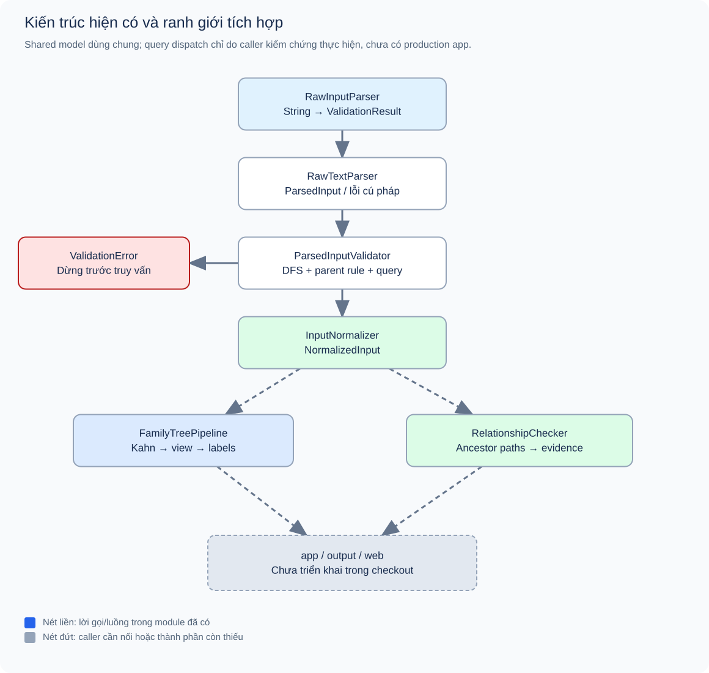
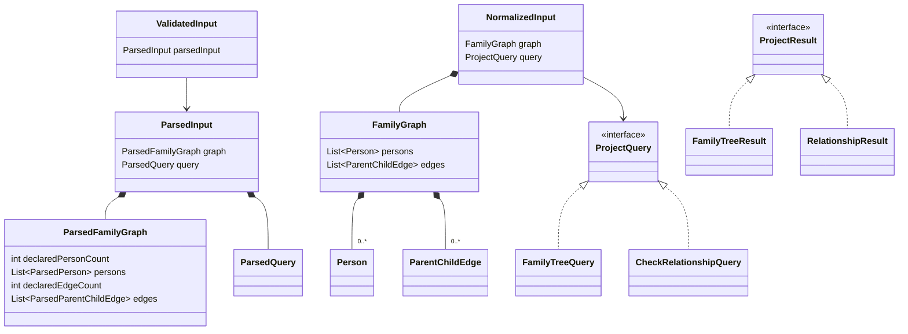
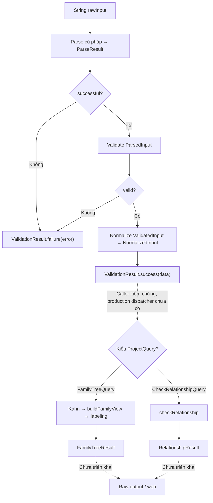
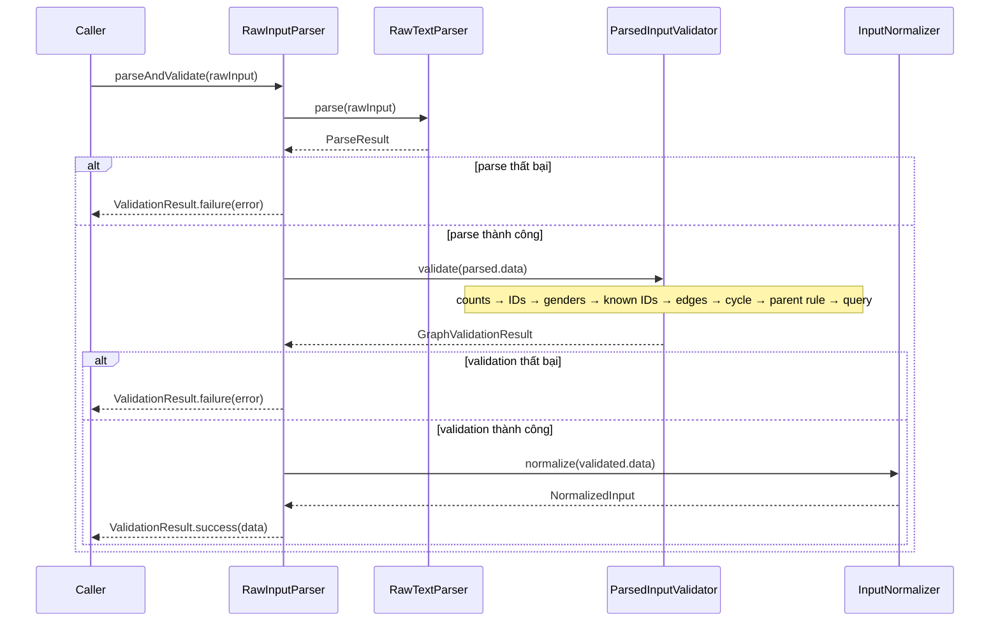
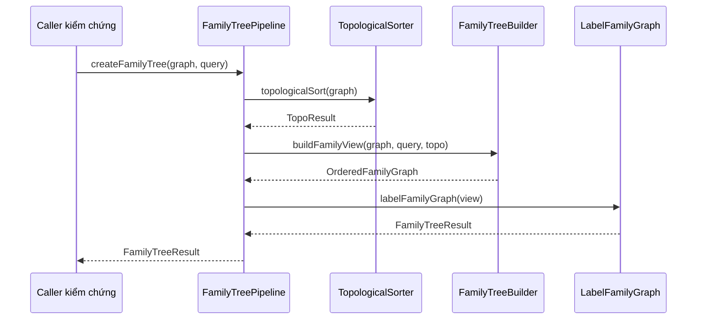
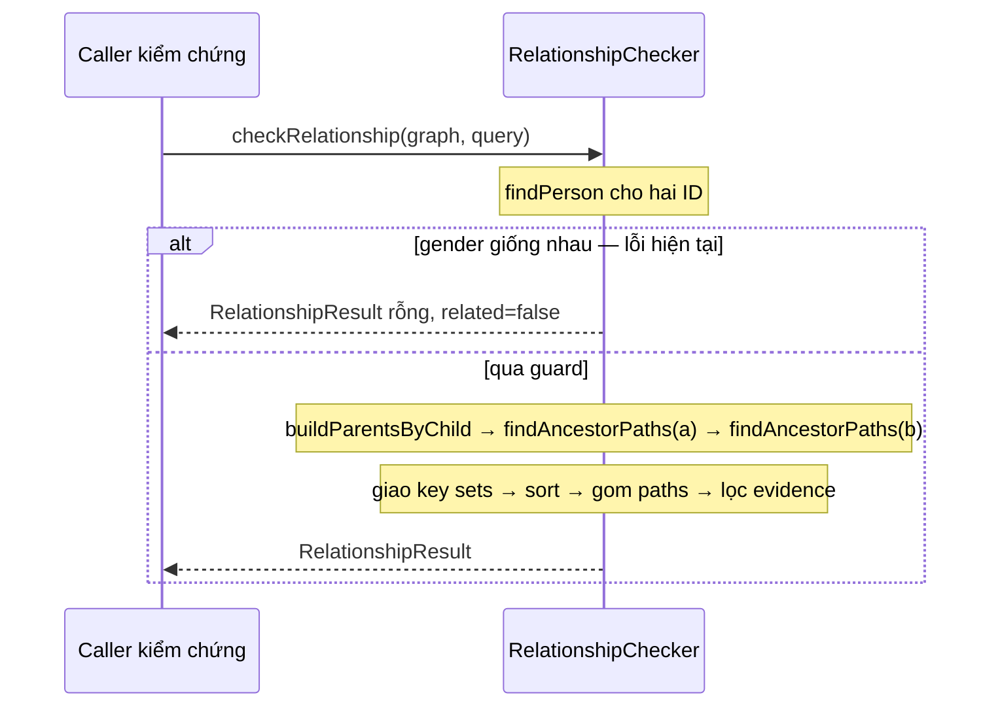

# 00 — Tổng thể hệ thống đồ thị gia phả

[Chỉ mục](README.md) · [Input →](01_input_validation.md) · [Kiểm thử](04_testing_and_complexity.md)

## Mục lục

1. [Phát biểu bài toán](#1-phát-biểu-bài-toán)
2. [Mô hình đồ thị và quy ước](#2-mô-hình-đồ-thị-và-quy-ước)
3. [Kiến trúc thực tế](#3-kiến-trúc-thực-tế)
4. [Object và hợp đồng truyền dữ liệu](#4-object-và-hợp-đồng-truyền-dữ-liệu)
5. [Luồng dữ liệu và điều phối query](#5-luồng-dữ-liệu-và-điều-phối-query)
6. [Sequence các lời gọi](#6-sequence-các-lời-gọi)
7. [Hai chức năng người dùng](#7-hai-chức-năng-người-dùng)
8. [Đánh giá phạm vi hoàn thành](#8-đánh-giá-phạm-vi-hoàn-thành)

## 1. Phát biểu bài toán

Cho danh sách người và quan hệ cha/mẹ với con, hệ thống cần trả lời hai câu hỏi: gia phả của một người trong số đời và hướng cho trước gồm những ai; hai người có tổ tiên chung trong phạm vi ba đời được ghi nhận hay không. Khi tìm thấy quan hệ, cần đưa ra đường liên hệ để người đọc kiểm tra kết luận, không chỉ trả boolean.

Đầu vào có thể thiếu tên, giới tính xác định hoặc một nhánh cha/mẹ. Hệ thống không được bịa thông tin để hoàn thiện cây. Ngược lại, các lỗi cấu trúc như ID trùng, cạnh đến người chưa khai báo hoặc chu trình phải được từ chối trước khi gọi truy vấn. Nguồn đặc tả: [kế hoạch nhóm, phần bài toán/Input/Output](../../Ke_hoach_chinh_sua_nhom.md) và [model contract](../contracts/model-contract.md).

Mô hình chỉ gồm cạnh huyết thống cha/mẹ–con được khai báo. Không mô hình hóa hôn nhân, quan hệ pháp lý, tuổi tác, độ tin cậy dữ liệu hay phần trăm di truyền. “Ba đời” là cửa sổ thuật toán của project; báo cáo không chuyển kết quả thành kết luận pháp lý.

## 2. Mô hình đồ thị và quy ước

Đặt G=(V,E). Mỗi v∈V là một `Person(id, gender, name)`; mỗi cạnh (p,c)∈E là `ParentChildEdge(parentId, childId)` và có chiều p→c. Hướng cạnh diễn đạt sự đi xuống từ thế hệ trước sang hậu duệ. Muốn tìm tổ tiên phải dùng chỉ mục ngược c→parents; không đổi chiều dữ liệu gốc.

### 2.1. Vì sao là DAG nhưng không nhất thiết là cây

Cycle A→B→…→A khiến A là tổ tiên của chính mình nên không hợp lệ. Bỏ cycle thu được directed acyclic graph, cho phép sắp topo. Nhưng một người có thể có nhiều phụ huynh, một ancestor có thể xuất hiện qua nhiều nhánh, và dữ liệu có thể chứa nhiều gia đình không liên thông. Vì vậy không tồn tại quy tắc “mỗi node chỉ có một parent” như cây có gốc.

Ví dụ [diamond](examples/family_tree_diamond.txt) có A→B, A→C, B→T, C→T. A đi đến T qua hai đường; bỏ hướng sẽ thấy một vòng, nhưng không có đường có hướng quay lại A. Validator phải kiểm tra cycle **có hướng**. Một người cũng có thể đến target bằng đường dài khác nhau, như [P10 có mức 1 và 3](examples/family_tree_multiple_levels.txt).

### 2.2. Quy ước thế hệ

| Truy vấn | Cửa sổ |
|---|---|
| Family Tree k, ANCESTORS | Target và tổ tiên cách tối đa k−1 cạnh |
| Family Tree k, DESCENDANTS | Target và hậu duệ cách tối đa k−1 cạnh |
| Family Tree k, BOTH | Hợp hai cửa sổ trên, không đổi hướng ở giữa đường |
| Check Relationship | Với mỗi source: source, parents, grandparents; tối đa 2 cạnh ngược |

Theo Family Tree, dấu mức là dương cho tổ tiên, âm cho hậu duệ và 0 cho target. K không phải tổng số node hoặc số hàng mà đồ thị phải có. Nhiều offset trên cùng người làm cho bố cục thế hệ cần quy tắc trình bày riêng; `topoOrder` không thay thế quy tắc đó.

## 3. Kiến trúc thực tế

**Hình 00.1.** Các module có code và vùng tích hợp còn thiếu. Nét đứt đánh dấu lời nối do caller thực hiện hoặc thành phần chưa triển khai; không phải bằng chứng có application hoàn chỉnh. [Source hình](figures/source/system_architecture.dot).

| Vùng | Trách nhiệm | Điểm vào thực tế | Trạng thái |
|---|---|---|---|
| Input | Parse cú pháp, validate nghiệp vụ, normalize | [`RawInputParser.parseAndValidate`](../../src/main/java/com/familygraph/input/RawInputParser.java), dòng 25–36 | Đã có, được test và chạy ví dụ |
| Family Tree | Kahn → graph con + mọi mức → nhãn | [`FamilyTreePipeline.createFamilyTree`](../../src/main/java/com/familygraph/familytree/FamilyTreePipeline.java), dòng 29–32 | Đã có pipeline trong bộ nhớ |
| Relationship | Tìm ancestor, mọi path, evidence | [`RelationshipChecker.checkRelationship`](../../src/main/java/com/familygraph/relationship/RelationshipChecker.java), dòng 30–90 | Đã có; còn gender guard sai |
| Shared model | Graph, query, validation và result records | [`model`](../../src/main/java/com/familygraph/model) | Có, collection snapshot |
| Application/output/web | Nhận input, chọn query, serialize và vẽ | `app/`, `output/`, `web/` | Chỉ placeholder trong checkout |

Các module không gọi lẫn nhau ngoài pipeline Family Tree. Input không tự chạy query. Relationship không chạy topo hoặc labeler. Caller phải đọc `ValidationResult.valid()` trước khi chuyển graph/query đến thuật toán. `ProjectQuery`/`ProjectResult` là interface đánh dấu, không phải application service.

## 4. Object và hợp đồng truyền dữ liệu

**Hình 00.2.** Quan hệ chứa/tham chiếu và implements giữa các object chủ chốt; multiplicity của list là khả năng biểu diễn của DTO, không thay yêu cầu n≥1 của validator. Sơ đồ không mô tả kế thừa giữa ParsedInput và NormalizedInput: chúng là các kiểu khác nhau, được chuyển đổi có chủ đích.

| Ranh giới | Object | Thông tin giữ lại / bảo đảm |
|---|---|---|
| Raw → parse | `ParsedInput`, `ParsedFamilyGraph`, `ParsedQuery` | Token, count khai báo và thứ tự; chưa bảo đảm enum hay graph hợp lệ |
| Parse → validate | `GraphValidationResult`, `ValidatedInput` | Qua mọi quy tắc khi được tạo bởi validator; marker có constructor public nên dựa vào quy ước sử dụng |
| Validate → domain | `NormalizedInput` | `FamilyGraph`, đúng loại query và enum; tên thiếu đã là `""` từ parser |
| Kahn → builder | `TopoResult` | Toàn bộ ID, parent trước child nếu graph hợp lệ |
| Builder → labeler | `OrderedFamilyGraph`, `FamilyNode` | Topo đã lọc, người, cạnh và mọi `relationLevels` |
| Family Tree → caller | `FamilyTreeResult`, `LabeledPerson`, `RelationLabel` | Mỗi người một record, nhiều nhãn; code và offset đọc bằng method |
| Relationship → caller | `RelationshipResult`, `RelationshipPath` | Common IDs, từng path nguồn→ancestor, người/cạnh evidence |

`List.copyOf` ngăn sửa list của module trước. Constructor record nhìn chung không kiểm tra lại nghiệp vụ: tự tạo query k=0 hoặc path rỗng vẫn có thể thực hiện ngoài pipeline. Ba result validation bảo vệ cặp trạng thái data/error loại trừ nhau. Bảng chi tiết từng class và các trạng thái không hợp lệ vẫn biểu diễn được có trong [audit, mục 3](../audits/week7-phase1-audit.md#3-thống-kê-toàn-bộ-class-và-object).

## 5. Luồng dữ liệu và điều phối query

**Hình 00.3.** Raw Input đến result object. Hai nhánh validation thất bại kết thúc trước query. Lựa chọn query là trách nhiệm còn thiếu của tầng application, được script bằng chứng thực hiện để chạy các ví dụ.

Một caller đúng phải giữ nguyên graph/query từ input đã xác nhận, không parse lại và không bổ sung dữ liệu. Query Family Tree chuyển graph + query sang pipeline; query Relationship chuyển sang static checker. Sau đó tầng output cần chuyển result thành format của kế hoạch; việc JSON hóa record trong script bằng chứng chỉ phục vụ quan sát, không được gọi là implementation serializer sản phẩm.

## 6. Sequence các lời gọi

**Hình 00.4.** Sequence đã triển khai của facade. DFS và parent gender chỉ chạy khi các bước ưu tiên trước đó chưa có lỗi; normalizer không chạy ở nhánh thất bại.

**Hình 00.5.** Sequence Family Tree đúng với `FamilyTreePipeline`, dòng 29–32. Caller phải có dữ liệu hợp lệ; pipeline không gọi lại raw validator.

**Hình 00.6.** Sequence Relationship phản ánh cả nhánh sai hiện còn trong source. Chi tiết vòng lặp path và proof có tại báo cáo 03.

## 7. Hai chức năng người dùng

### 7.1. Hiển thị gia phả

Người dùng chọn target, k, direction. Input module bảo đảm cú pháp, ID và graph hợp lệ. Kahn cung cấp thứ tự toàn graph; builder giữ phần được hỏi cùng mọi mức; labeler chuyển mức và giới tính thành nhãn. Ví dụ P03 k=2 BOTH trả cha P01, mẹ P02, SELF P03, con gái P04. [Raw Input](examples/family_tree_example.txt) và [Actual API](evidence/actual/family_tree_example.json) đã chạy; hình kết quả ở báo cáo 02.

Result chứa dữ liệu cần cho output và hình nhưng không có HTML/CSS/tọa độ. Nếu thiếu ông bà, chỉ trả phần có thật. Với một người nhiều nhãn, không được loại bớt để ép graph thành cây.

### 7.2. Kiểm tra tổ tiên chung

Người dùng chọn hai ID khác nhau. Sau input gate, checker duyệt ngược từ mỗi người, lấy giao ID trong 0–2 cạnh rồi đưa ra mọi path chứng minh. Ví dụ P05/P06 có common P01/P02, bốn path hai cạnh: [Raw Input](examples/relationship_example.txt), [Actual API](evidence/actual/relationship_example.json).

Vì gender guard, chức năng hiện chỉ tính nhánh BFS khi hai giá trị Gender khác nhau; đó là **hạn chế sai cần sửa**, không phải điều kiện hợp lệ mới được bổ sung cho người dùng. False không khẳng định tuyệt đối không có quan hệ ngoài dữ liệu/cửa sổ tìm kiếm.

## 8. Đánh giá phạm vi hoàn thành

| Nội dung | Đã có | Bằng chứng và giới hạn |
|---|---|---|
| Object contract và ba module | Có | 41 main Java, 14 test file, 67 invocation JUnit pass |
| Ví dụ raw Input → object result | Có qua caller riêng | 21 fixture chạy lại public API, lưu từng snapshot JSON; hai phản ví dụ gender sai expected |
| Production raw Input → raw Output | Chưa có | Không có entry point/dispatcher/serializer trong checkout |
| Web và layout đa mức | Chưa có | SVG trong báo cáo là hình giải thích sinh từ dữ liệu, không phải ảnh sản phẩm |
| Chứng minh mọi input hợp lệ đều đúng | Chưa đủ | Gender bug; coverage labeler và input sâu còn khoảng trống |

Bộ báo cáo hoàn thiện phần giải thích và truy nguyên bằng chứng. Nó không biến phần dự kiến thành phần đã triển khai, và không thay thế các công việc sửa lỗi/tích hợp trước demo. Bảng test, độ phức tạp và các việc còn lại được tập trung tại [04](04_testing_and_complexity.md).
