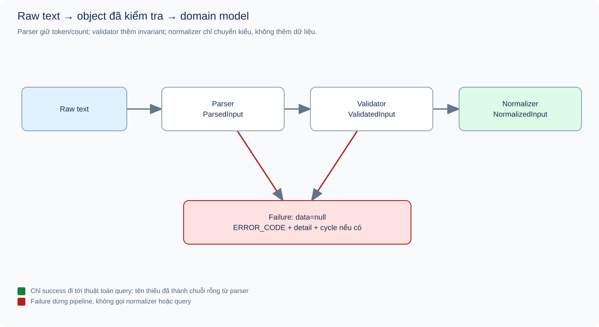
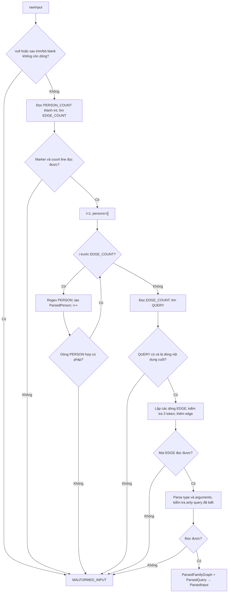
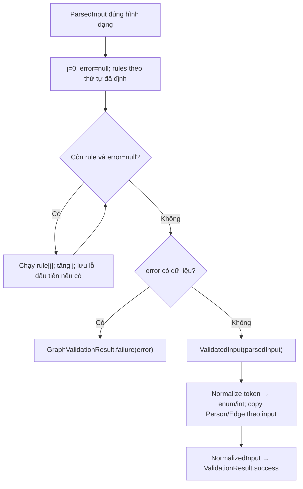
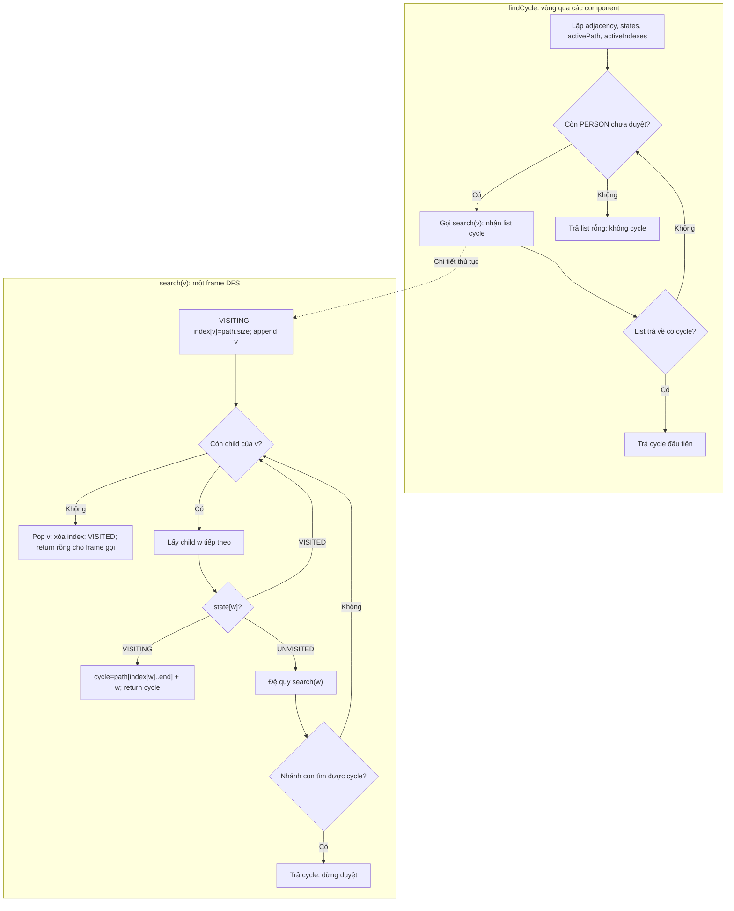
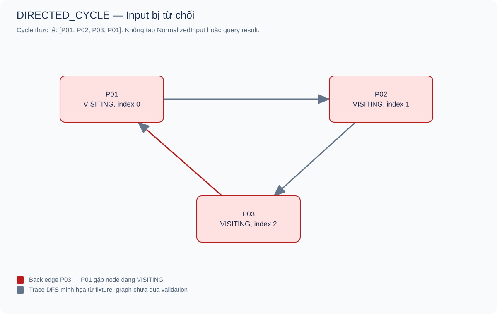
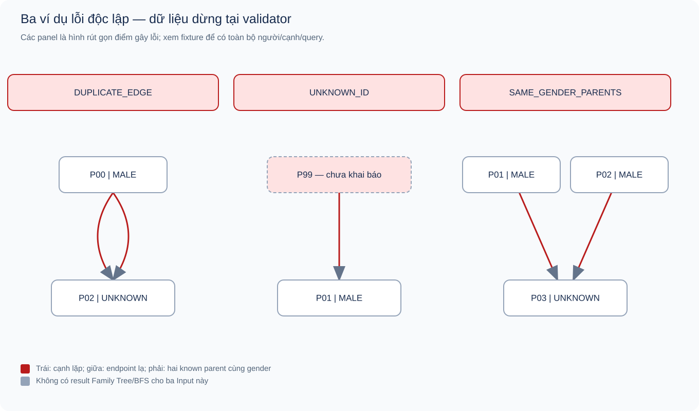

# 01 — Parse, Validate và Normalize dữ liệu đầu vào

[Chỉ mục](README.md) · [← Tổng thể](00_system_overview.md) · [Family Tree →](02_family_tree_topo_labeling.md)

**Snapshot:** commit `ba9b9c2920fc8621d1ab74e1681d7fa64540bdae`; bằng chứng chạy ngày 17/10/2026. Báo cáo mô tả code chưa sửa sau audit.

## Mục lục

1. [Bài toán con, Input và Output](#1-bài-toán-con-input-và-output)
2. [Grammar và ba tầng dữ liệu](#2-grammar-và-ba-tầng-dữ-liệu)
3. [Luồng parse và validation](#3-luồng-parse-và-validation)
4. [Thuật toán kiểm tra graph](#4-thuật-toán-kiểm-tra-graph)
5. [Liên hệ source và điều kiện đúng](#5-liên-hệ-source-và-điều-kiện-đúng)
6. [Ví dụ, Actual Output và trace](#6-ví-dụ-actual-output-và-trace)
7. [Độ phức tạp](#7-độ-phức-tạp)
8. [Edge cases và giới hạn](#8-edge-cases-và-giới-hạn)
9. [Tham khảo](#9-tham-khảo)

## 1. Bài toán con, Input và Output

Thuật toán đồ thị cần danh sách đỉnh/cạnh và query nhất quán. Raw text chưa có bảo đảm đó: hai dòng có thể trùng ID, edge có thể trỏ tới người chưa khai báo, số lượng khai báo có thể khác thực tế. Nếu đưa thẳng text hoặc graph chưa kiểm tra vào BFS/Kahn, lỗi dữ liệu có thể biến thành kết quả sai hoặc exception khó giải thích.

Module input biến một document text thành `ValidationResult`: hoặc success chứa `NormalizedInput(FamilyGraph, ProjectQuery)`, hoặc failure chứa đúng một `ValidationError(code, detail, cycle)`. Nó không tìm quan hệ, gán nhãn hoặc serialize raw output cuối. [RawInputParser](../../src/main/java/com/familygraph/input/RawInputParser.java), method `parseAndValidate`, dòng 25–36, là facade công khai của luồng này.

Điều kiện sau success: người có ID duy nhất; enum hợp lệ; cạnh có endpoint được khai báo, không trùng/tự nối/cycle; không xung đột known-parent gender; query hợp lệ. Không yêu cầu phải đủ hai phụ huynh, đủ k đời hay graph liên thông.

## 2. Grammar và ba tầng dữ liệu

### 2.1. Cú pháp document

```text
PERSON_COUNT <n>
PERSON <id> <gender> ["name"]
... các bản ghi PERSON ...
EDGE_COUNT <m>
EDGE <parentId> <childId>
... các bản ghi EDGE ...
QUERY FAMILY_TREE <targetId> <k> <direction>
```

Query cuối cũng có thể là `QUERY CHECK_RELATIONSHIP <firstId> <secondId>`. Chỉ có một query trên mỗi document. Keywords và enum phân biệt hoa/thường. n≥1, m≥0, k≥1 được kiểm tra ở tầng nghiệp vụ sau khi số đọc được thành int. ID là token không chứa whitespace.

Tên thiếu thành chuỗi rỗng; tên một token có thể không đặt ngoặc; tên nhiều từ phải nằm trong `"..."`. Parser không hỗ trợ escape ngoặc kép trong tên hoặc comment. Dòng trắng được bỏ, các dòng còn lại được trim; do vậy số dòng trong error detail được tính trên danh sách sau xử lý, không phải luôn là số dòng raw vật lý.

### 2.2. Vai trò từng tầng

| Tầng | Object nhận/trả | Bất biến được thêm |
|---|---|---|
| `RawTextParser.parse` | String → `ParseResult(ParsedInput/error)` | Có marker/record/query đúng hình dạng để đọc; token semantic vẫn có thể sai |
| `ParsedInputValidator.validate` | ParsedInput → `GraphValidationResult(ValidatedInput/error)` | Counts, ID, enum, graph và query hợp lệ theo nghiệp vụ |
| `InputNormalizer.normalize` | ValidatedInput → NormalizedInput | Token đã được chuyển thành enum/int và domain records |
| `RawInputParser.parseAndValidate` | String → ValidationResult | Đúng một trạng thái success có data hoặc failure có error |

Parsed graph giữ cả `declaredPersonCount/declaredEdgeCount` và list thực tế. Nếu chỉ giữ list, count mismatch sẽ mất bằng chứng. ParsedPerson giữ `genderToken` dạng String; chuyển sớm sang enum sẽ khiến lỗi semantic bị nhầm thành lỗi parse. `ValidatedInput` là marker theo quy ước, không phải một lớp tự chạy validation.



**Hình 01.1.** Các trạng thái dữ liệu và điểm dừng khi lỗi. Màu đỏ là failure; màu xanh là data có thể chuyển tiếp. [Source](figures/source/input_pipeline.dot). Đây là sơ đồ giải thích, không phải log runtime.

## 3. Luồng parse và validation

### 3.1. Parse theo marker, không dùng count để cắt cứng

[`RawTextParser.parseDocument`](../../src/main/java/com/familygraph/input/RawTextParser.java), dòng 35–78, tìm `EDGE_COUNT` rồi đọc mọi PERSON phía trước; tìm QUERY rồi đọc mọi EDGE ở giữa. Như vậy khai báo n=2 nhưng có một dòng PERSON vẫn parse được và đi tới `INVALID_COUNT`, miễn các dòng hiện có đúng grammar.



**Hình 01.2.** Flowchart parser. Các lỗi semantic như gender OTHER hoặc k=abc không bị chặn ở flowchart này. Arity của FAMILY_TREE/CHECK_RELATIONSHIP đã biết được parser kiểm tra; query type lạ chuyển tới validator để trả `INVALID_QUERY_TYPE`.

### 3.2. Thứ tự lỗi và lý do phải cố định

Một document có thể sai nhiều chỗ; trả một lỗi chính làm output ổn định và tránh các kiểm tra sau chạy trên cấu trúc chưa an toàn. Ví dụ phải kiểm tra endpoint đã biết trước khi helper cycle gọi `childrenByParent.get(parentId).add(...)`.

[`ParsedInputValidator.validate`](../../src/main/java/com/familygraph/input/ParsedInputValidator.java), dòng 34–55, chỉ tiếp tục khi `error==null`. Parser luôn đứng trước validator nên MALFORMED_INPUT thắng mọi lỗi semantic khi document không đọc được.

| Thứ tự | ERROR_CODE | Phương pháp phát hiện và source method |
|---:|---|---|
| Parse | `MALFORMED_INPUT` | Marker, pattern, arity hoặc count không đọc được; `RawTextParser.parse` bắt exception nội bộ |
| 1 | `INVALID_COUNT` | `validateCounts`: count sai miền/không khớp số record |
| 2 | `DUPLICATE_ID` | `validateDuplicateIds`: chèn ID vào HashSet, thất bại khi lặp |
| 3 | `INVALID_GENDER` | `validateGenders`: enum không nhận token |
| 4 | `UNKNOWN_ID` | `validateKnownIds`: membership endpoint theo EDGE trước, ID query sau |
| 5 | `DUPLICATE_EDGE` | `validateDuplicateEdges`: HashSet record so sánh parentId và childId |
| 6 | `SELF_PARENT` | `validateSelfParent`: parentId=childId |
| 7 | `DIRECTED_CYCLE` | `findCycle`: DFS ba trạng thái, lấy suffix activePath |
| 8 | `SAME_GENDER_PARENTS` | `validateParentGenders`: first parent theo child và known gender |
| 9 | `INVALID_QUERY_TYPE` | `validateQuery`: ngoài hai type được hỗ trợ |
| 10, Family | `INVALID_GENERATION` | `validateQuery`: int parse thất bại hoặc k<1 |
| 11, Family | `INVALID_DIRECTION` | `validateQuery`: direction ngoài enum |
| 10, Relationship | `SAME_PERSON_QUERY` | `validateQuery`: hai ID query bằng nhau |

Hai lỗi query cuối thuộc hai nhánh khác nhau. Một unknown ID trong query có thể được trả trước cycle vì `validateKnownIds` đứng sớm hơn. Count âm đọc được → INVALID_COUNT; count vượt miền int không đọc được → MALFORMED_INPUT; k vượt int → INVALID_GENERATION.



**Hình 01.3.** Flowchart nghiệp vụ dạng vòng qua danh sách rule để giải thích ưu tiên; implementation hiện dùng chuỗi `if(error==null)`, không có mảng rule hoặc biến j. `collectPersonIds` là helper chuẩn bị vẫn chạy sau ba check đầu; nó không đổi lỗi đã chọn.

## 4. Thuật toán kiểm tra graph

### 4.1. DFS ba trạng thái và lấy chu trình

DFS mở rộng sâu một nhánh trước khi trở về nhánh khác. Đối với graph có hướng, một cạnh đến đỉnh đã thấy chưa đủ chứng minh cycle; cần biết đỉnh đó còn nằm trên nhánh đang hoạt động hay đã hoàn tất. Implementation dùng `UNVISITED`, `VISITING`, `VISITED` trong [`DirectedCycleDetector`](../../src/main/java/com/familygraph/input/DirectedCycleDetector.java).

| Cấu trúc | Vai trò |
|---|---|
| `childrenByParent` | Adjacency thuận, thứ tự con theo EDGE |
| `states` | Trạng thái mỗi ID; không có entry được hiểu UNVISITED |
| `activePath` | Các ID từ đầu nhánh DFS hiện tại đến node đang xử lý |
| `activeIndexes` | Vị trí từng ID đang active để cắt đúng đoạn tạo cycle |



**Hình 01.4.** Hai thủ tục được vẽ tách: vòng ngoài xử lý mọi component; frame đệ quy giữ vị trí child đang xét và trả về đúng frame gọi. Nét đứt mở phần chi tiết của lời gọi, không phải một lượt duyệt bổ sung. Phát hiện cycle dừng ngay, không tìm tất cả cycle và không tìm cycle ngắn nhất.

**Invariant:** activePath luôn là một đường có hướng; các ID trên đó đang VISITING và index khớp vị trí. Khi gặp v→w với w đang VISITING, suffix từ w đến v cộng cạnh v→w tạo chu trình thật, khép kín. Nếu graph có cycle, lần DFS đi vào vòng không thể hoàn tất mọi đỉnh của vòng mà không gặp lại một đỉnh active. Nhờ VISITED, không cần kiểm tra lại phần graph đã xong. Đây là proof theo implementation; stack đệ quy có thể tràn trên nhánh quá sâu.

Tài liệu tham khảo chính thức [DirectedCycle của Sedgewick–Wayne](https://github.com/kevin-wayne/algs4/blob/master/src/main/java/edu/princeton/cs/algs4/DirectedCycle.java) cũng phân biệt đỉnh đã đánh dấu với đỉnh còn trên stack. Project dùng enum và activePath/index thay vì dựng cycle bằng predecessor của bản tham khảo.

### 4.2. Kiểm tra giới tính phụ huynh bằng bảng tra

[`ParentGenderValidator.validateParentGenders`](../../src/main/java/com/familygraph/input/ParentGenderValidator.java), dòng 15–40, giữ parent đầu tiên theo `(childId, gender)`. Nếu có parent khác ID cùng MALE hoặc FEMALE cho cùng child, hai record đó là bằng chứng đủ cho `SAME_GENDER_PARENTS`. UNKNOWN bỏ qua vì không đủ dữ liệu xác định giới tính xung đột.

Invariant: trước mỗi EDGE, bảng ghi parent đầu tiên của mỗi nhóm child/known-gender trong prefix đã quét. `putIfAbsent` trả parent cũ; nếu ID khác thì đã có ít nhất hai parent trong nhóm. Thuật toán tuyến tính theo bản ghi, không cần so sánh từng cặp phụ huynh O(p²).

Một child có M/F/U hoặc nhiều UNKNOWN parent vẫn hợp lệ. Quy tắc này không phải “mỗi người tối đa hai phụ huynh”, và tuyệt đối không phải lý do loại hai **query person** cùng gender.

## 5. Liên hệ source và điều kiện đúng

### 5.1. Đoạn điều phối bảo vệ ranh giới

Trích [`RawInputParser.parseAndValidate`](../../src/main/java/com/familygraph/input/RawInputParser.java), dòng 26–36:

```java
ParseResult parsed = parser.parse(rawInput);
if (!parsed.successful()) {
    return ValidationResult.failure(parsed.error());
}

GraphValidationResult validated = validator.validate(parsed.data());
if (!validated.valid()) {
    return ValidationResult.failure(validated.error());
}

return ValidationResult.success(normalizer.normalize(validated.data()));
```

Return sớm bảo đảm failure không có NormalizedInput. Facade không tham chiếu Family Tree/BFS; application hoàn chỉnh vẫn phải kiểm tra valid trước khi dispatch. Hiện chưa có production dispatcher để kiểm chứng thêm điều kiện này ở cấp sản phẩm.

### 5.2. Đoạn lấy cycle

Trích [`DirectedCycleDetector.search`](../../src/main/java/com/familygraph/input/DirectedCycleDetector.java), dòng 53–58:

```java
if (state == VisitState.VISITING) {
    List<String> cycle = new ArrayList<>(
            activePath.subList(activeIndexes.get(childId), activePath.size())
    );
    cycle.add(childId);
    return cycle;
}
```

Không lấy cả prefix trước cycle. Nếu activePath=[R,A,B,C] và gặp C→A, cycle đúng là [A,B,C,A], không phải [R,A,B,C,A]. Thứ tự PERSON và EDGE quyết định cycle đầu tiên, nên thay thứ tự input có thể thay bằng chứng nhưng không đổi việc graph có cycle.

### 5.3. Normalize không “sửa” dữ liệu

[`InputNormalizer.normalize`](../../src/main/java/com/familygraph/input/InputNormalizer.java), dòng 20–37, gọi `Gender.valueOf`, `Integer.parseInt`, `Direction.valueOf`, tạo `Person`, `ParentChildEdge` và query chính thức. Không thêm missing parent, không đổi UNKNOWN, không sửa ID. Tên thiếu được tạo `""` từ `RawTextParser.parsePersonLine`, dòng 102–105, rồi được copy.

| Bước | Điều kiện trước | Điều kiện sau |
|---|---|---|
| Parse | Có thể nhận mọi String, kể cả null | Success có object đúng hình dạng hoặc MALFORMED_INPUT |
| Validate | ParsedInput đúng hình dạng do parser tạo | Success thỏa các quy tắc nghiệp vụ hoặc một lỗi chính |
| Normalize | Marker thật sự bắt nguồn từ validation success | Domain object cùng thứ tự, token đã chuyển kiểu |

Nếu tự tạo ParsedQuery thiếu argument hoặc field null rồi gọi validator, code có thể ném exception; wrapper ValidatedInput cũng có thể tự dựng. Đây là giới hạn API trực tiếp, không được diễn đạt thành raw Input sai có thể đi qua facade thành success.

## 6. Ví dụ, Actual Output và trace

Các snapshot dưới đây được [script caller](evidence/run_examples.jsh) lưu từ public API. Script không tái cài thuật toán. Trace tay và phần giải thích được viết riêng; JSON full chứa object parser, validator và facade để đối chiếu.

### 6.1. I01 — Input hợp lệ từ raw text đến domain object

**Mục đích:** chứng minh tách tầng và giữ thứ tự. [Input đầy đủ](examples/family_tree_example.txt):

```text
PERSON_COUNT 4
PERSON P01 MALE "Nam"
PERSON P02 FEMALE "Hoa"
PERSON P03 MALE "Cường"
PERSON P04 FEMALE "An"
EDGE_COUNT 3
EDGE P01 P03
EDGE P02 P03
EDGE P03 P04
QUERY FAMILY_TREE P03 2 BOTH
```

**Expected:** valid=true; graph 4 người/3 cạnh, đúng thứ tự; FamilyTreeQuery(P03,2,BOTH). **Actual:** [snapshot I01](evidence/actual/family_tree_example.json) khớp các giá trị này. Việc gọi Family Tree sau đó được báo cáo 02 phân tích riêng.

| Tầng/bước — trace tay | Trạng thái object |
|---|---|
| Đọc marker | declaredPersonCount=4, declaredEdgeCount=3 |
| Đọc PERSON/EDGE | ParsedPerson giữ token MALE/FEMALE; ba edge đúng thứ tự |
| Đọc query | ParsedQuery type=FAMILY_TREE, arguments=[P03,"2",BOTH] |
| Validate | Count khớp; ID/gender/edge đúng; DFS không cycle; P03 có M/F parent; query đúng |
| Tạo marker | GraphValidationResult valid=true, data=ValidatedInput(parsedInput), error=null |
| Normalize | Gender/Direction enum; k là int2; tạo FamilyGraph/FamilyTreeQuery |
| Facade | ValidationResult valid=true, data=NormalizedInput, error=null |

Trường hợp tên thiếu cũng đã chạy ở [diamond](evidence/actual/family_tree_diamond.json): `Person.name` là `""`, không có null. Điều đó chứng minh mặc định tên, không chứng minh mọi grammar tên/escape đều được hỗ trợ.

### 6.2. I02 — Cycle, DFS và đường khép kín

[Input](examples/invalid_cycle_example.txt) có P01→P02→P03→P01, query Family Tree P03. **Expected:** DIRECTED_CYCLE, cycle=[P01,P02,P03,P01]. **Actual:** [snapshot I02](evidence/actual/invalid_cycle_example.json) đúng code/cycle; facade data=null và không có result query.



**Hình 01.5.** Cạnh đỏ P03→P01 quay về đỉnh đang VISITING. Graph là Input bị loại, không phải FamilyTreeResult. [DOT](figures/source/validation_cycle.dot).

| Bước — trace tay | ActivePath | Trạng thái / hành động |
|---:|---|---|
| 1 | [P01] | P01 VISITING, index0 |
| 2 | [P01,P02] | Đi cạnh P01→P02; P02 VISITING, index1 |
| 3 | [P01,P02,P03] | Đi cạnh P02→P03; P03 VISITING, index2 |
| 4 | Không đổi | Child P01 đang VISITING; suffix từ index0 + P01 |
| 5 | Dừng | Trả [P01,P02,P03,P01]; không chạy parent rule/query/normalize |

Cycle có mỗi cặp kề nhau là cạnh thật, ID đầu=cuối. Test hiện có `RawInputParserTest.returnsFirstDirectedCycleAsClosedPath` và `ParsedInputValidatorTest.directedCycleHasPriorityOverParentGenderError` cũng đã pass; ví dụ mới cho thấy cả facade không tạo domain success khi lỗi.

### 6.3. I03 — Duplicate edge thắng lỗi parent gender

[Input](examples/invalid_duplicate_edge.txt) khai báo P00/P01 đều MALE, P02 UNKNOWN; edges lần lượt P00→P02, P00→P02, P01→P02. **Expected:** DUPLICATE_EDGE với detail `P00 P02`, không phải SAME_GENDER_PARENTS. **Actual:** [snapshot I03](evidence/actual/invalid_duplicate_edge.json) khớp.

Trace tay: parser tạo đủ ba records → count/ID/gender/known ID pass → edge set ban đầu rỗng → chèn (P00,P02) thành công → chèn lại thất bại → dừng validator → facade failure, không normalize. Trường hợp chứng minh **ưu tiên lỗi**, không chứng minh cặp parent gender trong input này được chấp nhận.

### 6.4. I04 — ID không tồn tại trong EDGE thắng ID sai ở query

[Input](examples/invalid_unknown_id.txt): chỉ khai báo P01; có EDGE P99 P01 và QUERY FAMILY_TREE P88 1 BOTH. **Expected/Actual:** [UNKNOWN_ID, detail P99](evidence/actual/invalid_unknown_id.json).

Trace tay: parser vẫn tạo edge/query token → count/duplicate/gender pass → kiểm tra parentId của edge đầu thấy P99 không thuộc {P01} → trả lỗi trước khi xét query P88 hoặc graph helper. Không có người P99 được tự tạo. Hình tổng hợp điểm từ chối ở mục tiếp theo cũng minh họa lỗi này.

### 6.5. I05 — Hai parent có known gender giống nhau

[Input](examples/invalid_parent_gender.txt): P01 MALE, P02 MALE, P03 UNKNOWN; cạnh P01→P03 và P02→P03. **Expected/Actual:** [SAME_GENDER_PARENTS](evidence/actual/invalid_parent_gender.json), detail `child=P03 parents=P01,P02 gender=MALE`.

Trace tay: các check graph trước pass → bảng của P03 chưa có MALE → ghi parent đầu P01 → cạnh P02 tạo cùng child/MALE nhưng khác ID → lỗi → không chạy query semantic/normalize. Nếu P02 là UNKNOWN thì bước đó bị bỏ qua theo quy ước; test `ParsedInputValidatorTest.acceptsMaleFemaleMaleUnknownAndTwoUnknownParentCombinations` đã xác nhận một số tổ hợp hợp lệ.



**Hình 01.6.** Duplicate EDGE, unknown ID và parent gender conflict; mỗi panel có fixture riêng, không phải một input có ba lỗi cùng lúc. [Source](figures/source/validation_errors.dot).

### 6.6. I06 — Quote sai cú pháp

[Input](examples/invalid_quote.txt) có `PERSON P01 MALE "Nam` thiếu quote đóng. **Expected:** MALFORMED_INPUT. **Actual:** [snapshot I06](evidence/actual/invalid_quote.json) có detail chính xác `line 2: invalid PERSON name`.

Trace tay: parse count → regex có thể bắt token `"Nam` theo nhánh tên một từ → `unquotedName.contains("\"")` đúng → parser failure → không có `graphValidationResult` trong snapshot vì caller không gọi validator. Đây sửa cách giải thích ví dụ detail trong tài liệu cũ, không thay đổi source hoặc ERROR_CODE.

### 6.7. I07 — Count đọc được nhưng không khớp

[Input](examples/invalid_count.txt) khai báo PERSON_COUNT2 nhưng chỉ một PERSON. **Expected/Actual:** [INVALID_COUNT](evidence/actual/invalid_count.json), detail `PERSON_COUNT expected 2 but found 1`.

Trace tay: parser dùng marker để giữ list một người và count2 → ParsedInput tồn tại → `validateCounts` thấy2≠1 → GraphValidationResult failure → facade failure. Nếu token count là từ không phải số, luồng sẽ dừng sớm hơn ở parse; hai tình huống không có cùng mã lỗi.

## 7. Độ phức tạp

Đặt L là số ký tự raw Input, V số người, E số edge. Các nhận định theo V/E giả định ID có độ dài bị chặn, thao tác hash có chi phí kỳ vọng/amortized hằng; không phải kết luận worst-case mọi va chạm hash hoặc mọi độ dài String.

| Bước | Thời gian | Không gian |
|---|---|---|
| Đọc dòng, marker, tokenize, regex theo grammar hiện có | Cận dự kiến O(L), một số lượt quét tuyến tính | O(L+V+E), vì giữ list dòng và records |
| Count/ID/gender/known ID/duplicate/self/query | O(V+E), có thể dừng sớm | O(V+E) do sets |
| DFS cycle + lập adjacency | O(V+E) | O(V+E); active path/stack tối đa O(V) |
| Parent gender | O(V+E), mỗi EDGE một lần tra | O(V+E) upper bound; nhóm known gender có kích thước bị chặn cho mỗi child |
| Normalize và list snapshots | O(V+E) | O(V+E) domain objects |
| Toàn input module | O(L+V+E) theo mô hình trên | O(L+V+E) peak upper bound |

Các regex kiểm tra PERSON không phải một parser ngữ pháp tên tùy ý; báo cáo không đưa benchmark hay cam kết hard latency cho input đối kháng rất dài. “Điển hình” là document nhỏ/vừa, ít lỗi, graph không quá sâu; không có phân bố dữ liệu để gán một Big-O trung bình khác.

Worst-case graph hợp lệ khiến validator đi hết mọi check, quét mọi người/cạnh và DFS cả graph. DAG dạng chuỗi có E=V−1 làm sâu stack đến V, dù tổng thời gian vẫn tuyến tính. Cycle chỉ xuất hiện ở component cuối cũng khiến gần toàn bộ graph được thăm trước khi báo lỗi. Số bước thấp không bảo vệ khỏi stack overflow; đây là giới hạn implementation đệ quy, không phải thất bại của lý thuyết DFS.

Mỗi lần gọi facade parse/validate/normalize lại toàn document; không có cache đã kiểm chứng cho nhiều query. Chi phí copy và graph storage không được loại khỏi module chỉ vì records bất biến.

## 8. Edge cases và giới hạn

| Trường hợp | Vì sao khó | Cách xử lý | Bằng chứng | Trạng thái |
|---|---|---|---|---|
| Null/empty/blank lines | Không có document hoặc dòng vật lý thay đổi | Reject rỗng, bỏ blank | RawInputParserTest và RawTextParserTest | JUnit đã chạy |
| Count mismatch | Phải giữ count gốc | Parser giữ count và list thực tế | I07 và JUnit | Actual API đã chạy |
| Duplicate EDGE và parent conflict | Cần lỗi ổn định | Duplicate trước gender rule | I03 | Actual API đã chạy |
| Unknown ID trong edge/query | Helper graph không chịu endpoint lạ | EDGE membership trước query | I04 | Actual API đã chạy |
| Cycle có hướng | Duyệt lại đỉnh chưa chắc có cycle | Chỉ back edge tới VISITING | I02 và JUnit | Actual API đã chạy |
| Vòng vô hướng nhưng DAG | Không được loại diamond | DFS có hướng | RawInputParserTest `acceptsUndirectedCycleWhenDirectedGraphIsAcyclic` | JUnit đã chạy |
| Missing name/parent, UNKNOWN | Thiếu không đồng nghĩa sai | Giữ `""`, không bù data; UNKNOWN bỏ qua parent rule | Diamond Actual và ParsedInputValidatorTest | Đã chạy các fixture đã nêu |
| Hơn hai parent | Không được giả định nhị phân | Chỉ cấm cặp known cùng gender | JUnit M/F/U, U/U | Đã chạy ví dụ; chưa stress nhiều parent |
| Count/k overflow | Cú pháp count khác semantic k | Integer parsing ở từng tầng | Đọc source | Chưa có fixture chạy riêng |
| Cycle có prefix và component sau | Phải cắt đúng suffix/duyệt mọi component | activeIndexes + outer loop | Đọc source | Chưa có test chuyên biệt |
| DAG quá sâu | Stack hữu hạn | DFS hiện đệ quy | Đọc source | Nguy cơ chưa tái hiện; chưa xử lý giới hạn |
| Tự dựng DTO sai | Marker không thể chứng nhận nguồn tạo | Tiền điều kiện API nội bộ | Constructor source | Ngoài luồng facade; không bảo đảm an toàn |

Ưu tiên cải tiến sau này là thống nhất lineNumber/raw position, kiểm thử phần grammar còn thiếu và xác định nhu cầu hỗ trợ graph sâu trước khi đổi DFS. Chưa sửa parser/validator/normalizer hay contract trong phạm vi bộ báo cáo.

## 9. Tham khảo

- [Model contract của project](../contracts/model-contract.md), mục object trung gian, validation và ranh giới kiểm tra.
- [Luồng input hiện có](../contracts/luong-xu-ly-input.md); khi khác detail ví dụ, ưu tiên source và Actual API đã dẫn.
- [Sedgewick–Wayne, DirectedCycle](https://github.com/kevin-wayne/algs4/blob/master/src/main/java/edu/princeton/cs/algs4/DirectedCycle.java): tham khảo DFS và trạng thái trên stack; truy cập 17/10/2026. Implementation project có cơ chế trích cycle riêng như đã giải thích.
