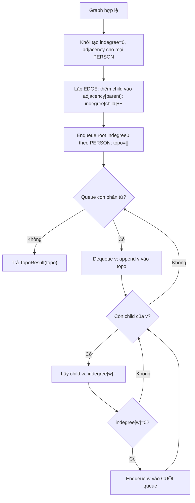
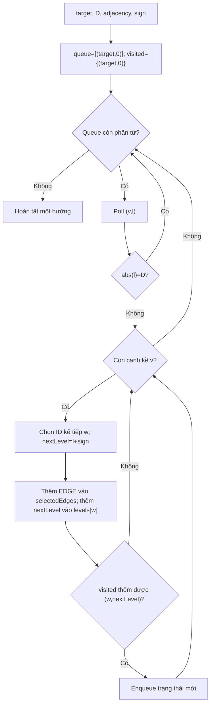
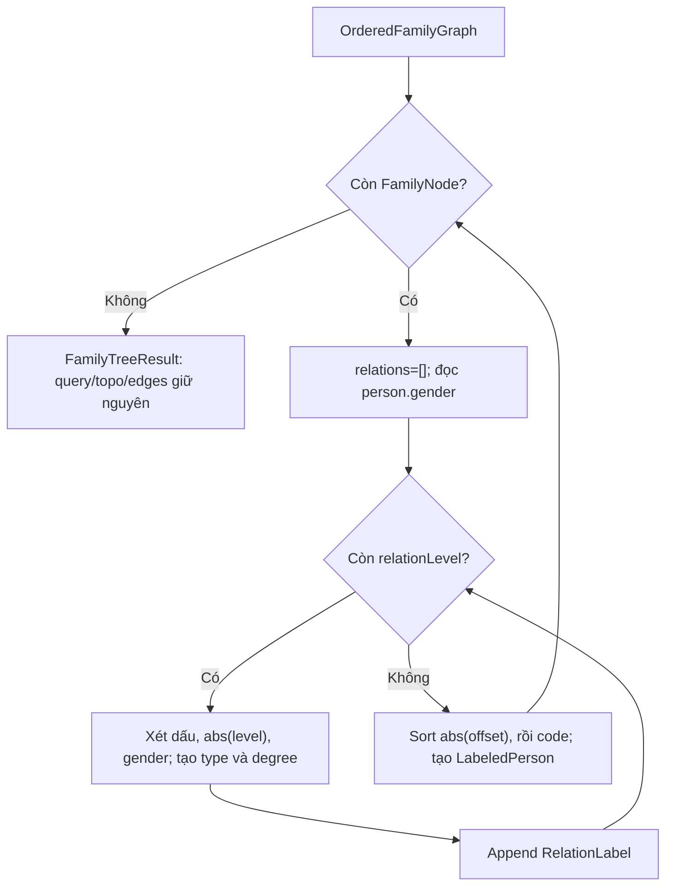
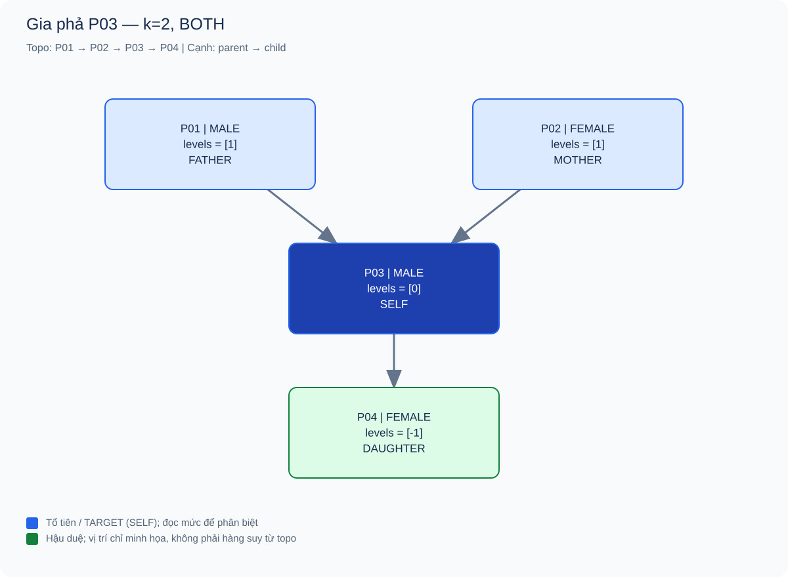
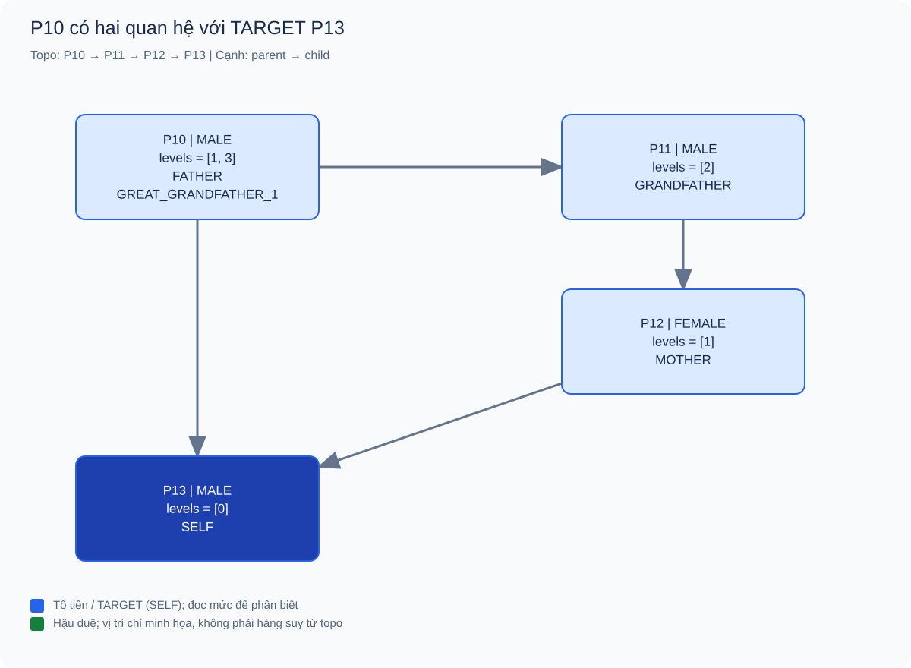
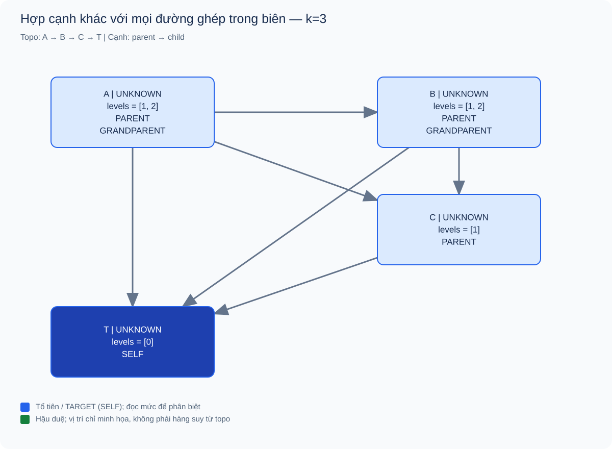

# 02 — Kahn, đồ thị con gia phả và gán nhãn quan hệ

[Chỉ mục](README.md) · [← Input](01_input_validation.md) · [Relationship BFS →](03_relationship_bfs.md)

**Snapshot:** commit `ba9b9c2920fc8621d1ab74e1681d7fa64540bdae`; Actual API ngày 17/10/2026. Không sửa thuật toán hoặc contract sau audit.

## Mục lục

1. [Bài toán con và hợp đồng](#1-bài-toán-con-và-hợp-đồng)
2. [Kahn: nguyên lý và implementation](#2-kahn-nguyên-lý-và-implementation)
3. [Duyệt mọi mức quan hệ và chọn cạnh](#3-duyệt-mọi-mức-quan-hệ-và-chọn-cạnh)
4. [Gán nhãn từ level và gender](#4-gán-nhãn-từ-level-và-gender)
5. [Ví dụ cơ bản và trace Kahn](#5-ví-dụ-cơ-bản-và-trace-kahn)
6. [Nhiều đường khác độ dài và nhãn kép](#6-nhiều-đường-khác-độ-dài-và-nhãn-kép)
7. [Các ví dụ biên và dễ nhầm](#7-các-ví-dụ-biên-và-dễ-nhầm)
8. [Độ phức tạp](#8-độ-phức-tạp)
9. [Edge cases và giới hạn](#9-edge-cases-và-giới-hạn)
10. [Tham khảo](#10-tham-khảo)

## 1. Bài toán con và hợp đồng

Từ một FamilyGraph hợp lệ, target, k đời và hướng, module cần trả những người/cạnh thuộc vùng được hỏi, thứ tự cha mẹ trước con và nhãn quan hệ của mỗi người với target. Kahn chỉ giải quyết **thứ tự phụ thuộc**; nó không tự trả cha/mẹ/ông/bà hoặc giới hạn query.

[`FamilyTreePipeline.createFamilyTree`](../../src/main/java/com/familygraph/familytree/FamilyTreePipeline.java), dòng 29–32, ghép ba bước:

```text
FamilyGraph + FamilyTreeQuery
→ TopologicalSorter.topologicalSort → TopoResult toàn graph
→ FamilyTreeBuilder.buildFamilyView → OrderedFamilyGraph
→ LabelFamilyGraph.labelFamilyGraph → FamilyTreeResult
```

| Bước | Input | Output | Điều không thuộc trách nhiệm |
|---|---|---|---|
| Kahn | Graph đã hợp lệ | Mọi ID đúng một lần, parent trước child | Không tính level hoặc lọc target |
| Builder | Graph, query, topo đúng | Nodes với mọi mức có dấu; cạnh được chọn; topo đã lọc | Không chọn tên nhãn |
| Labeler | Ordered graph do builder tạo | Một LabeledPerson mỗi node, nhiều RelationLabel | Không chạy lại traversal/topo |

Tiền điều kiện chung: graph DAG, ID/edge/query hợp lệ và k≥1. Module không parse raw text hoặc thay validator. `FamilyNode` chỉ giữ list mức; builder chịu trách nhiệm list không trùng, cùng hướng và sort theo trị tuyệt đối.

## 2. Kahn: nguyên lý và implementation

### 2.1. Kahn giải quyết vấn đề gì

Topological sorting tìm một thứ tự tuyến tính sao cho với mỗi cạnh u→v, u xuất hiện trước v. Đây là cách sắp các công việc có phụ thuộc; trong gia phả, con phụ thuộc vào việc cha/mẹ đứng trước khi trình bày. Một DAG có thể có nhiều topo hợp lệ vì người không phụ thuộc nhau không có thứ tự duy nhất.

Kahn bắt đầu từ indegree0, xuất các đỉnh đó rồi “xóa” cạnh đi ra bằng giảm indegree. Đỉnh vừa không còn phụ thuộc được đưa vào queue. [TopologicalX của Sedgewick–Wayne](https://github.com/kevin-wayne/algs4/blob/master/src/main/java/edu/princeton/cs/algs4/TopologicalX.java) là nguồn tham khảo cho phương pháp queue/indegree này; hành vi tie-break cụ thể của project phải đọc source của project.

### 2.2. Cấu trúc dữ liệu

[`TopologicalSorter.topologicalSort`](../../src/main/java/com/familygraph/familytree/TopologicalSorter.java), dòng 30–78:

| Cấu trúc | Vai trò và thứ tự |
|---|---|
| `LinkedHashMap<String,Integer> inDegree` | Khởi tạo mọi PERSON và giữ thứ tự khi lấy root |
| `Map<String,List<String>> adjacencyList` | Parent → children; list child giữ EDGE input |
| `ArrayDeque` queue | FIFO, không phải heap ưu tiên PERSON |
| `List<String> topoOrder` | Prefix output được nối thêm mỗi lần dequeue |



**Hình 02.1.** Vòng lặp Kahn của project. Không thêm bước kiểm tra `topo.size()==V` vào flowchart như thể source đã có; sorter dựa vào graph đã qua validator. Dùng độc lập trên cycle có thể trả topo thiếu.

### 2.3. Invariant và tính đúng

Sau khi đã xuất tập U, indegree[v] bằng số cạnh từ V\U vào v. Queue chỉ chứa các đỉnh chưa xuất có indegree0. Khi dequeue v, mọi parent của v đã nằm trong U, nên append không vi phạm cạnh. Giảm cạnh đi ra duy trì invariant cho phần graph còn lại.

Một DAG hữu hạn còn đỉnh thì có ít nhất một đỉnh indegree0; nếu không, lần theo parent mãi sẽ lặp và tạo cycle. Vì thế graph hợp lệ sẽ được xuất hết. Mỗi vertex vào queue một lần khi indegree chuyển về0 hoặc được khởi tạo0; mỗi edge được giảm một lần. Người cô lập và component khác vẫn được khởi tạo, không bị bỏ.

**Ổn định không có nghĩa ưu tiên PERSON toàn cục:** queue ban đầu theo PERSON; người vào queue sau phải chờ người đang xếp trước. Nếu hai child cùng về0, thứ tự duyệt EDGE quyết định enqueue. Ví dụ FIFO chạy thật ở mục7.1 phân biệt rõ hai khái niệm này.

## 3. Duyệt mọi mức quan hệ và chọn cạnh

### 3.1. Hai chỉ mục và hai hướng độc lập

[`FamilyTreeBuilder.buildFamilyView`](../../src/main/java/com/familygraph/familytree/FamilyTreeBuilder.java), dòng 35–77, lập `parentsByChild`, `childrenByParent` và bảng người theo ID. ANCESTORS dùng parent index, levelStep=+1; DESCENDANTS dùng child index, levelStep=−1. BOTH chạy hai lượt từ target rồi hợp dữ liệu.

Target được ghi mức0. Biên D=k−1: trạng thái đạt |level|=D được giữ nhưng không mở rộng. Cách làm này lấy các route thuần tổ tiên/thuần hậu duệ; không đi lên parent rồi đi xuống sibling. Thiếu adjacency làm một nhánh kết thúc tự nhiên, không thêm người/warning.

### 3.2. Vì sao visited phải gồm cả ID và level

Một ancestor A có thể có đường một cạnh và ba cạnh tới target. Nếu chỉ dùng visited[A], đường ngắn gặp trước sẽ làm mất mức3. Builder dùng [`TraversalState(personId, level)`](../../src/main/java/com/familygraph/familytree/FamilyTreeBuilder.java), dòng142–143, để coi hai độ dài đó là hai trạng thái.



**Hình 02.2.** Vòng duyệt trạng thái của `collectRelationLevels`, dòng106–130. Cạnh được thêm **trước** dedupe trạng thái; nhờ đó hai prefix khác nhau đến cùng trạng thái không làm mất một cạnh input.

Trích đoạn quan trọng, cùng method, dòng123–130:

```java
selectedEdges.add(edge);
relationLevelsById
        .computeIfAbsent(nextPersonId, ignored -> new LinkedHashSet<>())
        .add(nextLevel);

if (visitedStates.add(next)) {
    queue.offer(next);
}
```

### 3.3. Proof giữ đủ mức nhưng không liệt kê mọi route

Invariant: mỗi trạng thái đã tạo tương ứng ít nhất một route hợp lệ, đúng dấu và độ dài không vượt D. Bước nối cạnh duy trì điều đó. Với mọi route hợp lệ, từng prefix có trạng thái được tạo theo quy nạp độ dài; do đó mức cuối của route được ghi nhận.

Nếu hai prefix dẫn tới cùng `(v,l)`, phần tiếp theo chỉ phụ thuộc v, hướng và D−|l|, nên mở rộng một lần đủ thu mọi mức tiếp theo. Gộp như vậy không giữ danh tính từng đường riêng; đó là điều builder không cần trả. `relationLevels` giữ **các độ dài phân biệt**, không phải số lượng đường, không phải mọi danh sách nodeIds như RelationshipPath.

Trong DAG, một người không thể vừa ancestor vừa descendant của target: hai route đó ghép thành cycle. Vì vậy mức của người không trộn dấu trong luồng chuẩn; target chỉ có0. Điều kiện DAG cần thiết cho diễn giải quan hệ này, dù vòng duyệt có biên hữu hạn.

### 3.4. Lọc topo và cạnh

`buildFamilyView`, dòng79–94, lọc topo theo ID có trong `relationLevelsById`; tạo node theo cùng thứ tự; sort set mức theo abs rồi giá trị; lọc `graph.edges()` theo selectedEdges. Lọc một topo hợp lệ giữ nguyên tính parent trước child cho các cạnh còn lại. Set membership không làm xáo EDGE input vì output được tạo bằng duyệt lại list gốc.

Builder cần `TopoResult` đầy đủ, thuộc đúng graph. Nó không phát hiện topo bị caller tự tạo thiếu/sai. Hợp đồng này được `FamilyTreePipeline` đáp ứng bằng việc gọi sorter trước builder.

## 4. Gán nhãn từ level và gender

[`LabelFamilyGraph.labelFamilyGraph`](../../src/main/java/com/familygraph/familytree/LabelFamilyGraph.java), dòng16–38, duyệt node rồi từng level; `mapLevelToRelationLabel`, dòng41–87, thực hiện bảng:

| Level | MALE | FEMALE | UNKNOWN |
|---|---|---|---|
| 0 | SELF | SELF | SELF |
| +1 | FATHER | MOTHER | PARENT |
| +2 | GRANDFATHER | GRANDMOTHER | GRANDPARENT |
| +d, d≥3 | GREAT_GRANDFATHER_(d−2) | GREAT_GRANDMOTHER_(d−2) | GREAT_GRANDPARENT_(d−2) |
| −1 | SON | DAUGHTER | CHILD |
| −2 | GRANDSON | GRANDDAUGHTER | GRANDCHILD |
| −d, d≥3 | GREAT_GRANDSON_(d−2) | GREAT_GRANDDAUGHTER_(d−2) | GREAT_GRANDCHILD_(d−2) |

`RelationLabel` giữ enum type và greatDegree, không giữ chuỗi tùy ý. [`code()` và `generationOffset()`](../../src/main/java/com/familygraph/model/familytree/RelationLabel.java), dòng7–20, cung cấp mã output và khôi phục level có dấu. Ví dụ mức3 → GREAT_GRANDFATHER với degree1 → code GREAT_GRANDFATHER_1 và offset3.



**Hình 02.3.** Labeler không duyệt graph. Mỗi mức hợp lệ được ánh xạ đúng một nhãn; d≥3 có degree=d−2 nên phép +2 trong offset trả lại đúng d. Nhãn trung tính bảo toàn UNKNOWN. Sort bảo đảm thứ tự quan hệ theo độ dài rồi code; source hiện không dedupe lại nếu caller đưa levels trùng ngoài contract.

## 5. Ví dụ cơ bản và trace Kahn

### 5.1. F01 — Hai hướng, cha/mẹ và con

[Raw Input đầy đủ](examples/family_tree_example.txt): PERSON P01 MALE Nam, P02 FEMALE Hoa, P03 MALE Cường, P04 FEMALE An; edges P01→P03, P02→P03, P03→P04; query P03, k2, BOTH.

**Expected:** topo P01,P02,P03,P04; levels lần lượt +1,+1,0,−1; nhãn FATHER,MOTHER,SELF,DAUGHTER; đủ ba edge. **Actual API:** [snapshot F01](evidence/actual/family_tree_example.json) khớp cả topo, levels, codes và edges. `FamilyTreePipelineTest.createsLabeledFamilyTreeFromGraphAndQuery` cũng có các assertion tương ứng trong bộ JUnit đã chạy.



**Hình 02.4.** Target xanh đậm; tổ tiên xanh lam nhạt; hậu duệ xanh lục. Dãy topo được ghi riêng; vị trí node phục vụ minh họa, không suy từ chỉ số topo. Labels lấy từ Actual API. [DOT](figures/source/family_tree_example.dot).

Trace Kahn bằng tay; vector indegree theo [P01,P02,P03,P04]:

| Bước | Node xuất | Indegree sau bước | Queue sau bước | Topo prefix |
|---:|---|---|---|---|
| Khởi tạo | — | [0,0,2,1] | [P01,P02] | [] |
| 1 | P01 | [0,0,1,1] | [P02] | [P01] |
| 2 | P02 | [0,0,0,1] | [P03] | [P01,P02] |
| 3 | P03 | [0,0,0,0] | [P04] | [P01,P02,P03] |
| 4 | P04 | [0,0,0,0] | [] | [P01,P02,P03,P04] |

Trace builder: ancestor queue bắt đầu(P03,0), ghi(P01,1),(P02,1) rồi dừng các node biên1; descendant queue bắt đầu(P03,0), ghi(P04,−1) rồi dừng. Hợp có bốn node/ba edge, không có người mới. Trace labeler: P01(+1,MALE)→FATHER; P02(+1,FEMALE)→MOTHER; P03(0)→SELF; P04(−1,FEMALE)→DAUGHTER. Output đúng vì mỗi route có đúng một cạnh trong hướng tương ứng.

## 6. Nhiều đường khác độ dài và nhãn kép

### 6.1. F02 — Một người vừa là cha vừa là cụ

[Input](examples/family_tree_multiple_levels.txt):

```text
PERSON_COUNT 4
PERSON P10 MALE "Nam"
PERSON P11 MALE "Bình"
PERSON P12 FEMALE "Lan"
PERSON P13 MALE "Minh"
EDGE_COUNT 4
EDGE P10 P11
EDGE P11 P12
EDGE P12 P13
EDGE P10 P13
QUERY FAMILY_TREE P13 4 ANCESTORS
```

**Expected:** P10 có mức [1,3], không chỉ mức1; mọi edge được giữ; nhãn FATHER và GREAT_GRANDFATHER_1. **Actual API:** [snapshot F02](evidence/actual/family_tree_multiple_levels.json) xác nhận đầy đủ từ raw facade đến result. JUnit builder cũng kiểm tra `[1,3]`, nhưng assertion nhãn kép end-to-end mới ở lượt quan sát API này, chưa được thêm thành regression test.



**Hình 02.5.** Cạnh tắt P10→P13 tạo mức1; chuỗi qua P11/P12 tạo mức3. Một box P10 ghi hai nhãn, không nhân đôi người để giả thành cây. Các vị trí là bố cục minh họa, không phải một hàng duy nhất suy ra từ các offset. [DOT](figures/source/family_tree_multiple_levels.dot).

Trace Kahn: indegree[P10,P11,P12,P13]=[0,1,1,2], queue[P10]. Xuất P10 giảm P11→0 và P13→1, enqueueP11; xuấtP11 giảmP12→0; xuấtP12 giảmP13→0; xuấtP13. Topo cuối[P10,P11,P12,P13].

Trace trạng thái ancestor bằng tay, D3:

| Poll | Queue sau mở rộng | Mức được thêm |
|---|---|---|
| (P13,0) | [(P12,1),(P10,1)] | P12:+1, P10:+1 |
| (P12,1) | [(P10,1),(P11,2)] | P11:+2 |
| (P10,1) | [(P11,2)] | Không parent |
| (P11,2) | [(P10,3)] | P10:+3, vì state khác(P10,1) |
| (P10,3) | [] | Biên3, không mở rộng |

`visitedStates` cuối gồm target và bốn trạng thái thêm; P10 xuất hiện ở hai state nhưng chỉ một `FamilyNode`. Levels sau sort và nhãn thực tế:

| ID | relationLevels | Nhãn | Offset trả lại |
|---|---|---|---|
| P10 | [1,3] | FATHER, GREAT_GRANDFATHER_1 | [1,3] |
| P11 | [2] | GRANDFATHER | [2] |
| P12 | [1] | MOTHER | [1] |
| P13 | [0] | SELF | [0] |

Ví dụ cho thấy shortest distance không đủ mô tả mọi quan hệ. Nó không tạo cycle vì không có đường thuận từ P13 quay về P10.

### 6.2. F03 — Nhãn kép ở hướng hậu duệ

[Input](examples/family_tree_descendant_multiple_levels.txt) dùng cùng graph F02, đổi query thành P10, k4, DESCENDANTS. **Expected/Actual:** [snapshot F03](evidence/actual/family_tree_descendant_multiple_levels.json) có P13 levels[−1,−3], codes[SON,GREAT_GRANDSON_1]. P11 là SON, P12 là GRANDDAUGHTER; P10 SELF.

Trace tay: queue(P10,0) → (P11,−1),(P13,−1); P11 thêm(P12,−2); P13 không có child; P12 thêm(P13,−3); state biên dừng. Labeler đọc hai mức âm của P13: −1→SON; −3→GREAT_GRANDSON với degree1. Trường hợp chứng minh cơ chế đa mức không chỉ đúng với ancestor dương.

## 7. Các ví dụ biên và dễ nhầm

### 7.1. F04 — FIFO khác ưu tiên PERSON toàn cục

[Input](examples/topo_fifo.txt): PERSON A,B,C đều UNKNOWN; EDGE A→C rồi A→B; query A,k2,DESCENDANTS. **Expected theo policy FIFO đã chốt:** topo[A,C,B]. **Actual:** [snapshot F04](evidence/actual/topo_fifo.json) đúng[A,C,B], B/C cùng nhãn CHILD.

| Bước — trace tay | Indegree[A,B,C] | Queue | Topo |
|---|---|---|---|
| Init | [0,1,1] | [A] | [] |
| Poll A, duyệt A→C rồi A→B | [0,0,0] | [C,B] | [A] |
| Poll C | [0,0,0] | [B] | [A,C] |
| Poll B | [0,0,0] | [] | [A,C,B] |

Nếu dùng heap theo vị trí PERSON, kết quả sẽ khác; project không làm vậy. Test mới này là quan sát API trong báo cáo, không phải thay đổi thuật toán hoặc test suite.

### 7.2. F05 — Diamond, hai route cùng độ dài

[Input](examples/family_tree_diamond.txt): A UNKNOWN; B MALE; C FEMALE; T UNKNOWN; A→B, A→C, B→T, C→T; targetT,k3,ANCESTORS. **Expected/Actual:** [snapshot F05](evidence/actual/family_tree_diamond.json) giữ cả bốn cạnh, A chỉ mức[2]/GRANDPARENT, B FATHER, C MOTHER, T SELF.

Trace tay: T0→B1,C1; B1→A2; C1 cũng→A2. Cạnh A→C vẫn thêm trước visited; state(A,2) không enqueue lần hai. Set mức không đếm hai route thành hai nhãn trùng. UNKNOWN ở A/T được giữ trung tính. Case chứng minh dedupe state khác với bỏ cạnh hoặc chọn một route đại diện.

### 7.3. F06 — k=1, dữ liệu xung quanh vẫn bị loại

[Input](examples/family_tree_one_generation.txt) là graph cơ bản nhưng queryP03,k1,BOTH. **Expected/Actual:** [snapshot F06](evidence/actual/family_tree_one_generation.json) chỉ P03, SELF, không cạnh; topo toàn graph trước lọc vẫn có bốn ID.

Trace tay: D0, cả ancestor và descendant lượt đều poll(P03,0), gặp |0|=0 và không mở rộng. Sau lọc topo còn[P03]. Case không yêu cầu đủ k đời hoặc tạo warning; source không có field warning. Hai direction đơn lẻ với k1 suy ra từ cùng cơ chế nhưng chưa có fixture chạy riêng ở bộ báo cáo này.

### 7.4. F07 — Hợp cạnh không đồng nghĩa mọi đường ghép đều trong biên

[Input](examples/family_tree_union_edges.txt) gồm A,B,C,T UNKNOWN; edges A→B,A→C,A→T,B→C,B→T,C→T; queryT,k3,ANCESTORS. **Expected/Actual:** [snapshot F07](evidence/actual/family_tree_union_edges.json): A/B levels[1,2], C[1], T[0]; giữ cả sáu cạnh; không có level3.



**Hình 02.6.** Graph output hợp có đường A→B→C→T dài3, nhưng query chỉ cho tối đa2 cạnh. Mỗi edge được giữ vì thuộc một route khác trong biên. Nhãn lấy từ state traversal, không được suy lại bằng duyệt không giới hạn trên hình. [DOT](figures/source/family_tree_union_edges.dot).

Trace tay: T0 thêm A1,B1,C1; A1 hết parent; B1 thêm A2; C1 thêm A2,B2; các state mức2 dừng. A3 không được tạo. Dữ liệu hợp cạnh không lưu provenance của từng route; đây là giới hạn biểu diễn cần nói khi giải thích hình, không phải bằng chứng level3 bị bỏ sót.

## 8. Độ phức tạp

### 8.1. Ký hiệu và chi phí từng bước

V/E là số người/cạnh toàn graph; k số đời; h=min(k−1,V−1); S số state được enqueue; T số lượt xét cạnh từ mọi state được mở rộng; q_v số mức của người v; Q=Σq_v; V_s/E_s số node/cạnh được chọn. Giả định thao tác hash kỳ vọng/amortized O(1), ID có độ dài bị chặn.

| Thành phần | Thời gian | Không gian |
|---|---|---|
| Kahn | O(V+E) | O(V+E), kể cả adjacency mới |
| Builder, trước sort | O(V+E+S+T) | O(V+E+S+Q) |
| Sort levels | Cận trên O(Σq_v log(q_v+1)) | Các list mức tổng O(Q), cộng overhead sort |
| Labeler và sort nhãn | O(V_s+E_s+Q+Σq_v log(q_v+1)) upper bound | O(V_s+E_s+Q), tính snapshot result |

E_s ở labeler là cận bảo thủ cho snapshot list cạnh; vòng gán nhãn không xét edge. List bất biến có thể được tái sử dụng. Không khẳng định mọi sort đạt cận log khi input đã có thứ tự.

Builder luôn lập cả hai chỉ mục và lọc toàn bộ persons/topo/edges, dù query chỉ trả một người. Vì vậy không thể chỉ ghi chi phí O(R) với R đỉnh trả về và bỏ chi phí O(V+E) tiền xử lý mỗi lần.

### 8.2. Worst-case theo số trạng thái

Một ID có thể có h mức; S=O(V(h+1)), T=O(Eh), Q=O(V(h+1)). Pipeline có cận trên:

$$
O\left(V+E+V(h+1)+Eh+V(h+1)\log(h+2)\right).
$$

Không gian phụ trợ có cận O(V+E+V(h+1)); graph gốc chiếm O(V+E), result có O(V_s+E_s+Q). k quá lớn nhưng graph DAG hữu hạn không làm route vượt V−1; queue kết thúc khi hết cạnh.

DAG nhiều cạnh tắt làm cùng vertex có nhiều độ dài tới target. Nếu mọi i<j đều có edge v_i→v_j, target v_V và k đủ lớn, q_v và số state có thể cùng tăng theo V; các adjacency được xét lại ở nhiều mức làm T đạt bậc Θ(V³). Dùng UNKNOWN cho các parent bảo đảm cấu trúc này không tự vi phạm known-parent gender rule. F07 là phiên bản nhỏ đã chạy minh họa cơ chế, không phải benchmark chứng minh bậc tăng.

Trên graph có ít route-length phân biệt, mỗi node thường có một/vài state nên S/T nhỏ hơn cận trên. Đây là **trường hợp điển hình có giả định**, không phải một Big-O trung bình suy ra từ phân bố dữ liệu chưa có. Builder nén các route cùng state nên không liệt kê mọi route theo cấp số nhân như một thuật toán all-paths không nén.

### 8.3. Tiền xử lý và query lặp

Mỗi `createFamilyTree` chạy lại Kahn và builder lập lại adjacency. Không có graph index/cache dùng chung hoặc batch query service trong main source. Không trừ tiền xử lý khỏi complexity một lần gọi hiện tại bằng giả định “đã tính trước” chưa được triển khai.

## 9. Edge cases và giới hạn

| Trường hợp | Vì sao khó | Cách xử lý | Bằng chứng | Trạng thái |
|---|---|---|---|---|
| Nhiều root/component | Topo không chỉ của target component | Khởi tạo mọi PERSON | TopologicalSorterTest disconnected/root order | JUnit đã chạy |
| EDGE khác PERSON order | Stable khác ưu tiên toàn cục | FIFO enqueue theo EDGE | F04 | Actual API đã chạy |
| k1 | Biên ngay tại target | Không mở rộng state0 | F06 BOTH | Actual API; hướng đơn riêng chưa chạy |
| Missing parents/k vượt dữ liệu | Không được tạo data giả | Hết adjacency thì dừng | FamilyTreeBuilderTest missing parents | JUnit đã chạy |
| Độ dài khác nhau tới cùng ID | ID-only visited mất mức | State(ID,level) | F02/F03 | Actual API đã chạy cả hai hướng |
| Cùng độ dài qua diamond | Không trùng level, không mất cạnh | Level set, edge trước visited | F05 | Actual API đã chạy |
| UNKNOWN | Không suy đoán gender | Nhãn trung tính | F04/F05/F07 | Actual API đã chạy các nhãn nêu trên |
| Nhãn xa nam/nữ/trung tính mọi dấu | Nhiều nhánh mapping | Dấu+gender+degree | F02/F03 và model tests một số nhãn | Chưa phủ đủ toàn ma trận |
| Union route dài hơn biên | Hình dễ dẫn tới suy luận nhãn sai | Dùng levels đã tính | F07 | Actual API đã chạy |
| Sibling/co-parent có cạnh gần vùng chọn | BOTH có thể bị hiểu như undirected BFS | Hai lượt đơn hướng riêng | Đọc source, fixture chuyên biệt chưa có | Chưa có assertion đầy đủ |
| Đỉnh nhiều offset cần một tọa độ | Không có hàng duy nhất theo định nghĩa | Hình báo cáo ghi nhiều mức trên một node | Source result; chưa có web | Bố cục sản phẩm chưa triển khai |
| Caller truyền topo/graph không hợp lệ | DTO không chứng nhận invariant | Giả định input chuẩn | Pipeline source | Không cam kết dùng độc lập an toàn |

Cải tiến có thể nghiên cứu là tái sử dụng graph index/topo khi nhiều query, kiểm thử đủ bảng nhãn và thiết kế layout bảo toàn đa quan hệ. Các việc này chưa được triển khai trong bộ báo cáo; không cần đổi sang cây hoặc bỏ nhãn dài hơn để làm hình đơn giản.

## 10. Tham khảo

- [Source TopologicalSorter](../../src/main/java/com/familygraph/familytree/TopologicalSorter.java), [FamilyTreeBuilder](../../src/main/java/com/familygraph/familytree/FamilyTreeBuilder.java), [LabelFamilyGraph](../../src/main/java/com/familygraph/familytree/LabelFamilyGraph.java), [RelationLabel](../../src/main/java/com/familygraph/model/familytree/RelationLabel.java).
- [Model contract](../contracts/model-contract.md), phần relationLevels và FamilyTreeResult.
- [Sedgewick–Wayne, TopologicalX](https://github.com/kevin-wayne/algs4/blob/master/src/main/java/edu/princeton/cs/algs4/TopologicalX.java), tham khảo Kahn dùng queue và indegree; truy cập 17/10/2026. Phân tích đa mức và các cận theo state ở đây dựa trên source project, không lấy cận tuyến tính của Kahn áp cho cả pipeline.
