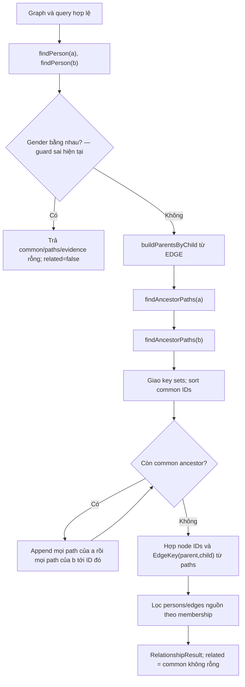
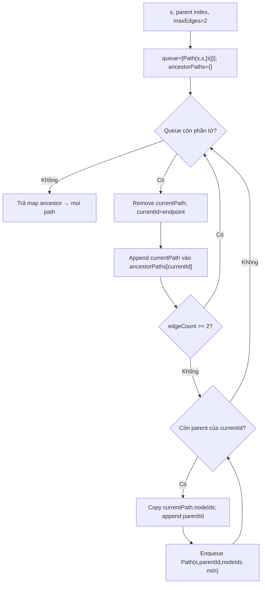
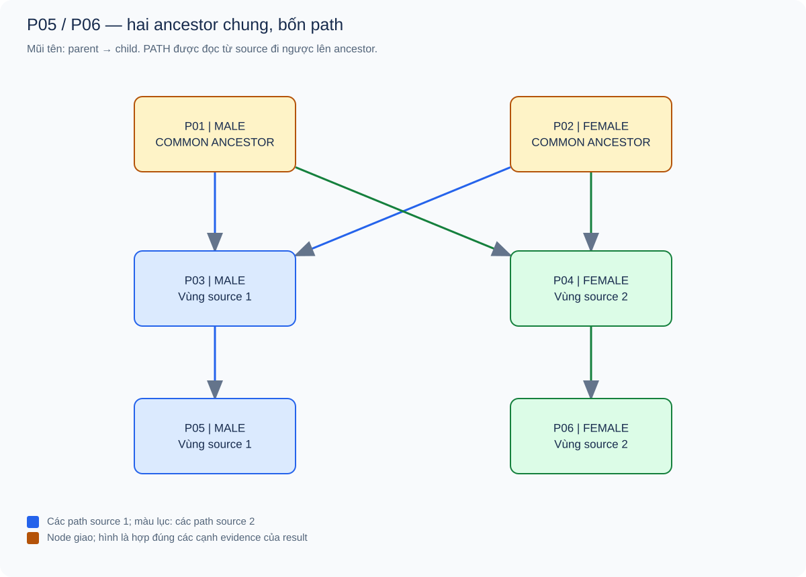
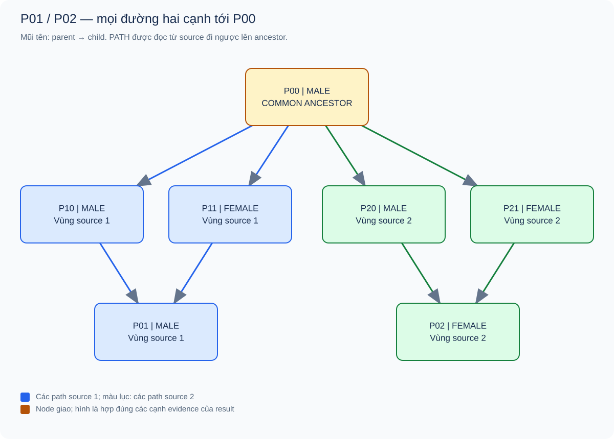
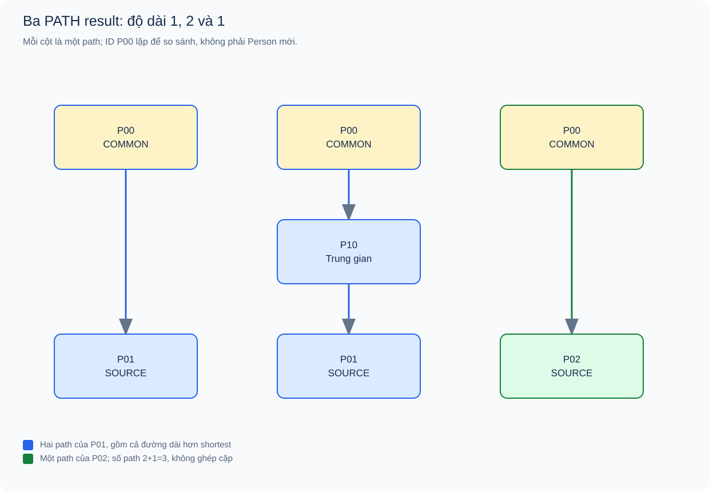
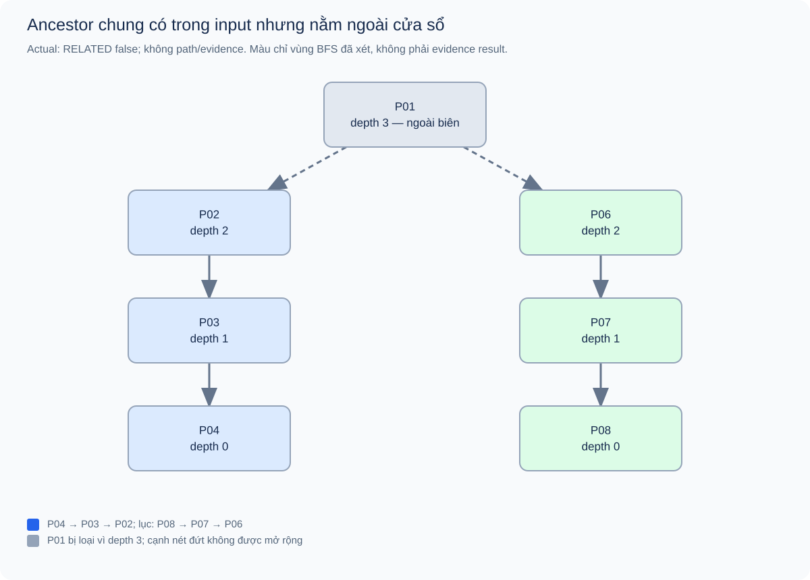
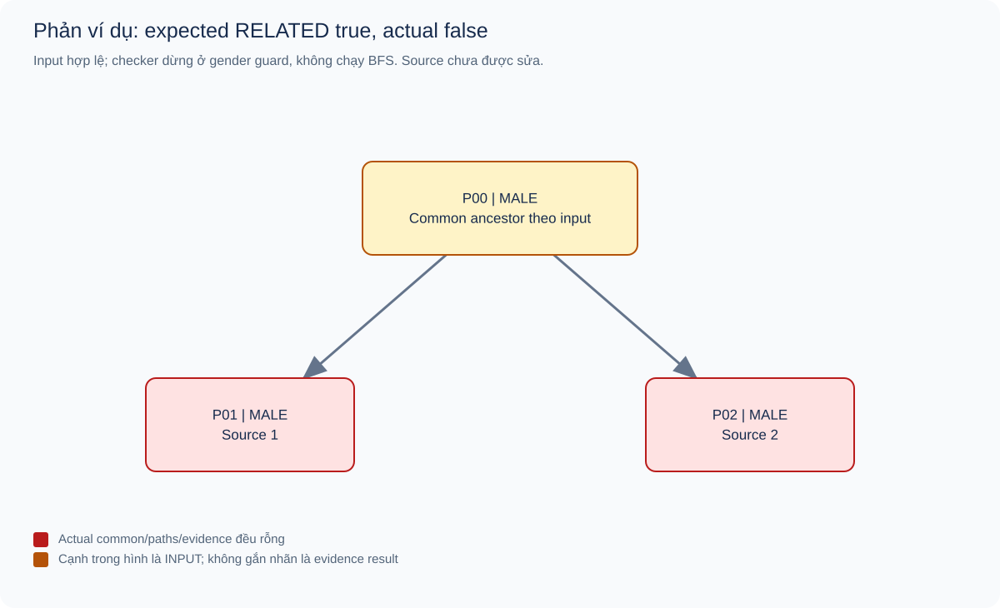

# 03 — BFS kiểm tra tổ tiên chung trong phạm vi ba đời

[Chỉ mục](README.md) · [← Family Tree](02_family_tree_topo_labeling.md) · [Kiểm thử →](04_testing_and_complexity.md)

**Snapshot:** commit `ba9b9c2920fc8621d1ab74e1681d7fa64540bdae`; Actual API ngày 17/10/2026. **Còn lỗi gender guard:** báo cáo giải thích đầy đủ nhánh BFS và phản ví dụ của toàn hàm, không coi chương trình đã đúng mọi query.

## Mục lục

1. [Bài toán và cửa sổ ba đời](#1-bài-toán-và-cửa-sổ-ba-đời)
2. [Thuật toán thực tế và cấu trúc dữ liệu](#2-thuật-toán-thực-tế-và-cấu-trúc-dữ-liệu)
3. [Flowchart và liên hệ source](#3-flowchart-và-liên-hệ-source)
4. [Invariant và lập luận tính đúng](#4-invariant-và-lập-luận-tính-đúng)
5. [Nhiều ancestor và trace BFS cơ bản](#5-nhiều-ancestor-và-trace-bfs-cơ-bản)
6. [Nhiều path và path dài hơn shortest](#6-nhiều-path-và-path-dài-hơn-shortest)
7. [Trực hệ, biên và dữ liệu thiếu](#7-trực-hệ-biên-và-dữ-liệu-thiếu)
8. [Phản ví dụ đã chạy: lỗi lọc giới tính](#8-phản-ví-dụ-đã-chạy-lỗi-lọc-giới-tính)
9. [Độ phức tạp](#9-độ-phức-tạp)
10. [Edge cases, ý nghĩa false và giới hạn](#10-edge-cases-ý-nghĩa-false-và-giới-hạn)
11. [Tham khảo](#11-tham-khảo)

## 1. Bài toán và cửa sổ ba đời

Input là `FamilyGraph` đã được kiểm tra và `CheckRelationshipQuery(firstPersonId,secondPersonId)` có hai ID tồn tại, khác nhau. Output là `RelationshipResult`: tập common ancestor, từng đường chứng minh và dữ liệu người/cạnh cần để vẽ. Module không xét quan hệ hôn nhân hoặc phần trăm huyết thống.

Với source s, định nghĩa:

$$
A_2(s)=\{v\mid\text{có đường từ s đi ngược cạnh tới v dài }0,1\text{ hoặc }2\}.
$$

“Ba đời” gồm chính s, cha/mẹ và ông/bà. Tập xét bao gồm s để phát hiện trực hệ; path[s] dài0 là hợp lệ. Theo bài toán, hai người related khi C=A₂(a)∩A₂(b) không rỗng. Mỗi ID trong C cần giữ **tất cả path hợp lệ** từ từng source, không chỉ shortest.

Điều kiện hợp lệ của query không có hạn chế gender của hai người. Nhưng [`RelationshipChecker.checkRelationship`](../../src/main/java/com/familygraph/relationship/RelationshipChecker.java), dòng37–39, đang thêm một guard sai. Các proof nhánh BFS ở mục4 áp dụng khi guard không chặn; phản ví dụ toàn hàm ở mục8.

## 2. Thuật toán thực tế và cấu trúc dữ liệu

### 2.1. Từ BFS chuẩn đến BFS trên đường đi

BFS chuẩn trên graph không trọng số thường dùng queue vertex, visited để chỉ mở rộng mỗi vertex một lần, distance lưu shortest depth và predecessor dựng một shortest path. Ví dụ tham khảo chính thức [BreadthFirstDirectedPaths](https://github.com/kevin-wayne/algs4/blob/master/src/main/java/edu/princeton/cs/algs4/BreadthFirstDirectedPaths.java) có `marked`, `distTo`, `edgeTo` cho mục tiêu shortest path.

Project cần giữ mọi đường trong cửa sổ nhỏ, nên queue phần tử là `RelationshipPath`, không phải chỉ vertex. Hai path đến cùng ancestor vẫn là hai phần tử và đều được ghi. Depth đọc từ `nodeIds.size()-1`. Vì không loại path đã gặp endpoint, nó giữ cả nhiều shortest path bằng nhau lẫn path dài hơn shortest nhưng chưa vượt2 cạnh. Đây là BFS trên **không gian path có giới hạn độ dài**.

Không thêm visited theo ID vào lời giải thích hoặc flowchart: làm vậy sẽ mô tả thuật toán khác và có thể mất bằng chứng theo contract hiện tại.

### 2.2. Bảng cấu trúc dữ liệu đúng với source

| Thành phần | Dùng như thế nào |
|---|---|
| `parentsByChild` | HashMap child→list parent; list theo thứ tự EDGE input |
| `Queue<RelationshipPath>` | ArrayDeque FIFO, giữ toàn bộ prefix của một route |
| `ancestorPaths` | LinkedHashMap ancestorId→list path tới ancestor đó, kể cả source tự nó |
| Depth | `currentPath.edgeCount()`, không có distance map |
| Visited/predecessor | **Không có**; endpoint lặp vẫn được enqueue qua route khác |
| `commonAncestorIds` | Giao key set rồi sort theo String ID tăng dần |
| `paths` | Với mỗi common ID: mọi path source1 trước, mọi path source2 sau |
| `evidencePersonIds`, `evidenceEdgeKeys` | Sets lấy hợp các phần tử xuất hiện trên path được trả |
| `evidencePersons/evidenceEdges` | Lọc list input bằng sets để giữ nguyên thứ tự nguồn |

`HashMap` không quyết định thứ tự path vì code chỉ lookup theo ID; list parent mới quyết định thứ tự sinh path. HashSet evidence chỉ dùng membership, không được iterate để xuất result. ID sort là thứ tự chuỗi, ví dụ P10 có thể đứng trước P2; project không parse phần số trong ID để sort tự nhiên.

### 2.3. Ba mức thông tin khác nhau

| Khái niệm | Số lượng / ý nghĩa | Trong implementation |
|---|---|---|
| Mọi common ancestor | Một ID mỗi phần tử giao | Có, ở nhánh BFS |
| Mọi path hợp lệ tới common ancestor | Có thể nhiều path mỗi source/ancestor | Có, giữ cả route dài hơn shortest |
| Một shortest path mỗi source/ancestor | Hai path mỗi common ancestor nếu chỉ chọn một mỗi nguồn | Không phải policy hiện tại |

Nếu a có p đường và b có q đường tới cùng ancestor, result giữ p+q `RelationshipPath`. Không tạo p×q cặp bằng chứng, cũng không tạo một nodeIds nối a→ancestor→b. Cạnh lưu thuận parent→child; PATH đọc ngược child→parent.

## 3. Flowchart và liên hệ source

### 3.1. Toàn bộ checker, gồm nhánh sai đang có



**Hình 03.1.** Flowchart phản ánh source, không hợp thức hóa guard thành yêu cầu mới. Nhánh rỗng cũng xảy ra nếu phép giao thực sự rỗng, nhưng đó là nguyên nhân khác với guard bỏ qua tìm kiếm.

### 3.2. Vòng BFS của một nguồn



**Hình 03.2.** `findAncestorPaths`, dòng114–143. Path ở biên được ghi vào map **trước** khi chặn mở rộng, nên không mất ancestor ở đúng đời3. Không có bước “đã visited thì bỏ”.

Trích method [`findAncestorPaths`](../../src/main/java/com/familygraph/relationship/RelationshipChecker.java), dòng125–139:

```java
RelationshipPath currentPath = queue.remove();
String currentId = currentPath.ancestorId();
ancestorPaths
        .computeIfAbsent(currentId, ignored -> new ArrayList<>())
        .add(currentPath);

if (currentPath.edgeCount() >= maxEdges) {
    continue;
}

for (String parentId : parentsByChild.getOrDefault(currentId, List.of())) {
    // Each route remains eligible, even if another route reached this parent.
    List<String> nodeIds = new ArrayList<>(currentPath.nodeIds());
    nodeIds.add(parentId);
    queue.add(new RelationshipPath(sourceId, parentId, nodeIds));
}
```

Copy prefix cho mỗi path bảo đảm các route không sửa chung một list. `RelationshipPath` còn snapshot list trong constructor. Không có bước truy vết từ predecessor ở cuối: toàn bộ nodeIds đã được mang theo trong quá trình duyệt.

### 3.3. Gom evidence mà không đảo sai chiều cạnh

[`checkRelationship`](../../src/main/java/com/familygraph/relationship/RelationshipChecker.java), dòng63–82, lấy từng cặp kề nhau trong path:

```java
String childId = path.nodeIds().get(i);
String parentId = path.nodeIds().get(i + 1);
evidenceEdgeKeys.add(new EdgeKey(parentId, childId));
```

Ví dụ PATH[P05,P03,P01] tạo khóa(P03,P05) và(P01,P03). Hai edge vẫn đúng chiều lưu. Lọc input sau đó chỉ giữ edge thực sự nằm trên path trả về; không gom mọi edge giữa các người evidence. Result không có field warning hay độ sâu thực tế; `related()` chỉ kiểm tra common list rỗng.

## 4. Invariant và lập luận tính đúng

Tiền điều kiện graph DAG, không duplicate edge/self edge, query tồn tại và khác ID. Để chứng minh nhánh BFS hiện có còn cần query không bị gender guard loại.

1. **Path hợp lệ:** khởi tạo[s] đúng0 cạnh; mỗi lần append parent theo index tạo đúng một cạnh ngược của graph. Source, endpoint và `edgeCount` nhất quán.
2. **Không vượt biên:** chỉ mở rộng path dài0/1; path tạo mới tối đa2. Path2 được lưu rồi dừng.
3. **Đủ path:** xét mọi path hợp lệ độ dài d≤2. Prefix độ dài d−1 được xử lý theo quy nạp; vòng parent xét đúng cạnh cuối, nên path đầy đủ được tạo. Không có visited chặn route thứ hai.
4. **Thứ tự:** FIFO sinh/poll path theo độ dài không giảm; các route cùng độ dài theo thứ tự parent của từng prefix. Khi gom result, grouping common ID và source thắng thứ tự độ dài toàn cục giữa hai người.
5. **Giao và boolean:** ID xuất hiện trong cả hai map khi và chỉ khi có ít nhất một path hợp lệ từ mỗi nguồn. Gom mọi list tại các ID giao giữ đủ bằng chứng; `related()` suy ra đúng từ giao ở nhánh này.
6. **Evidence đúng:** mỗi ID/cạnh lấy từ path thật; lọc list gốc không tạo node/edge giả. Một phần tử dùng chung nhiều path được xuất một lần vì membership set.

Graph hợp lệ có hữu hạn cạnh và giới hạn2 bảo đảm kết thúc. Không có proof rằng **toàn hàm** đúng với mọi query vì phản ví dụ gender guard phá điều5 trước khi BFS được gọi.

## 5. Nhiều ancestor và trace BFS cơ bản

### 5.1. R01 — Hai ông/bà chung

[Input đầy đủ](examples/relationship_example.txt):

```text
PERSON_COUNT 6
PERSON P01 MALE "Nam"
PERSON P02 FEMALE "Hoa"
PERSON P03 MALE "Bình"
PERSON P04 FEMALE "Lan"
PERSON P05 MALE "Minh"
PERSON P06 FEMALE "An"
EDGE_COUNT 6
EDGE P01 P03
EDGE P02 P03
EDGE P01 P04
EDGE P02 P04
EDGE P03 P05
EDGE P04 P06
QUERY CHECK_RELATIONSHIP P05 P06
```

**Mục đích:** tìm đầy đủ nhiều ancestor và evidence hai nhánh. **Expected:** common[P01,P02], related=true, bốn path2 cạnh. **Actual API:** [R01](evidence/actual/relationship_example.json) khớp; mọi sáu người/sáu cạnh đều thuộc evidence.



**Hình 03.3.** Nguồn1 và nhánh của nó màu xanh lam, nguồn2 màu xanh lục; node chung màu vàng. Mũi tên vẫn parent→child; PATH đọc lên. Cả bốn path trong result được thể hiện bằng hợp các cạnh đúng màu nhánh, không thêm đường ngoài result. [DOT](figures/source/relationship_paths.dot).

Trace tay, mỗi ô queue chứa cả path:

| Nguồn | Path poll | Depth | Queue sau bước | Key mới trong ancestorPaths |
|---|---|---:|---|---|
| P05 | [P05] | 0 | [[P05,P03]] | P05 |
| P05 | [P05,P03] | 1 | [[P05,P03,P01],[P05,P03,P02]] | P03 |
| P05 | [P05,P03,P01] | 2 | [[P05,P03,P02]] | P01; không mở rộng |
| P05 | [P05,P03,P02] | 2 | [] | P02; không mở rộng |
| P06 | [P06] | 0 | [[P06,P04]] | P06 |
| P06 | [P06,P04] | 1 | [[P06,P04,P01],[P06,P04,P02]] | P04 |
| P06 | [P06,P04,P01] | 2 | [[P06,P04,P02]] | P01; không mở rộng |
| P06 | [P06,P04,P02] | 2 | [] | P02; không mở rộng |

Không có visited/distance/predecessor để cập nhật trong bảng này. Tập key là {P05,P03,P01,P02} và {P06,P04,P01,P02}; giao sort[P01,P02]. Paths được trả theo đúng thứ tự:

```text
P05 → P03 → P01
P06 → P04 → P01
P05 → P03 → P02
P06 → P04 → P02
```

Đây là cách trình bày nodeIds đọc từ JSON; không phải raw serializer Output đã triển khai. Trace map/queue là bằng tay; Actual result được production API tạo.

## 6. Nhiều path và path dài hơn shortest

### 6.1. R02 — Mọi shortest path bằng nhau đều được giữ

[Input](examples/relationship_multiple_paths.txt) có P00→P10/P11/P20/P21; P10/P11→P01; P20/P21→P02; P01 MALE, P02 FEMALE; queryP01/P02. Parent gender của mỗi source là M/F nên input hợp lệ.

**Expected/Actual:** [R02](evidence/actual/relationship_multiple_paths.json) common[P00], related=true, bốn path:

| Source | Path thực tế |
|---|---|
| P01 | [P01,P10,P00] |
| P01 | [P01,P11,P00] |
| P02 | [P02,P20,P00] |
| P02 | [P02,P21,P00] |



**Hình 03.4.** Bốn đường trong result cùng đến một node P00; hai màu phân biệt source và bốn nhánh đều giữ. Evidence có bảy người/tám edge đúng input. [DOT](figures/source/relationship_multiple_paths.dot).

Trace tay nguồnP01: poll[P01] → queue[[P01,P10],[P01,P11]]; poll nhánhP10 append[P01,P10,P00]; pollP11 append[P01,P11,P00]; hai path tớiP00 đều ghi dù endpoint trùng. NguồnP02 tương tự quaP20/P21. EndpointP00 chỉ một ID ở giao nhưng có hai path mỗi source. JUnit `includesAllPathsFromBothPeopleToTheSameCommonAncestor` cũng xác nhận bốn path này.

### 6.2. R03 — Giữ cả đường dài hơn shortest trong biên

[Input](examples/relationship_short_and_long.txt) có P00→P10, P00→P01, P10→P01, P00→P02; P10 FEMALE, P01 MALE, P02 FEMALE. **Expected/Actual:** [R03](evidence/actual/relationship_short_and_long.json) common[P00]; path source1 có độ dài1 và2, source2 có độ dài1.



**Hình 03.5.** Ba panel tương ứng đúng ba `RelationshipPath`. NodeP00 được lặp trên panel để so sánh đường, không phải ba Person khác nhau trong result. Mũi tên thuận cạnh và nodeIds đọc ngược. [DOT](figures/source/relationship_short_and_long.dot).

| Poll nguồn P01 — trace tay | Queue sau bước | Map thêm |
|---|---|---|
| [P01] | [[P01,P00],[P01,P10]] | P01:[P01] |
| [P01,P00] | [[P01,P10]] | P00 có path1 cạnh |
| [P01,P10] | [[P01,P10,P00]] | P10 có path1 cạnh |
| [P01,P10,P00] | [] | P00 thêm path2 cạnh, dừng |

NguồnP02 có map key{P02,P00}, path tớiP00=[P02,P00]. Giao với{P01,P00,P10} làP00; result theo thứ tự [P01,P00], [P01,P10,P00], [P02,P00]. Trường hợp có p2/q1 nên số path3, khác số cặp route p×q=2; result không ghép cặp.

## 7. Trực hệ, biên và dữ liệu thiếu

### 7.1. R04 — Source tự là common ancestor

[Input](examples/relationship_direct.txt): P01 MALE→P02 FEMALE; queryP01/P02. **Expected/Actual:** [R04](evidence/actual/relationship_direct.json) related=true, common[P01], paths[P01] và[P02,P01]. Path đầu `edgeCount=0`, path sau1; evidence hai người/một cạnh.

Trace tay: source1 map{P01:[[P01]]}; source2 bắt đầuP02 rồi đi parentP01; giaoP01. Giữ source trong tập tìm kiếm là lý do không bỏ sót quan hệ cha–con. Nếu loại source, ví dụ này có thể không có giao dù quan hệ trực tiếp.

### 7.2. R05 — Ancestor thật ở ngoài hai cạnh

[Input](examples/relationship_outside_boundary.txt): P01→P02→P03→P04 và P01→P06→P07→P08; queryP04/P08 khác gender. **Expected/Actual:** [R05](evidence/actual/relationship_outside_boundary.json) related=false, common/paths/evidence rỗng.



**Hình 03.6.** P01 có trong input nhưng cách cả hai source ba cạnh, nên ngoài vùng BFS. Node màu lam/lục là các vùng thực sự được xét; root xám và nét đứt là phần graph có nhưng không đi tiếp. Không có common ancestor được ghi nhận trong cửa sổ. [DOT](figures/source/relationship_boundary.dot).

Trace tay: nguồnP04 ghi P04@0,P03@1,P02@2; dừng trướcP01. NguồnP08 ghi P08@0,P07@1,P06@2; dừng trướcP01. Giao rỗng không phủ nhận hai người có ancestor chung ngoài cửa sổ. Case đúng biên2 đã có R01; case đường dài3 tới ID đã có đường ngắn còn được JUnit `excludesLongerPathPastThreeGenerationsToAnAlreadyReachableAncestor` xác nhận.

### 7.3. R06 — Không edge, không ancestor chung được ghi nhận

[Input](examples/relationship_disconnected.txt): P01 MALE/P02 FEMALE, EDGE_COUNT0. **Expected/Actual:** [R06](evidence/actual/relationship_disconnected.json) false và mọi list bằng chứng rỗng.

Trace tay: hai queue chỉ có path source, không có parent nên kết thúc; hai key set{P01}/{P02} không giao. `getOrDefault` xử lý nhánh thiếu adjacency. Các ví dụ R01/R04 cũng chỉ có một số parent được ghi nhận; không cần đủ cả cha và mẹ để chạy.

## 8. Phản ví dụ đã chạy: lỗi lọc giới tính

### 8.1. R07 — Hai anh em trai có chung cha

[Input](examples/relationship_same_gender_bug.txt):

```text
PERSON_COUNT 3
PERSON P00 MALE
PERSON P01 MALE
PERSON P02 MALE
EDGE_COUNT 2
EDGE P00 P01
EDGE P00 P02
QUERY CHECK_RELATIONSHIP P01 P02
```

| Nội dung | Expected theo bài toán | Actual API hiện tại |
|---|---|---|
| Validation | valid=true | true |
| Common ancestor | [P00] | [] |
| RELATED | true | **false** |
| Paths | [P01,P00], [P02,P00] | [] |

Actual nằm tại [R07](evidence/actual/relationship_same_gender_bug.json). Đây là **phản ví dụ đã thực thi**, không phải suy đoán từ source. JUnit hiện có cũng kỳ vọng false cho M/M và F/F, nên bộ test xanh không phát hiện sai yêu cầu này.



**Hình 03.7.** Cạnh input chứng minh P00 là common ancestor. Banner tách expected=true với actual=false; các cạnh không được gắn nhãn “evidence result” vì result thực tế rỗng. [DOT](figures/source/relationship_same_gender_bug.dot).

Trace thực thi suy ra từ source: `findPerson(P01)`, `findPerson(P02)` → MALE==MALE → return empty. BFS không khởi tạo queue, không tạo parent index, không có phép giao. Không được vẽ một trace BFS rỗng rồi kết luận đã tìm không thấy ancestor.

### 8.2. R08 — Cả hai UNKNOWN cũng bị loại

[Input](examples/relationship_unknown_gender_bug.txt) giữ cùng edges, đổi P01/P02 thành UNKNOWN. **Expected:** commonP00, true; **Actual:** [R08](evidence/actual/relationship_unknown_gender_bug.json) false/empty vì UNKNOWN==UNKNOWN. Đây cũng đã chạy qua facade thành valid trước khi checker trả sai.

Trích đoạn lỗi tại `checkRelationship`, dòng37–39:

```java
if (firstPerson.gender() == secondPerson.gender()) {
    return new RelationshipResult(query, List.of(), List.of(), List.of(), List.of());
}
```

Quy tắc input cấm **hai parent khác ID cùng known gender của một child** không liên quan việc hai query person cùng gender. Đề xuất đã chốt về mục tiêu là không lọc huyết thống theo gender; source/test chưa được sửa trong nhiệm vụ báo cáo này. Cần thay đổi riêng và chạy regression trước khi công bố checker đúng toàn bộ đặc tả.

## 9. Độ phức tạp

### 9.1. Chi phí triển khai với maxEdges cố định bằng2

Đặt V/E là số người/cạnh, d_s=|Parents(s)|, P_s số path0–2 của source s, C số common ID, P_c số path result. Giả định hash kỳ vọng/amortized O(1) và ID có độ dài bị chặn. Không giả định mỗi người có tối đa hai parent vì UNKNOWN có thể xuất hiện nhiều lần.

Với không duplicate edge:

$$
P_s=1+d_s+\sum_{p\in Parents(s)}indegree(p).
$$

Các parent ở bước1 khác nhau. Khi mở rộng từng parent một lần tại depth1, các nhóm edge vào parent đó có child khác nhau, nên tổng không vượt E. Path chỉ có tối đa ba ID nên copy prefix là hằng theo biên hiện tại. Hai lượt tìm có P=O(1+E), dù cùng ancestor có nhiều route.

| Bước | Chi phí |
|---|---|
| Tìm hai Person bằng scan list | O(V) mỗi query, hai scan vẫn O(V) |
| Lập reverse index | O(E) thời gian/không gian |
| Hai BFS path | O(P), path length bị chặn2 cạnh |
| Giao và sort common IDs | O(|A₂(a)|+C log(C+1)) upper bound |
| Gom path/evidence và lọc input | O(P_c+V+E), vì mỗi path có ≤3 ID |
| Tổng nhánh BFS | **O(V+E+C log(C+1)) thời gian; O(V+E) không gian** |

Graph gốc lưu O(V+E); result chứa O(P_c+V_e+E_e), V_e/E_e là kích thước evidence. Sort tạo chi phí ngoài BFS tuyến tính; không được bỏ sort khi phân tích toàn checker. Nhánh guard sai có thể trả sớm sau scan người, nhưng không được quảng bá đó như tối ưu đúng nghiệp vụ.

### 9.2. Điển hình, worst-case và giới hạn tổng quát hóa

Với dữ liệu gần cây nhị phân và ít thiếu parent, vùng tổ tiên nhỏ; tuy vậy mỗi lần gọi vẫn scan người/edge để tìm và lập index trên toàn graph. Worst-case hợp lệ có nhiều UNKNOWN parent/grandparent, khiến số path và C tăng; sort common IDs có thể góp thêm log. Không có benchmark hoặc phân bố dữ liệu để nói độ trễ trung bình hay Big-O trung bình khác.

Nếu đổi depth thành d tùy ý, có thể có rất nhiều prefix khác nhau đến cùng node. Khi đó chi phí phụ thuộc **tổng độ dài path được tạo**; graph nhiều phân nhánh có thể gây tăng nhanh theo d, không còn dùng cận P=O(E) của depth2. Ngược lại, không gọi implementation hiện tại “cấp số nhân theo độ sâu không giới hạn” khi hằng MAX_GENERATIONS vẫn là3.

Không có cache parent index hoặc ancestorPaths tái sử dụng giữa query. Từng query hiện thanh toán lại scan/index; đây là khác biệt giữa khả năng tối ưu trong lý thuyết và code đã có.

## 10. Edge cases, ý nghĩa false và giới hạn

| Trường hợp | Vì sao khó | Cách xử lý | Bằng chứng | Trạng thái |
|---|---|---|---|---|
| Một/nhiều common ID | Không được dừng ở giao đầu tiên | Giao mọi key, sort | R01 và JUnit | Đã chạy |
| Nhiều route bằng nhau | ID-only visited mất route | Queue path, giữ mọi route | R02 | Actual API đã chạy |
| Route dài hơn shortest trong biên | Shortest-only không đủ contract | Giữ mọi prefix hợp lệ | R03 | Actual API đã chạy |
| Direct ancestry, path0 | Source phải tham gia tập tìm kiếm | Khởi tạo[s] | R04 | Actual API đã chạy cặp khác gender |
| Ancestor đúng2 cạnh | Lưu rồi mới dừng | Path biên vẫn trong map | R01 | Actual API đã chạy |
| Ancestor chỉ ở3 cạnh | Không mở rộng qua biên | Dừng path2 | R05 | Actual API đã chạy |
| Route3 tới ancestor đã có route1 | Không giữ route ngoài cửa sổ | Dừng theo từng path | JUnit `excludesLongerPathPastThreeGenerationsToAnAlreadyReachableAncestor` | JUnit đã chạy |
| Nhánh thiếu dữ liệu | Không có adjacency không phải lỗi | Default empty parents | R04/R06 và fixture một parent | Đã chạy |
| Same known gender có ancestor | Guard làm false negative | Trả rỗng trước BFS | R07, JUnit M/M và F/F | **Sai đặc tả, đã thực thi** |
| UNKNOWN/UNKNOWN có ancestor | UNKNOWN không chứng minh không related | Cùng guard | R08 | **Sai đặc tả, đã thực thi** |
| Một UNKNOWN, một known | Cần không suy đoán gender | Guard không loại, BFS chạy | Source | Chưa có fixture riêng |
| Hoán vị input | Common set ổn nhưng order path/evidence có thể đổi | List order được bảo toàn | Source; chưa có test hoán vị | Chưa kiểm chứng riêng |
| Graph rất nhiều parent | Không mặc định tối đa7 node | Duyệt mọi parent0–2 | Source; chưa stress | Chưa kiểm chứng tải lớn |

Theo đặc tả, **RELATED false chỉ có nghĩa không phát hiện ancestor chung trong dữ liệu hiện có và cửa sổ0–2 cạnh mỗi người**. Nó không loại trừ dữ liệu thiếu hoặc ancestor xa hơn. Với source hiện tại, false còn có thể do gender guard bỏ qua tìm kiếm; phải nêu nguyên nhân này đến khi lỗi được sửa.

Các cải tiến có thể làm sau: bỏ guard sai và đổi test expectation, thêm regression UNKNOWN/direct ancestry, tái sử dụng reverse index nếu hỗ trợ nhiều query. Nếu muốn chỉ trả một shortest path, đó là thay đổi contract/policy, không phải sửa lỗi nhỏ trong thuật toán all-paths hiện tại.

## 11. Tham khảo

- [RelationshipChecker](../../src/main/java/com/familygraph/relationship/RelationshipChecker.java), các method và dòng được chỉ rõ trong báo cáo.
- [RelationshipPath](../../src/main/java/com/familygraph/model/relationship/RelationshipPath.java), [RelationshipResult](../../src/main/java/com/familygraph/model/relationship/RelationshipResult.java), [model contract](../contracts/model-contract.md).
- [Sedgewick–Wayne, BreadthFirstDirectedPaths](https://github.com/kevin-wayne/algs4/blob/master/src/main/java/edu/princeton/cs/algs4/BreadthFirstDirectedPaths.java), tham khảo BFS shortest-path chuẩn để phân biệt với BFS trên path của project; truy cập 17/10/2026.
